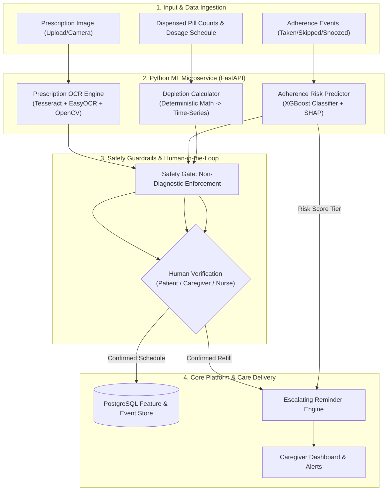
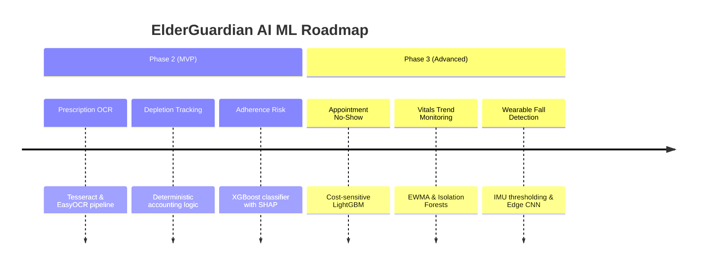
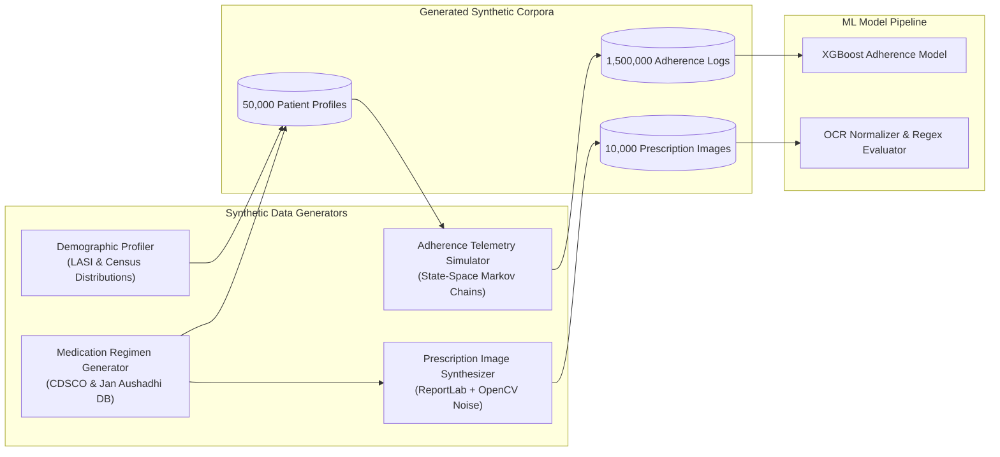
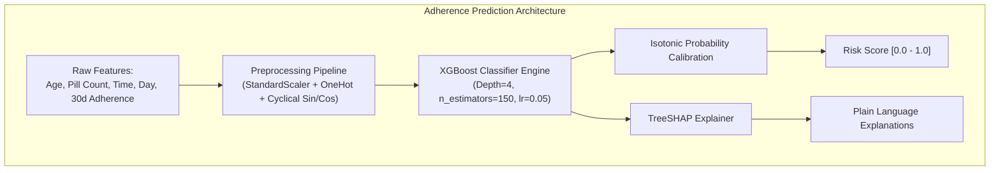
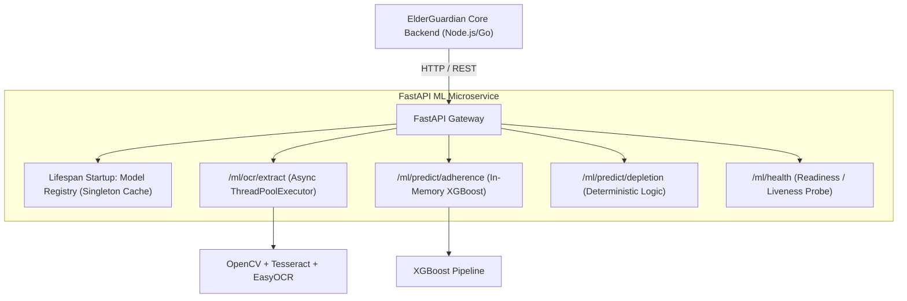
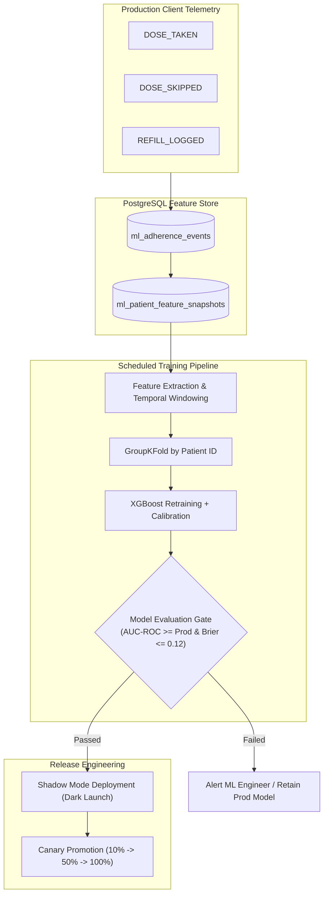
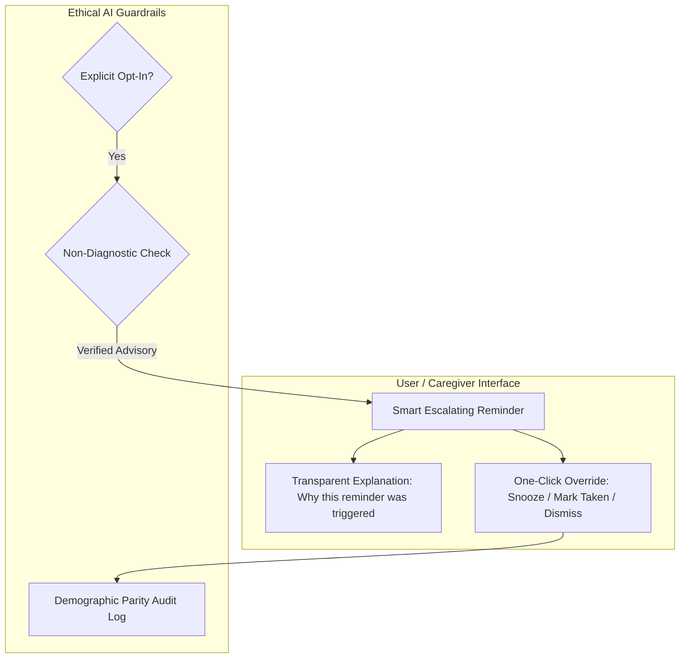

# ElderGuardian AI — Machine Learning Implementation Strategy

**Document Version:** 1.0.0  
**Status:** Architecture & Engineering Specification  
**Classification:** Internal ML Engineering Blueprint  
**Primary Tech Stack:** Python 3.11, FastAPI, scikit-learn, XGBoost, Tesseract OCR, EasyOCR, OpenCV, PostgreSQL  
**Safety Mandate:** Assistive & Advisory Only — Non-Diagnostic, Non-Prescriptive

---

> [!CAUTION]
> **CRITICAL CLINICAL SAFETY PRINCIPLE**  
> ElderGuardian AI **never** prescribes, diagnoses, recommends drug alternatives, or alters clinical dosages. All machine learning predictions, optical character recognition extractions, and risk scores are strictly **advisory and assistive**. Every algorithmic output mandates explicit **human-in-the-loop (HITL)** verification by a patient, family caregiver, or clinical care coordinator prior to taking any schedule or operational action.

---

## Executive Summary

ElderGuardian AI is an intelligent healthcare coordination platform designed to support geriatric care through automated medication tracking, schedule adherence forecasting, prescription digitalization, and proactive caregiver alerting. 

In geriatric healthcare, algorithmic failures can have acute consequences. This strategy outlines an engineering-first, pragmatically staged deployment plan where deterministic algorithms are favored over stochastic ML where applicable (e.g., initial depletion tracking), and complex models are introduced only when justifiable by metrics and safety guardrails.



---

## 1. ML Use Cases (Prioritized)

### 1.1 MVP (Phase 2: Months 3–6)

#### Use Case 1: Prescription OCR & Information Extraction
* **Objective:** Enable elders or caregivers to digitize physical paper prescriptions by snapping a photo, eliminating tedious and error-prone manual typing of complex multi-drug regimens.
* **Technology:** 
  * Image preprocessing: OpenCV (adaptive thresholding, Otsu binarization, deskewing, bilateral filtering).
  * OCR Engines: Dual-engine ensemble with **Tesseract OCR (v5)** (optimized for structured printed text) and **EasyOCR** (PyTorch-based CRAFT + ResNet-LSTM, superior on uneven lighting and low-contrast camera artifacts).
  * Information Extraction (NER / Pattern Parsing): Regular expression grammars combined with tokenized fuzzy matching (`RapidFuzz`) against a curated reference dictionary of Indian Pharmacopoeia, Jan Aushadhi, and CDSCO-approved pharmaceutical formulations.
* **Input:** Smartphone image upload (JPEG, PNG, HEIC) or camera scan.
* **Output:** Structured JSON schema containing:
  * Extracted raw text blocks with spatial bounding boxes.
  * Identified drug brand/generic candidates with string-similarity match confidence.
  * Parsed dosage strengths (e.g., `500 mg`, `5 mg`, `0.2 mg`).
  * Dosage forms (Tablet, Capsule, Syrup, Drops, Inhaler).
  * Frequencies mapped to standard Indian clinical notation (`1-0-1`, `OD`, `BD`, `TDS`, `QID`, `SOS`).
  * Temporal instructions (e.g., *Before Food / AC*, *After Food / PC*, *Bedtime / HS*).
  * Aggregate extraction confidence score (0.0 to 1.0).
* **Accuracy Targets:** 
  * Character & Word Extraction: $\ge 85\%$ on printed clinic/hospital slips.
  * Medicine & Dosage Extraction: $\ge 70\%$ precision/recall on structured printed text.
  * *Realistic constraint:* Cursive, degraded doctor handwriting is out-of-scope for automated single-pass OCR at MVP. The system detects illegible handwritten text and flags it immediately for manual entry.
* **Fallback Strategy:** A frictionless verification UI displays extracted fields as pre-populated, editable input chips tagged with color-coded confidence badges:
  * Green ($\ge 80\%$ confidence): High confidence.
  * Amber ($50\% - 79\%$): Requires attentive confirmation.
  * Red ($< 50\%$): Low confidence, field left blank with a manual input prompt.
  * An ever-present **"Switch to Manual Entry"** button is accessible at every step.
* **Training & Calibration Data:** 100% synthetic prescription documents generated programmatically (see Section 2). Real patient records are never used during initial training.

#### Use Case 2: Medicine Depletion Prediction
* **Objective:** Prevent sudden treatment interruptions (stock-outs) for critical chronic conditions (hypertension, diabetes, cardiac disorders) by forecasting exact inventory run-out dates.
* **Technology:** 
  * **MVP Implementation:** **Deterministic Event-Driven Accounting**.
    $$\text{Days Remaining} = \left\lfloor \frac{\text{Current Verified Pill Count}}{\sum (\text{Daily Scheduled Doses})} \right\rfloor$$
    $$\text{Estimated Depletion Date} = \text{Current Date} + \text{Days Remaining}$$
  * **Phase 3 Evolution:** Autoregressive time-series / Bayesian state-space filtering to dynamically adapt to PRN (as-needed) medications and fluctuating consumption patterns.
* **Engineering Justification (Why No ML at MVP?):** Deterministic mathematical computation is strictly superior to statistical machine learning for fixed-schedule oral solid medications. It offers zero inference latency, 100% interpretability, requires zero cold-start training data, cannot hallucinate, and guarantees mathematical consistency.
* **Input:** Prescription start date, total dispensed quantity, scheduled daily frequency, verified adherence log (actual taken doses vs reported skipped doses), user emergency reserve buffer (e.g., 5-day reserve threshold).
* **Output:** Estimated depletion date, days of supply remaining, refill trigger alert window (e.g., "Refill required in 4 days to accommodate pharmacy delivery lead time").
* **Accuracy Target:** $\pm 3$ days accuracy for standard fixed-dosage regimens; zero false "safe" alerts when stock is critically low ($< 5$ days).
* **Fallback Strategy:** Direct manual inventory reset in the UI ("I counted 8 pills left in the bottle") which instantly resets the deterministic baseline.

#### Use Case 3: Medication Adherence Risk Prediction
* **Objective:** Proactively identify scheduled doses with a high probability of being missed, enabling the platform to apply smart escalating reminders rather than spamming the user with uniform, fatigue-inducing alarms.
* **Technology:** Supervised Tabular Classification via **XGBoost (Extreme Gradient Boosting)**.
  * Outperforms deep learning on small-to-medium tabular datasets with heterogeneous feature types.
  * Native handling of missing values and non-linear interactions between temporal features.
  * Fast inference ($\le 15\text{ ms}$ on standard CPU).
  * Direct explainability via TreeSHAP (SHapley Additive exPlanations) for human-readable audit trails.
* **Feature Inputs:**
  * Temporal context: Time of day (morning, afternoon, evening, night), Day of week (weekday vs weekend routine disruption).
  * Patient metrics: Age band, living status (alone vs with family), digital interface response rate.
  * Regimen complexity: Total daily pill burden (number of pills per day), total distinct concurrent medications (polypharmacy index), timing flexibility window.
  * Longitudinal telemetry: Trailing 7-day adherence rate, trailing 30-day adherence rate, historical miss rate for the specific medicine, consecutive missed doses counter.
* **Output:** Calibrated Miss Probability $P(\text{Missed Dose}) \in [0.0, 1.0]$, classified into risk tiers:
  * `LOW` ($P < 0.35$): Standard silent push notification.
  * `MODERATE` ($0.35 \le P < 0.70$): High-visibility audio/vibration reminder + secondary reminder at $T+20$ minutes.
  * `HIGH` ($P \ge 0.70$): Escalating reminder with automated caregiver push/SMS notification after 30 minutes of non-response.
  * Local SHAP explanation string (e.g., *"Miss probability is elevated due to weekend evening routine disruption and high daily pill count"*).
* **Training Data:** Synthetically generated adherence event streams modeled on published geriatric compliance research (Osterberg & Blaschke, NEJM; WHO Adherence Guidelines).
* **Accuracy Target:** $\ge 75\%$ AUC-ROC on synthetic holdout validation data; Brier score $\le 0.15$ (ensuring calibrated probabilities).

---

### 1.2 Phase 3 Roadmap (Months 6–12)



#### Use Case 4: Appointment No-Show Prediction
* **Clinical Rationale:** Geriatric patients frequently miss clinical consultations due to transport limitations, memory impairment, or caregiver scheduling conflicts, disrupting chronic disease management.
* **Algorithm:** Cost-sensitive LightGBM or Logistic Regression with L1 regularization.
* **Key Features:** Appointment lead time, clinic distance, specialty (e.g., Cardiology vs Ophthalmology), historical cancellation rate, local weather forecasts, caregiver availability flag.
* **Actionable Output:** No-show risk rating generated 72 hours prior, triggering proactive transportation assistance or automated confirmation calls by care coordinators.

#### Use Case 5: Longitudinal Health Risk Monitoring (Trend Analysis, Non-Diagnostic)
* **Clinical Rationale:** Chronic geriatric decline rarely presents instantaneously; it manifests as subtle drift in longitudinal vitals (blood pressure, resting heart rate, blood glucose, weight).
* **Algorithm:** Exponentially Weighted Moving Average (EWMA), Cumulative Sum control charts (CUSUM), and Isolation Forests for multidimensional multivariate anomaly detection.
* **Critical Safety Boundary:** The system **never diagnoses conditions** (e.g., will never output *"Patient has Stage 2 Hypertension"*). Instead, it generates descriptive statistical telemetry (e.g., *"Systolic BP has deviated $+18\text{ mmHg}$ above the patient's 30-day median across 4 consecutive readings"*).
* **Actionable Output:** Weekly care summary reports dispatched exclusively to licensed care coordinators or verified physicians.

#### Use Case 6: Fall Detection & Mobility Stability Tracking
* **Clinical Rationale:** Falls are the leading cause of accidental injury in elders aged 65+. Immediate alert dispatch saves critical golden hours.
* **Algorithm:** Two-tier edge-to-cloud architecture:
  * *Tier 1 (Wearable Edge):* High-pass filtered Signal Vector Magnitude ($SVM = \sqrt{a_x^2 + a_y^2 + a_z^2}$) threshold check on tri-axial accelerometer and gyroscope data.
  * *Tier 2 (Cloud Classifier):* 1D-Convolutional Neural Network (CNN) evaluating a 5-second post-impact immobility and orientation window to filter out false alarms (e.g., dropping the device on a sofa).
* **Safety Protocol:** An un-cancellable 30-second audio chime on the elder's device; failure to cancel initiates emergency SMS and VoIP calls to family members with GPS coordinates.

---

## 2. Synthetic Data Strategy

Healthcare data is protected by strict privacy frameworks (India's Digital Personal Data Protection Act 2023, HIPAA, GDPR). Furthermore, zero production telemetry exists prior to launch. ElderGuardian AI utilizes a **100% synthetic-first data strategy** for model training and pipeline hardening.



### 2.1 Synthetic Patient Demographic Profiles
Synthetic cohorts are synthesized using `Faker` and `NumPy` parameterized on statistical distributions from the **Longitudinal Ageing Study in India (LASI, Wave-1)**:
* **Age Distribution:** Truncated normal distribution ($\mu = 69.4$, $\sigma = 6.8$, min 60, max 95).
* **Gender Ratio:** $52\%$ Female, $48\%$ Male.
* **Geographic Tiers:** Tier-1 Metro ($35\%$), Tier-2/Tier-3 City ($45\%$), Rural/Semi-urban ($20\%$).
* **Comorbidity Prevalences:**
  * Hypertension: $46.2\%$
  * Type 2 Diabetes Mellitus: $31.8\%$
  * Arthritis / Osteoporosis: $28.4\%$
  * Chronic Kidney Disease: $8.1\%$
  * Cardiovascular Disease / Post-MI: $14.5\%$
  * Polypharmacy Incidence ($\ge 4$ concurrent daily drugs): $62.3\%$
* **Caregiver Co-residence Status:** Living with adult child ($58\%$), Living with spouse only ($29\%$), Living alone ($13\%$).

### 2.2 Synthetic Medication Schedules (Indian Context)
Prescriptions are synthesized by sampling from an ontological mapping of common Indian branded generics and generic equivalents derived from the National Health Portal and Jan Aushadhi generic catalogs:

| Therapeutic Area | Common Indian Brand Names | Generic Name & Formulations | Typical Dosage & Timing Notation |
| :--- | :--- | :--- | :--- |
| **Diabetes** | Glycomet, Cetapin, Gluconorm | Metformin (500mg, 850mg, 1000mg ER) | 1-0-1 (PC - After food) |
| **Diabetes** | Amaryl, Glimy, Zoryl | Glimepiride (1mg, 2mg) | 1-0-0 (AC - Before breakfast) |
| **Hypertension** | Amlopres, Stamlo | Amlodipine (2.5mg, 5mg, 10mg) | 0-0-1 (HS - Bedtime) |
| **Hypertension** | Telma, Telmikem | Telmisartan (20mg, 40mg, 80mg) | 1-0-0 (OD - Morning) |
| **Dyslipidemia** | Atorva, Lipicure, Storvas | Atorvastatin (10mg, 20mg, 40mg) | 0-0-1 (HS - Bedtime) |
| **Cardiovascular** | Deplatt, Clopivas | Clopidogrel (75mg) + Aspirin (75mg) | 0-1-0 (PC - Afternoon) |
| **Gastric Buffer** | Pan, Pantocid | Pantoprazole (40mg) | 1-0-0 (AC - Empty stomach) |
| **Supplements** | Shelcal, Gemcal | Calcium Carbonate 500mg + Vit D3 | 0-1-0 (PC - Post lunch) |

*Schedule Generator Logic:*
```python
import numpy as np

def generate_patient_regimen(conditions: list[str]) -> list[dict]:
    regimen = []
    if "hypertension" in conditions:
        regimen.append({
            "drug_name": "Telmisartan",
            "strength": "40 mg",
            "frequency": "OD",
            "time_slot": "08:00",
            "instruction": "Before breakfast"
        })
    if "diabetes_t2" in conditions:
        regimen.append({
            "drug_name": "Metformin ER",
            "strength": "500 mg",
            "frequency": "BD",
            "time_slot": "08:30, 20:30",
            "instruction": "After meals"
        })
    # Add geriatric supplement
    regimen.append({
        "drug_name": "Shelcal 500",
        "strength": "500 mg",
        "frequency": "OD",
        "time_slot": "13:30",
        "instruction": "After lunch"
    })
    return regimen
```

### 2.3 Synthetic Adherence Behavior Simulator
Adherence is simulated as a non-stationary Markov decision process incorporating verified behavioural archetypes from empirical adherence literature:
1. **The Strictly Adherent Archetype (Base Compliance $90\%-98\%$):** Rare, stochastic misses due to unplanned travel or emergency.
2. **The Weekend Slipper Archetype (Weekday $88\%$, Weekend $58\%$):** Marked drop-off on Saturday and Sunday due to disrupted morning and evening social routines.
3. **The Regimen Fatigue Archetype:** Adherence probability decays inversely with daily pill burden:
   $$P(\text{adherence}) = P_0 \times (0.93)^{\max(0, N_{\text{pills}} - 3)}$$
4. **The Asymptomatic Deserter Archetype:** Gradual compliance decay over 60–90 days for silent conditions (statins, antihypertensives) where patients "feel fine" and neglect refills.

*Telemetry Generator Outputs:* For each patient over an artificial 180-day trajectory:
* Timestamps: `scheduled_time`, `actual_response_time`.
* Interaction states: `TAKEN_ON_TIME`, `TAKEN_LATE`, `SNOOZED`, `SKIPPED`, `IGNORED`.

### 2.4 Synthetic Prescription Image Generator
To train and calibrate the OCR pipeline without violating patient confidentiality, an automated Python graphics generator is implemented using `ReportLab`, `Pillow`, and `OpenCV`:
* **Canvas Layouts:** 12 parametric templates replicating clinic outpatient slips, hospital discharge summaries, and pharmacy orders (clinic logo header, doctor registration number, Rx symbol, tabular medicine list, signature block).
* **Typography Diversity:** 18 standard printed fonts (Calibri, Arial, Times New Roman, Roboto, Courier) with varying kerning, font weights, and table formatting.
* **Degradation & Artifact Augmentation Pipeline:**
  * Random 2D affine rotation ($\pm 8^{\circ}$) simulating angled camera capture.
  * Perspective distortion (homography transformation) mimicking handheld smartphone tilt.
  * Simulated uneven illumination: Gaussian shadow masks and directional lighting gradients.
  * Motion blur (`cv2.GaussianBlur` kernel sizes $3 \times 3$ to $7 \times 7$) and camera defocus.
  * Salt-and-pepper noise and JPEG compression artifacts (quality factors $40 - 85$).

### 2.5 Published External Datasets & Licensing Constraints
While synthetic data drives development, benchmark comparisons reference academic databases under strict compliance:
* **MIMIC-IV (PhysioNet):**
  * *Content:* Real-world de-identified electronic health record data (admissions, medication administrations, lab results).
  * *Access Restrictions:* Requires formal completion of human subjects research training (CITI Program: *Data or Specimens Only Research*), signed Data Use Agreement (DUA), credentialed account verification, and strict prohibition against re-identification attempts. It cannot be uploaded to public repositories or unapproved commercial cloud environments.
* **Synthea™ Patient Generator:** Open-source synthetic EHR software generating synthetic longitudinal records without legal restrictions.
* **Strict Safety Mandate:** ElderGuardian AI will **never** claim clinical validation or diagnostic performance on real patient populations until formal institutional ethics board (IRB) review, clinical trial protocol registration, and empirical clinical validation have taken place.

---

## 3. Model Architecture



### 3.1 Model 1: Prescription OCR & Parsing Pipeline

#### Algorithm Choice & Justification
* **Ensemble Strategy:** 
  1. *OpenCV Preprocessing:* Converts RGB image to grayscale $\to$ applies bilateral filtering to preserve edges while removing noise $\to$ applies Otsu's adaptive thresholding $\to$ detects document orientation via Radon transform or Hough line transform and deskews image.
  2. *Dual OCR Ingestion:*
     * **Tesseract v5 (`--oem 1 --psm 6`):** Highly performant on clean, tabular printed monospace/serif clinic prescriptions.
     * **EasyOCR (ResNet-LSTM):** Recovers characters in low-contrast, shadowed, or slightly blurred regions where Tesseract fails.
  3. *Information Extraction:* Domain-specific regex tokenizers parse structured patterns (`\d+\s*(?:mg|ml|mcg)`, `(?:1-0-1|0-1-0|OD|BD|TDS)`). Normalized text tokens are matched against the pharmaceutical lexicon using `RapidFuzz` with token sort ratio scoring:
     $$\text{MatchScore}(T_1, T_2) = \frac{2 \cdot |T_1 \cap T_2|}{|T_1| + |T_2|} \times 100$$
     Matches with score $\ge 82\%$ are linked to the canonical generic drug formulation.

#### Evaluation Metrics
* Character Error Rate (CER) and Word Error Rate (WER) on synthetic ground truth.
* Field-level Precision, Recall, and F1-score on Medicine Name, Dosage, and Frequency.
  * Target: Precision $\ge 75\%$ (prioritizing precision to prevent extracting an incorrect medication entity).

---

### 3.2 Model 2: Medicine Depletion Calculator

#### Algorithm Choice & Justification
* **Deterministic Event-Driven Engine:**
  ```python
  from datetime import date, timedelta
  from pydantic import BaseModel

  class DepletionResult(BaseModel):
      days_remaining: int
      estimated_depletion_date: date
      refill_recommended_date: date
      urgency: str

  def calculate_depletion(
      current_inventory: int,
      daily_dose_count: float,
      lead_time_days: int = 3,
      buffer_days: int = 2
  ) -> DepletionResult:
      if daily_dose_count <= 0:
          raise ValueError("Daily dose count must be greater than zero.")
      
      days_remaining = int(current_inventory // daily_dose_count)
      today = date.today()
      depletion_date = today + timedelta(days=days_remaining)
      
      # Recommended order date allows for delivery lead time + safety buffer
      refill_trigger_days = lead_time_days + buffer_days
      refill_date = today + timedelta(days=max(0, days_remaining - refill_trigger_days))
      
      urgency = "NORMAL"
      if days_remaining <= refill_trigger_days:
          urgency = "CRITICAL"
      elif days_remaining <= refill_trigger_days + 4:
          urgency = "UPCOMING"
          
      return DepletionResult(
          days_remaining=days_remaining,
          estimated_depletion_date=depletion_date,
          refill_recommended_date=refill_date,
          urgency=urgency
      )
  ```
* **Evaluation Metric:** Mean Absolute Error (MAE) in days against physical inventory verification. Target: $\le 1$ day variance on regular schedules.

---

### 3.3 Model 3: Medication Adherence Risk Classifier

#### Algorithm Choice & Justification
* **Model:** XGBoost Classifier (`xgboost.XGBClassifier`).
* **Why not Logistic Regression?** Logistic regression fails to capture non-linear feature interactions without extensive manual polynomial expansion (e.g., interaction between high age + weekend evening + high pill burden).
* **Why not Deep Neural Networks (MLP)?** Tabular tabular data sets under $10^6$ rows achieve superior AUC-ROC with tree ensembles, train $50\times$ faster, require minimal parameter tuning, and allow direct computation of exact TreeSHAP values for auditability.

#### Feature Engineering Pipeline

| Feature Name | Data Type | Transformation / Encoding | Rationale |
| :--- | :--- | :--- | :--- |
| `time_of_day_sin`, `time_of_day_cos` | Float | Cyclical trigonometric encoding of scheduled hour: $\sin\left(\frac{2\pi h}{24}\right), \cos\left(\frac{2\pi h}{24}\right)$ | Preserves 23:00 to 00:00 cyclical temporal continuity. |
| `day_of_week_sin`, `day_of_week_cos` | Float | Cyclical encoding of day (0=Mon, 6=Sun): $\sin\left(\frac{2\pi d}{7}\right), \cos\left(\frac{2\pi d}{7}\right)$ | Captures weekend vs weekday lifestyle routine shifts. |
| `trailing_7d_adherence` | Float | Ratio: $\frac{\text{Doses taken on time in last 7d}}{\text{Total doses scheduled in last 7d}}$ | Recent behavioural momentum. |
| `trailing_30d_adherence`| Float | Ratio over trailing 30 days | Long-term baseline habituation. |
| `consecutive_misses` | Integer | Count of immediate prior unrecorded/skipped doses | Identifies acute disruption (illness, hospital visit). |
| `regimen_pill_count` | Integer | Total oral pills scheduled across all prescriptions | Direct measure of polypharmacy burden. |
| `patient_age` | Integer | Standardized: $\frac{\text{Age} - \mu}{\sigma}$ | Geriatric risk covariate. |
| `living_alone_flag` | Binary | $\{0, 1\}$ | Proximate caregiver support indicator. |
| `dose_timing_relation` | Categorical | One-Hot Encoded (`BEFORE_FOOD`, `AFTER_FOOD`, `BEDTIME`, `INDEPENDENT`) | Meal-bound medicines are more easily tied to eating habits. |

#### Training Procedure
1. **Dataset Split:** Grouped Split by `patient_id` (GroupKFold with $k=5$) to guarantee that no patient's longitudinal events leak across training and test splits.
2. **Class Imbalance Handling:** With an adherence rate of $\sim 85\%$ (miss rate $15\%$), `scale_pos_weight` is set to $5.67$ or optimized via Bayesian search (`Optuna`) to optimize the Precision-Recall trade-off.
3. **Probability Calibration:** Raw boosting outputs are calibrated using **Isotonic Regression** fitted on validation folds to ensure output probabilities correspond directly to observed empirical miss frequencies.
4. **Evaluation Metrics:**
   * **AUC-ROC:** Target $\ge 0.75$ on synthetic holdout.
   * **PR-AUC (Average Precision):** Primary metric due to class imbalance. Target $\ge 0.50$ (baseline random rate $\approx 0.15$).
   * **Recall on Missed Doses:** Target $\ge 80\%$ at the designated operational threshold, ensuring vulnerable skipped doses are caught.
   * **Brier Score:** Target $\le 0.12$.

#### Bias & Fairness Considerations
* **Age Stratification:** Validation metrics are segmented across age buckets ($60-70$, $71-80$, $81+$) to confirm the model does not exhibit disproportionately high False Negative rates for the oldest elders.
* **Language & Digital Literacy:** The model must not interpret delays caused by unfamiliarity with smartphone touch interfaces as intentional medical non-compliance. Interaction latency features are decoupled from adherence risk scoring.

#### Model Versioning & Artifact Strategy
* Semantic versioning format: `adherence-xgb-major.minor.patch` (e.g., `v1.2.0`).
* Every artifact package stored in S3/MinIO contains:
  * `model.joblib`: Serialized calibrated pipeline.
  * `feature_schema.json`: Strict input data types, bounds, and categorical levels.
  * `metrics_card.json`: Test fold AUC-ROC, PR-AUC, Brier score, and training data git hash.

---

## 4. ML Service Design

The ML subsystem is implemented as an independent, high-throughput microservice using **FastAPI**, fully decoupled from the core application backend.



### 4.1 Service Directory Layout
```
elderguardian-ml-service/
├── app/
│   ├── api/
│   │   ├── v1/
│   │   │   ├── endpoints/
│   │   │   │   ├── ocr.py
│   │   │   │   ├── adherence.py
│   │   │   │   ├── depletion.py
│   │   │   │   └── health.py
│   │   │   └── router.py
│   ├── core/
│   │   ├── config.py
│   │   ├── logging.py
│   │   └── security.py
│   ├── models/
│   │   ├── registry.py
│   │   └── artifacts/
│   │       ├── adherence_v1.joblib
│   │       └── drug_lexicon.json
│   ├── schemas/
│   │   ├── ocr_schema.py
│   │   ├── adherence_schema.py
│   │   └── depletion_schema.py
│   ├── services/
│   │   ├── ocr_engine.py
│   │   ├── adherence_engine.py
│   │   └── depletion_engine.py
│   └── main.py
├── tests/
│   ├── test_ocr.py
│   ├── test_adherence.py
│   └── test_depletion.py
├── Dockerfile
└── requirements.txt
```

### 4.2 API Schemas & Data Contracts

#### Prescription OCR Schemas (`ocr_schema.py`)
```python
from pydantic import BaseModel, Field
from typing import List, Optional

class ExtractedMedicine(BaseModel):
    raw_text: str = Field(..., description="Raw text token extracted by OCR")
    matched_name: Optional[str] = Field(None, description="Normalized pharmaceutical name")
    confidence: float = Field(..., ge=0.0, le=1.0, description="Extraction confidence score")
    dosage: Optional[str] = Field(None, example="500 mg")
    dosage_form: Optional[str] = Field(None, example="Tablet")
    frequency: Optional[str] = Field(None, example="1-0-1")
    timing: Optional[str] = Field(None, example="After food")
    requires_manual_review: bool = Field(..., description="True if confidence is below 0.80")

class OCRResponse(BaseModel):
    status: str = "success"
    medicines: List[ExtractedMedicine]
    overall_confidence: float
    processing_time_ms: float
    disclaimer: str = (
        "ADVISORY NOTICE: OCR extractions are assistive suggestions only. "
        "All medicine names and schedules must be verified by a human."
    )
```

#### Adherence Risk Prediction Schemas (`adherence_schema.py`)
```python
from pydantic import BaseModel, Field
from typing import List
from enum import Enum

class RiskLevel(str, Enum):
    LOW = "LOW"
    MODERATE = "MODERATE"
    HIGH = "HIGH"

class AdherenceRequest(BaseModel):
    patient_id: str
    patient_age: int = Field(..., ge=50, le=120)
    scheduled_hour: int = Field(..., ge=0, le=23)
    day_of_week: int = Field(..., ge=0, le=6, description="0=Monday, 6=Sunday")
    trailing_7d_adherence: float = Field(..., ge=0.0, le=1.0)
    trailing_30d_adherence: float = Field(..., ge=0.0, le=1.0)
    consecutive_misses: int = Field(..., ge=0)
    regimen_pill_count: int = Field(..., ge=1)
    living_alone: bool
    dose_timing_relation: str = Field(..., example="AFTER_FOOD")

class AdherenceResponse(BaseModel):
    risk_score: float = Field(..., ge=0.0, le=1.0, description="Calibrated probability of missed dose")
    risk_level: RiskLevel
    top_contributing_factors: List[str]
    suggested_action: str
    model_version: str
```

#### Depletion Schemas (`depletion_schema.py`)
```python
from pydantic import BaseModel, Field
from datetime import date
from enum import Enum

class DepletionUrgency(str, Enum):
    NORMAL = "NORMAL"
    UPCOMING = "UPCOMING"
    CRITICAL = "CRITICAL"

class DepletionRequest(BaseModel):
    prescription_id: str
    current_inventory_count: int = Field(..., ge=0)
    daily_dosage_frequency: float = Field(..., gt=0.0)
    delivery_lead_time_days: int = Field(default=3, ge=1)
    safety_buffer_days: int = Field(default=2, ge=0)

class DepletionResponse(BaseModel):
    days_supply_remaining: int
    estimated_depletion_date: date
    recommended_reorder_date: date
    urgency: DepletionUrgency
    is_refill_due: bool
```

### 4.3 Model Loading, In-Memory Caching & Lifespan Management

Loading models from disk for every HTTP request adds significant latency ($100-300\text{ ms}$). Models are pre-warmed into memory during the application lifespan:

```python
# app/models/registry.py
import joblib
import json
import logging
from typing import Optional

logger = logging.getLogger(__name__)

class ModelRegistry:
    _instance = None
    adherence_model = None
    drug_lexicon: Optional[set] = None

    @classmethod
    def load_artifacts(cls):
        logger.info("Pre-warming ML models into memory...")
        try:
            cls.adherence_model = joblib.load("app/models/artifacts/adherence_v1.joblib")
            with open("app/models/artifacts/drug_lexicon.json", "r") as f:
                cls.drug_lexicon = set(json.load(f))
            logger.info("All model artifacts successfully cached in memory.")
        except Exception as e:
            logger.error(f"Error loading model artifacts: {e}")
            raise e

# app/main.py
from contextlib import asynccontextmanager
from fastapi import FastAPI
from app.models.registry import ModelRegistry
from app.api.v1.router import api_router

@asynccontextmanager
async def lifespan(app: FastAPI):
    # Startup: Load ML models once
    ModelRegistry.load_artifacts()
    yield
    # Shutdown: Clean up resources
    ModelRegistry.adherence_model = None

app = FastAPI(
    title="ElderGuardian ML Microservice",
    version="1.0.0",
    lifespan=lifespan
)
app.include_router(api_router, prefix="/ml")
```

### 4.4 Non-Blocking Asynchronous Processing for OCR

OCR image processing and text extraction is CPU-bound. Executing it directly in an `async def` route would block FastAPI's event loop, stalling concurrent requests. We offload OCR tasks to a dedicated worker thread pool using `asyncio.to_thread`:

```python
# app/api/v1/endpoints/ocr.py
import asyncio
from fastapi import APIRouter, UploadFile, File, HTTPException
from app.schemas.ocr_schema import OCRResponse
from app.services.ocr_engine import process_prescription_image

router = APIRouter()

@router.post("/extract", response_model=OCRResponse)
async def extract_prescription(file: UploadFile = File(...)):
    if file.content_type not in ["image/jpeg", "image/png", "image/webp"]:
        raise HTTPException(status_code=400, detail="Invalid image format. Supported: JPEG, PNG, WebP.")
    
    contents = await file.read()
    
    # Offload CPU-bound OCR execution to threadpool
    result = await asyncio.to_thread(process_prescription_image, contents)
    return result
```

### 4.5 Health & Diagnostic Endpoints

The service implements an industry-standard `/ml/health` endpoint distinguishing between Kubernetes liveness (process alive) and readiness (models loaded and operational):

```python
# app/api/v1/endpoints/health.py
from fastapi import APIRouter, Response, status
from app.models.registry import ModelRegistry
import psutil

router = APIRouter()

@router.get("/health", status_code=status.HTTP_200_OK)
def health_check(response: Response):
    is_ready = (
        ModelRegistry.adherence_model is not None and 
        ModelRegistry.drug_lexicon is not None
    )
    
    if not is_ready:
        response.status_code = status.HTTP_503_SERVICE_UNAVAILABLE
        return {"status": "unready", "reason": "Model artifacts not fully loaded"}
    
    mem = psutil.virtual_memory()
    return {
        "status": "healthy",
        "service": "elderguardian-ml-service",
        "models_loaded": {
            "adherence_xgb": "v1.0.0",
            "drug_lexicon_entries": len(ModelRegistry.drug_lexicon)
        },
        "system_metrics": {
            "ram_used_pct": mem.percent,
            "cpu_utilization_pct": psutil.cpu_percent(interval=None)
        }
    }
```

---

## 5. ML Pipeline & Operations



### 5.1 Event Collection & Ingestion
Application events are captured asynchronously via the core platform and persisted in the transactional PostgreSQL database. Every adherence-related action emits a structured event:

```sql
CREATE TABLE ml_adherence_events (
    event_id UUID PRIMARY KEY DEFAULT gen_random_uuid(),
    patient_id UUID NOT NULL,
    prescription_id UUID NOT NULL,
    dose_id UUID NOT NULL,
    scheduled_timestamp TIMESTAMPTZ NOT NULL,
    recorded_timestamp TIMESTAMPTZ,
    event_status VARCHAR(20) NOT NULL CHECK (event_status IN ('TAKEN', 'SKIPPED', 'SNOOZED', 'MISSED_TIMEOUT')),
    interaction_channel VARCHAR(20) NOT NULL CHECK (interaction_channel IN ('PATIENT_APP', 'CAREGIVER_PORTAL', 'VOICE_CALL', 'SMS')),
    created_at TIMESTAMPTZ DEFAULT CURRENT_TIMESTAMP
);

CREATE INDEX idx_ml_events_patient_time ON ml_adherence_events (patient_id, scheduled_timestamp DESC);
```

### 5.2 Feature Store Design (PostgreSQL Table Initially)
To avoid the infrastructure and operational overhead of complex feature stores (Feast, Hopsworks) during early phases, a dedicated PostgreSQL schema stores daily rolling aggregations. A nightly background database worker updates the table:

```sql
CREATE TABLE ml_patient_feature_snapshots (
    patient_id UUID PRIMARY KEY,
    trailing_7d_adherence NUMERIC(4, 3) NOT NULL,
    trailing_30d_adherence NUMERIC(4, 3) NOT NULL,
    total_active_medications INT NOT NULL,
    total_daily_pill_count INT NOT NULL,
    consecutive_missed_doses INT NOT NULL DEFAULT 0,
    historical_weekend_miss_ratio NUMERIC(4, 3) DEFAULT 0.0,
    last_updated_at TIMESTAMPTZ DEFAULT CURRENT_TIMESTAMP
);
```

### 5.3 Model Retraining & Evaluation Gate
1. **Cadence:** Bi-weekly scheduled retraining batch job.
2. **Evaluation Gate Criteria:** A newly trained candidate model must pass all automated criteria against a held-out temporal validation set before qualifying for production:
   * $\text{AUC-ROC}_{\text{candidate}} \ge \max(0.75, \text{AUC-ROC}_{\text{production}} - 0.01)$
   * $\text{PR-AUC}_{\text{candidate}} \ge \text{PR-AUC}_{\text{production}}$
   * $\text{Brier Score}_{\text{candidate}} \le 0.12$
   * P95 Inference Latency $\le 30\text{ ms}$ on benchmark test vectors.
   * Zero data type regression on edge-case schema inputs.

### 5.4 Shadow Mode (Dark Launch) Deployment
Prior to routing user-facing notifications through a newly promoted model:
* The candidate model runs in **Shadow Mode** for 14 days.
* The API serves production inferences using the current stable model, but asynchronously evaluates the candidate model on identical input payloads.
* Predictions are logged to an audit table to compare distribution parity and evaluate false-alarm rates against real-world user confirmations.

### 5.5 Continuous Monitoring & Drift Detection
* **Data Drift (Feature Distribution Shifts):** Monitored using the **Population Stability Index (PSI)** on numerical inputs and Chi-squared tests on categorical inputs:
  $$PSI = \sum \left( (Actual\% - Expected\%) \times \ln\left(\frac{Actual\%}{Expected\%}\right) \right)$$
  * $PSI < 0.1$: No significant drift; baseline maintained.
  * $0.1 \le PSI < 0.2$: Moderate drift; warning notification dispatched.
  * $PSI \ge 0.2$: Significant data drift; triggers an automated alert for ML engineer investigation and model retraining.
* **Concept Drift:** Tracking rolling 30-day ground truth adherence vs predicted risk probability. If calibration error exceeds $15\%$, retraining is triggered.

---

## 6. Ethical AI & Safety Framework

Because ElderGuardian AI operates in a geriatric health context, ethical governance is implemented as programmatic constraints within the codebase, not merely abstract principles.



### 6.1 Explainability & Plain-Language Transparency
Statistical outputs (e.g., `risk_score: 0.742`) must never be displayed raw to patients or caregivers. Predictions are translated into plain-language contextual rationale using TreeSHAP values:
* *Model Output:* Top positive feature is `day_of_week` (Saturday) and `regimen_pill_count` ($> 4$).
* *UI Presentation:*
  > **Extra Reminder Scheduled (8:30 PM)**  
  > *Why am I seeing this?* "Your evening routine tends to vary on weekends, and you have 4 medications scheduled. We've set an extra reminder to help you stay on track."

### 6.2 Safety Guardrails & Non-Diagnostic Boundary
* **No Autonomous Dose Alterations:** The ML system is programmatically blocked from updating a patient's schedule, altering prescribed strengths, or suggesting medication substitutions.
* **Advisory Disclaimer:** Every ML-assisted UI component carries a persistent advisory badge:
  > *"ElderGuardian AI is an assistive organization tool and does not provide medical advice or diagnoses. Always consult your doctor."*

### 6.3 Explicit Patient & Caregiver Consent
* ML-driven smart reminders require explicit, affirmative opt-in during onboarding.
* Patients can switch back to standard static clock-based alarms at any time with a single toggle in settings.
* Full compliance with India's DPDP Act: complete right to data erasure, anonymization, and telemetry export.

### 6.4 Algorithmic Fairness & Bias Audits
* **Demographic Parity:** Quarterly evaluations of False Negative Rate (FNR) across gender, age bands ($60-70$, $71-80$, $81+$), and socio-economic geography.
* **Alert Fatigue Prevention:** Hard limit preventing the system from generating more than 2 escalating alerts per day for any individual patient, avoiding annoyance-driven app uninstalls.

### 6.5 Human-in-the-Loop & Override Architecture
* Every automated prediction, OCR field extraction, and depletion alert provides an instant, single-tap **Override / Edit** capability.
* Overridden alerts are logged as high-value edge cases for retraining and error analysis.

### 6.6 Clinical Review Protocol for High-Risk Alerts
In Phase 3 health trend monitoring:
* Vital anomalies (e.g., severe BP elevation) are **never** delivered directly to the patient as an alarm to avoid inducing panic.
* Telemetry anomalies route directly to a designated human clinical care coordinator or nursing liaison who reviews the chart before contacting the patient or family.

---

## 7. Realistic Implementation Timeline & Milestones

The timeline below delineates achievable engineering targets from aspirational long-term goals.

| Timeline | Milestone / Focus | Deliverables & Scope | Success Criteria / Targets |
| :--- | :--- | :--- | :--- |
| **Month 3** | Foundation & Synthetic Baselines | • Synthetic data generator (patient profiles, medication regimens, adherence logs).<br>• Synthetic prescription image synthesis pipeline.<br>• Deterministic depletion calculator logic. | • 10,000 synthetic prescription images generated.<br>• Depletion logic unit test coverage $\ge 95\%$. |
| **Month 4** | OCR Prototype & FastAPI Service | • FastAPI microservice scaffolding with Docker containerization.<br>• OpenCV preprocessing + Tesseract/EasyOCR dual pipeline.<br>• Generic drug lexicon and fuzzy matcher. | • $\ge 85\%$ character accuracy on printed test slips.<br>• API endpoint latency $\le 2.0\text{ s}$ for standard image scans. |
| **Month 5** | Adherence Risk Model & Feature Store | • XGBoost baseline training on synthetic cohort.<br>• Isotonic probability calibration & SHAP explainability module.<br>• PostgreSQL feature store tables and automated rollup triggers. | • $\ge 75\%$ AUC-ROC on synthetic test split.<br>• Brier score $\le 0.15$.<br>• Inference latency $\le 25\text{ ms}$. |
| **Month 6** | MVP Integration & Shadow Launch | • Human-in-the-loop verification UI integration.<br>• End-to-end integration with Core Platform backend.<br>• Security hardening, ethical safety guardrails, and shadow mode deployment. | • Zero service-blocking errors in staging.<br>• 100% test coverage on safety disclaimers and human override controls. |
| **Months 7–8** | Telemetry Ingestion & Model Fine-Tuning | • Ingest first batches of anonymized, consented production telemetry.<br>• Compare real-world feature distributions to synthetic assumptions.<br>• Retrain adherence model on hybrid synthetic + production data. | • Drift detection pipeline operating with PSI alerts.<br>• Model calibration maintained within $\pm 10\%$ error. |
| **Months 9–10** | Appointment No-Show & Vitals Trend Engine | • LightGBM appointment no-show prediction model.<br>• EWMA & Isolation Forest anomaly detection for longitudinal vitals.<br>• Care coordinator clinical trend review dashboard. | • No-show prediction AUC-ROC $\ge 0.72$.<br>• Zero diagnostic claims output by trend detection engine. |
| **Months 11–12** | Wearable Fall Detection & Cloud Pipeline | • Tri-axial accelerometer SVM edge-thresholding prototype.<br>• Cloud-based 1D-CNN post-impact inactivity classifier.<br>• MLflow automated registry and continuous deployment pipeline. | • Controlled volunteer testbed: $\ge 90\%$ fall detection recall with $\le 2$ false alarms/week. |

### Engineering Realism: Achievable vs. Aspirational

```
                               ACHIEVABLE AT MVP (PHASE 2)
  ┌────────────────────────────────────────────────────────────────────────┐
  │  ✓ Deterministic pill depletion tracking (±1 day accuracy).             │
  │  ✓ Printed prescription OCR extraction with fuzzy brand matching.      │
  │  ✓ XGBoost adherence risk scoring calibrated on synthetic cohorts.     │
  │  ✓ Human-in-the-loop verification screens with editable field chips.   │
  │  ✓ Microservice architecture serving sub-30ms tabular predictions.     │
  └────────────────────────────────────────────────────────────────────────┘
                                      │
                                      ▼
                           ASPIRATIONAL FOR PHASE 3+
  ┌────────────────────────────────────────────────────────────────────────┐
  │  ✗ Zero-shot cursive doctor handwriting deciphering (requires massive  │
  │    clinical image datasets and multimodal LLMs/vision transformers).   │
  │  ✗ Highly accurate fall detection with zero false alarms from everyday │
  │    geriatric movements (requires months of clinical wearable data).    │
  │  ✗ Complex multi-agent medical triage or clinical decision support     │
  │    (requires formal SaMD regulatory clearances and clinical trials).   │
  └────────────────────────────────────────────────────────────────────────┘
```

* **The Reality of Real-World Data:** High accuracy in production cannot be achieved using synthetic data alone. Phase 2 models provide a structurally sound baseline; actual accuracy gains will occur strictly during Phase 3 after capturing 3–6 months of consented, anonymized human interaction telemetry.
* **The Reality of Handwriting OCR:** Marketing claims of "100% handwriting recognition on doctor prescriptions" are technically irresponsible. ElderGuardian AI explicitly limits automated OCR to printed/typed clinical documents and gracefully falls back to structured manual entry when handwriting is encountered.

---

## 8. Summary & Next Engineering Actions

1. **Deploy Microservice Skeleton:** Initialize the FastAPI repository with Docker, poetry/pip dependencies, and `/ml/health`.
2. **Execute Synthetic Generation:** Run synthetic patient and prescription image generation scripts to populate test datasets.
3. **Benchmark Dual OCR Pipeline:** Measure Tesseract vs EasyOCR on baseline printed Indian prescription formats.
4. **Integrate HITL UI:** Ensure frontend teams build the confidence-badged editable verification screens before connecting the live ML service.
