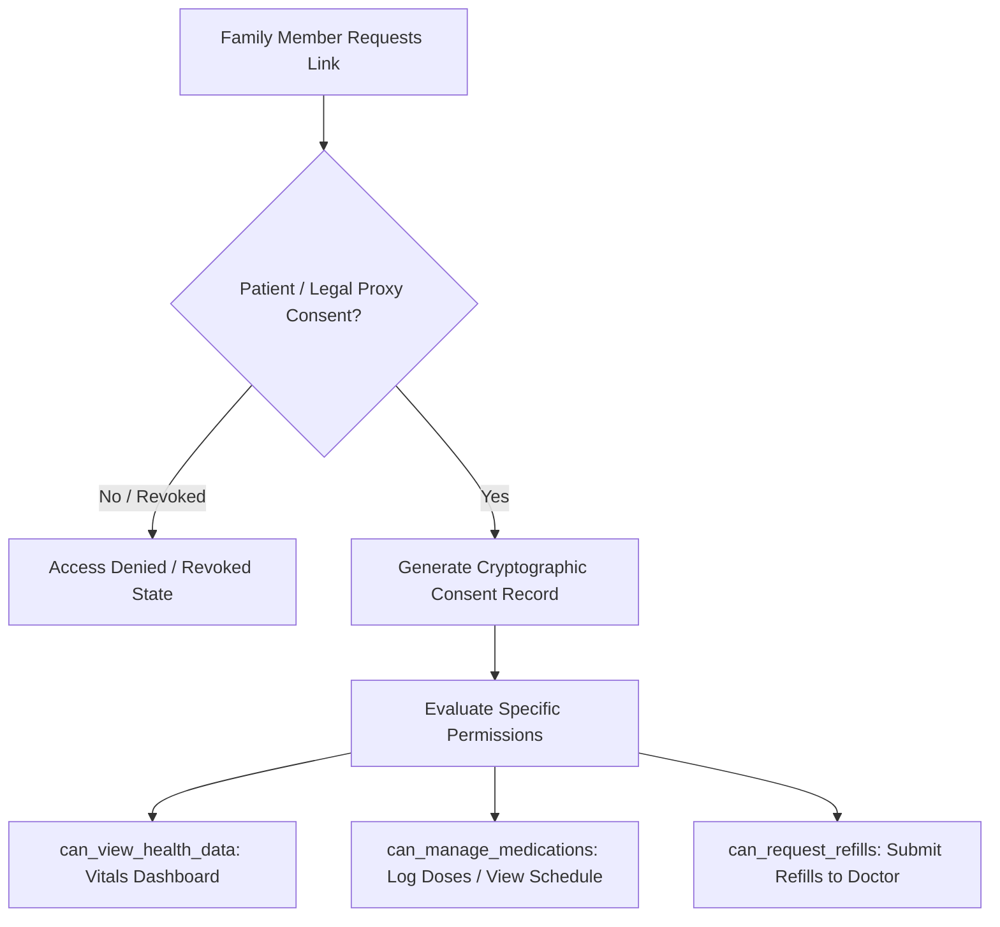
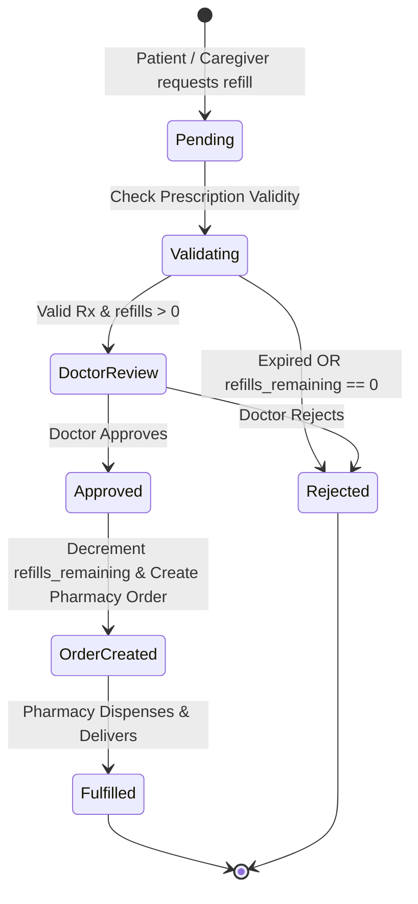

# ElderGuardian AI — Database Architecture Specification & Schema Design

**System:** ElderGuardian AI Healthcare Coordination Platform  
**Target Environments:** Development (SQLite 3.x), Production (PostgreSQL 15+)  
**Data Access & Migration Layer:** Knex.js ORM / Query Builder  
**Security & Compliance Standards:** HIPAA Security Rule (§ 164.312), HITECH Act, GDPR Article 9 (Health Data)

---

## 1. Executive Summary & Architectural Decisions

ElderGuardian AI is an enterprise-grade healthcare coordination and remote patient monitoring (RPM) platform dedicated to geriatric care. The database architecture is engineered around the following core design imperatives:

1. **Dual-Dialect Compatibility (SQLite Dev & PostgreSQL Prod):**
   - SQLite for rapid, zero-dependency local development, in-memory continuous integration (CI), and offline testing.
   - PostgreSQL 15+ for high-throughput transactional integrity, Row-Level Security (RLS), ACID durability, JSONB indexing, and horizontal read scaling.
   - Knex.js migrations abstract dialect variations while retaining native PostgreSQL features in production.

2. **Universal UUID Primary Keys:**
   - 128-bit UUIDs (PostgreSQL `uuid`, SQLite `TEXT`/`CHAR(36)`) eliminate predictable sequential enumeration attacks (OWASP API Vulnerability #1), simplify distributed data synchronization, and decouple ID generation from transactional locks.

3. **Temporal Tracking & Soft Deletes:**
   - Every table enforces timezone-aware timestamps (`created_at TIMESTAMPTZ`, `updated_at TIMESTAMPTZ`).
   - Clinical and patient entities implement soft deletion via `deleted_at TIMESTAMPTZ NULL` with partial unique indexes (`WHERE deleted_at IS NULL`) to maintain historical integrity for medical auditing.

4. **Multi-Tenancy Scoping:**
   - Hospital and clinical operations are isolated using `hospital_id` tenancy scoping.
   - Cross-facility consultations and transfers are managed via explicit authorization and consent records.

5. **Granular Consent & Role-Based Access Control (RBAC):**
   - Direct polymorphic identity inheritance via table-per-role extension of the base `users` entity.
   - Cryptographically verifiable consent records governing patient data visibility to family members and healthcare providers.

6. **Tamper-Evident Append-Only Audit Logging:**
   - Strict append-only audit trail with SHA-256 state hashing and chaining compliant with HIPAA 45 CFR § 164.312(b).

---

## 2. Entity-Relationship (ER) Diagram

The following Mermaid diagram captures all 26 entities, their cardinalities, attributes, and foreign key relationships.

```mermaid
erDiagram
    %% ===================================================
    %% CORE IDENTITY & ROLE HIERARCHY
    %% ===================================================
    USERS ||--o| PATIENTS : "extends (1:0..1)"
    USERS ||--o| DOCTORS : "extends (1:0..1)"
    USERS ||--o| HOSPITAL_ADMINS : "extends (1:0..1)"
    USERS ||--o| PHARMACISTS : "extends (1:0..1)"
    USERS ||--o| LAB_ADMINS : "extends (1:0..1)"

    USERS ||--o{ FAMILY_LINKS : "acts as family member"
    USERS ||--o{ NOTIFICATIONS : "receives"
    USERS ||--o{ AUDIT_LOGS : "initiates"

    %% ===================================================
    %% CLINICAL INFRASTRUCTURE & STAFFING
    %% ===================================================
    HOSPITALS ||--o{ HOSPITAL_DOCTORS : "employs"
    DOCTORS ||--o{ HOSPITAL_DOCTORS : "affiliated with"
    SPECIALIZATIONS ||--o{ DOCTORS : "qualifies"
    HOSPITALS ||--o{ HOSPITAL_ADMINS : "governs"
    HOSPITALS ||--o{ LAB_ADMINS : "operates"
    HOSPITALS ||--o{ PATIENTS : "primary facility"
    HOSPITALS ||--o{ APPOINTMENTS : "hosts"
    HOSPITALS ||--o{ PRESCRIPTIONS : "issues"
    HOSPITALS ||--o{ HOSPITALS_SUBSCRIPTIONS : "contracts"
    SUBSCRIPTIONS ||--o{ HOSPITALS_SUBSCRIPTIONS : "defines"

    %% ===================================================
    %% PATIENT CARE & CLINICAL ENCOUNTERS
    %% ===================================================
    PATIENTS ||--o{ FAMILY_LINKS : "designates family"
    PATIENTS ||--o{ CONSENTS : "authorizes"
    PATIENTS ||--o{ APPOINTMENTS : "books"
    DOCTORS ||--o{ APPOINTMENTS : "attends"
    APPOINTMENTS ||--o| PRESCRIPTIONS : "generates encounter Rx"

    PATIENTS ||--o{ PRESCRIPTIONS : "receives"
    DOCTORS ||--o{ PRESCRIPTIONS : "prescribes"
    PRESCRIPTIONS ||--o{ PRESCRIPTION_ITEMS : "details"

    %% ===================================================
    %% MEDICATION MANAGEMENT & RPM
    %% ===================================================
    PATIENTS ||--o{ MEDICATIONS : "follows schedule"
    PRESCRIPTION_ITEMS ||--o| MEDICATIONS : "translates to"
    MEDICATIONS ||--o{ MEDICATION_DOSES : "logs adherence"
    PATIENTS ||--o{ MEDICATION_DOSES : "takes dose"
    PATIENTS ||--o{ MEDICINE_INVENTORY : "maintains stock"
    MEDICATIONS ||--o| MEDICINE_INVENTORY : "tracks item"

    %% ===================================================
    %% PHARMACY, REFILLS & TELE-PHARMACY
    %% ===================================================
    PHARMACIES ||--o{ PHARMACISTS : "employs"
    PRESCRIPTIONS ||--o{ REFILL_REQUESTS : "authorizes refill"
    PRESCRIPTION_ITEMS ||--o{ REFILL_REQUESTS : "specifies drug"
    PATIENTS ||--o{ REFILL_REQUESTS : "requests"
    REFILL_REQUESTS ||--o| REFILL_APPROVALS : "adjudicates"
    DOCTORS ||--o{ REFILL_APPROVALS : "reviews"

    REFILL_REQUESTS ||--o| PHARMACY_ORDERS : "dispenses"
    PHARMACIES ||--o{ PHARMACY_ORDERS : "fulfills"
    PATIENTS ||--o{ PHARMACY_ORDERS : "receives order"

    %% ===================================================
    %% HEALTH READINGS & AUDIT
    %% ===================================================
    PATIENTS ||--o{ HEALTH_READINGS : "measures vitals"
    HOSPITALS ||--o{ AUDIT_LOGS : "logs tenant audit"

    %% ===================================================
    %% ENTITY DEFINITIONS & ATTRIBUTES
    %% ===================================================
    USERS {
        uuid id PK
        string email UK
        string password_hash
        string role
        string first_name
        string last_name
        string phone_number
        date date_of_birth
        string gender
        boolean is_active
        boolean is_mfa_enabled
        timestamptz created_at
        timestamptz updated_at
        timestamptz deleted_at
    }

    PATIENTS {
        uuid id PK,FK
        string medical_record_number UK
        uuid primary_hospital_id FK
        uuid primary_care_physician_id FK
        string blood_group
        string emergency_contact_name
        string emergency_contact_phone
        string emergency_contact_relation
        string mobility_status
        string fall_risk_level
        string cognitive_status
        jsonb allergies
        jsonb chronic_conditions
        timestamptz created_at
        timestamptz updated_at
        timestamptz deleted_at
    }

    DOCTORS {
        uuid id PK,FK
        string license_number UK
        string npi_number UK
        uuid primary_specialization_id FK
        integer years_of_experience
        decimal consultation_fee
        boolean is_telehealth_available
        timestamptz created_at
        timestamptz updated_at
        timestamptz deleted_at
    }

    HOSPITAL_ADMINS {
        uuid id PK,FK
        uuid hospital_id FK
        string department
        string admin_level
        timestamptz created_at
        timestamptz updated_at
        timestamptz deleted_at
    }

    PHARMACISTS {
        uuid id PK,FK
        uuid pharmacy_id FK
        string license_number UK
        timestamptz created_at
        timestamptz updated_at
        timestamptz deleted_at
    }

    LAB_ADMINS {
        uuid id PK,FK
        uuid hospital_id FK
        string lab_name
        string certification_number
        timestamptz created_at
        timestamptz updated_at
        timestamptz deleted_at
    }

    HOSPITALS {
        uuid id PK
        string name
        string registration_number UK
        string phone
        string email
        string city
        string state
        boolean is_active
        timestamptz created_at
        timestamptz updated_at
        timestamptz deleted_at
    }

    HOSPITAL_DOCTORS {
        uuid id PK
        uuid hospital_id FK
        uuid doctor_id FK
        string department
        string employment_type
        boolean is_primary
        boolean is_active
        timestamptz created_at
        timestamptz updated_at
    }

    SPECIALIZATIONS {
        uuid id PK
        string code UK
        string name
        text description
        timestamptz created_at
        timestamptz updated_at
    }

    APPOINTMENTS {
        uuid id PK
        uuid patient_id FK
        uuid doctor_id FK
        uuid hospital_id FK
        timestamptz scheduled_start_time
        timestamptz scheduled_end_time
        string type
        string status
        text reason_for_visit
        text clinical_notes
        timestamptz created_at
        timestamptz updated_at
        timestamptz deleted_at
    }

    PRESCRIPTIONS {
        uuid id PK
        string prescription_number UK
        uuid patient_id FK
        uuid doctor_id FK
        uuid hospital_id FK
        uuid appointment_id FK
        text diagnosis
        jsonb icd10_codes
        string status
        date issued_date
        date expiration_date
        timestamptz created_at
        timestamptz updated_at
        timestamptz deleted_at
    }

    PRESCRIPTION_ITEMS {
        uuid id PK
        uuid prescription_id FK
        string medication_name
        string rxnorm_code
        string dosage_form
        string strength
        string frequency
        string frequency_cron
        integer duration_days
        integer total_quantity
        integer refills_authorized
        integer refills_remaining
        text instructions
        jsonb details
        timestamptz created_at
        timestamptz updated_at
        timestamptz deleted_at
    }

    MEDICATIONS {
        uuid id PK
        uuid patient_id FK
        uuid prescription_item_id FK
        string medicine_name
        string dosage
        jsonb schedule_times
        date start_date
        date end_date
        string status
        boolean reminder_enabled
        timestamptz created_at
        timestamptz updated_at
        timestamptz deleted_at
    }

    MEDICATION_DOSES {
        uuid id PK
        uuid medication_id FK
        uuid patient_id FK
        timestamptz scheduled_time
        timestamptz recorded_time
        string status
        text skipped_reason
        uuid recorded_by_user_id FK
        boolean pill_count_verified
        timestamptz created_at
        timestamptz updated_at
    }

    MEDICINE_INVENTORY {
        uuid id PK
        uuid patient_id FK
        uuid medication_id FK
        string medication_name
        integer current_stock
        string unit
        integer low_stock_threshold
        date expiry_date
        timestamptz created_at
        timestamptz updated_at
    }

    REFILL_REQUESTS {
        uuid id PK
        string request_number UK
        uuid patient_id FK
        uuid prescription_id FK
        uuid prescription_item_id FK
        uuid requested_by_user_id FK
        string status
        integer quantity_requested
        timestamptz created_at
        timestamptz updated_at
        timestamptz deleted_at
    }

    REFILL_APPROVALS {
        uuid id PK
        uuid refill_request_id FK
        uuid doctor_id FK
        string decision
        timestamptz decision_timestamp
        integer approved_quantity
        uuid new_prescription_id FK
        timestamptz created_at
        timestamptz updated_at
    }

    PHARMACIES {
        uuid id PK
        string name
        string license_number UK
        string phone
        string email
        string city
        string state
        boolean delivers
        boolean is_active
        timestamptz created_at
        timestamptz updated_at
        timestamptz deleted_at
    }

    PHARMACY_ORDERS {
        uuid id PK
        string order_number UK
        uuid refill_request_id FK
        uuid prescription_id FK
        uuid patient_id FK
        uuid pharmacy_id FK
        string status
        decimal total_amount
        decimal copay_amount
        string tracking_number
        timestamptz fulfilled_at
        timestamptz created_at
        timestamptz updated_at
        timestamptz deleted_at
    }

    HEALTH_READINGS {
        uuid id PK
        uuid patient_id FK
        string reading_type
        timestamptz reading_timestamp
        jsonb reading_data
        string unit
        boolean is_abnormal
        string severity
        jsonb device_info
        boolean caregiver_acknowledged
        timestamptz created_at
        timestamptz updated_at
        timestamptz deleted_at
    }

    FAMILY_LINKS {
        uuid id PK
        uuid patient_id FK
        uuid family_user_id FK
        string relationship_type
        boolean is_primary_caregiver
        boolean can_view_health_data
        boolean can_manage_medications
        boolean can_request_refills
        string status
        timestamptz verified_at
        timestamptz created_at
        timestamptz updated_at
        timestamptz deleted_at
    }

    CONSENTS {
        uuid id PK
        uuid patient_id FK
        uuid granted_to_user_id FK
        uuid granted_to_hospital_id FK
        string consent_type
        jsonb scope
        string signature_hash
        boolean is_granted
        timestamptz granted_at
        timestamptz revoked_at
        timestamptz expires_at
        timestamptz created_at
        timestamptz updated_at
    }

    NOTIFICATIONS {
        uuid id PK
        uuid user_id FK
        string title
        text message
        string type
        string priority
        jsonb payload
        boolean is_read
        string channel
        timestamptz created_at
        timestamptz updated_at
    }

    AUDIT_LOGS {
        uuid id PK
        uuid user_id FK
        uuid hospital_id FK
        string action
        string entity_name
        uuid entity_id
        jsonb old_values
        jsonb new_values
        string ip_address
        string checksum
        timestamptz created_at
    }

    SUBSCRIPTIONS {
        uuid id PK
        string name
        string tier
        decimal price_per_month
        integer max_patients
        integer max_doctors
        jsonb features
        boolean is_active
        timestamptz created_at
        timestamptz updated_at
    }

    HOSPITALS_SUBSCRIPTIONS {
        uuid id PK
        uuid hospital_id FK
        uuid subscription_id FK
        string status
        string billing_cycle
        timestamptz current_period_start
        timestamptz current_period_end
        boolean cancel_at_period_end
        timestamptz created_at
        timestamptz updated_at
    }
```



---

## 3. Detailed Table Definitions

### 3.1. `users`
**Purpose:** Base polymorphic identity table storing authentication credentials, account state, and personal demographic baselines for all system actors.

| Column | Data Type (PG / SQLite) | Constraints | Description |
| :--- | :--- | :--- | :--- |
| `id` | `UUID` / `TEXT` | PK, DEFAULT `gen_random_uuid()` | Unique immutable system identifier. |
| `email` | `VARCHAR(255)` / `TEXT` | NOT NULL, UNIQUE | Primary login identity and email contact. |
| `password_hash` | `VARCHAR(255)` / `TEXT` | NOT NULL | Argon2id / bcrypt salted hash. |
| `role` | `VARCHAR(50)` / `TEXT` | NOT NULL, CHECK in `('patient','doctor','hospital_admin','pharmacist','lab_admin','super_admin')` | Functional security persona discriminator. |
| `first_name` | `VARCHAR(100)` / `TEXT` | NOT NULL | Legal first name. |
| `last_name` | `VARCHAR(100)` / `TEXT` | NOT NULL | Legal family name. |
| `phone_number` | `VARCHAR(20)` / `TEXT` | NULL | E.164 formatted international telephone. |
| `date_of_birth` | `DATE` / `TEXT` | NULL | Date of birth for age calculation & clinical verification. |
| `gender` | `VARCHAR(20)` / `TEXT` | NULL | Administrative gender (`male`, `female`, `other`, `undisclosed`). |
| `avatar_url` | `VARCHAR(500)` / `TEXT` | NULL | Secure S3 pre-signed URI to profile image. |
| `is_active` | `BOOLEAN` / `INTEGER` | NOT NULL, DEFAULT `true` | Account suspension toggle. |
| `is_mfa_enabled` | `BOOLEAN` / `INTEGER` | NOT NULL, DEFAULT `false` | Multi-Factor Authentication enforcement flag. |
| `mfa_secret` | `VARCHAR(255)` / `TEXT` | NULL | Encrypted TOTP authenticator secret. |
| `last_login_at` | `TIMESTAMPTZ` / `TEXT` | NULL | Timestamp of most recent authenticated session. |
| `created_at` | `TIMESTAMPTZ` / `TEXT` | NOT NULL, DEFAULT `CURRENT_TIMESTAMP` | Record creation timestamp. |
| `updated_at` | `TIMESTAMPTZ` / `TEXT` | NOT NULL, DEFAULT `CURRENT_TIMESTAMP` | Last modification timestamp. |
| `deleted_at` | `TIMESTAMPTZ` / `TEXT` | NULL | Soft-deletion lifecycle timestamp. |

**Indexes:**
- `idx_users_email_active`: UNIQUE (`email`) WHERE `deleted_at IS NULL` (Supports fast login lookup).
- `idx_users_role`: B-Tree (`role`) WHERE `deleted_at IS NULL` (Role segmentation filter).
- `idx_users_phone`: B-Tree (`phone_number`) (Emergency & SMS dispatch lookup).

---

### 3.2. `patients`
**Purpose:** Geriatric patient clinical extension table. Houses clinical baselines, risk indicators, mobility metrics, and emergency contacts.

| Column | Data Type (PG / SQLite) | Constraints | Description |
| :--- | :--- | :--- | :--- |
| `id` | `UUID` / `TEXT` | PK, FK -> `users(id)` ON DELETE CASCADE | 1:1 foreign extension key referencing `users`. |
| `medical_record_number` | `VARCHAR(50)` / `TEXT` | NOT NULL, UNIQUE | Institutional MRN identifier (e.g., `MRN-98234-A`). |
| `primary_hospital_id` | `UUID` / `TEXT` | NULL, FK -> `hospitals(id)` ON DELETE SET NULL | Primary treating hospital facility. |
| `primary_care_physician_id` | `UUID` / `TEXT` | NULL, FK -> `doctors(id)` ON DELETE SET NULL | Assigned primary care physician (PCP). |
| `blood_group` | `VARCHAR(10)` / `TEXT` | NULL, CHECK in `('A+','A-','B+','B-','AB+','AB-','O+','O-','UNKNOWN')` | Blood type for emergency transfusions. |
| `emergency_contact_name` | `VARCHAR(150)` / `TEXT` | NOT NULL | Designated emergency contact person. |
| `emergency_contact_phone` | `VARCHAR(20)` / `TEXT` | NOT NULL | Designated emergency contact phone number. |
| `emergency_contact_relation` | `VARCHAR(50)` / `TEXT` | NOT NULL | Kinship relationship (e.g. `Spouse`, `Daughter`). |
| `address_line1` | `VARCHAR(255)` / `TEXT` | NOT NULL | Residential street address for dispatch. |
| `address_line2` | `VARCHAR(255)` / `TEXT` | NULL | Apartment/suite/room number. |
| `city` | `VARCHAR(100)` / `TEXT` | NOT NULL | Municipality. |
| `state` | `VARCHAR(100)` / `TEXT` | NOT NULL | State or province. |
| `postal_code` | `VARCHAR(20)` / `TEXT` | NOT NULL | Postal / ZIP code. |
| `country` | `VARCHAR(100)` / `TEXT` | NOT NULL, DEFAULT `'USA'` | Country of residence. |
| `insurance_provider` | `VARCHAR(150)` / `TEXT` | NULL | Health insurance carrier (Medicare, BlueCross, etc.). |
| `insurance_policy_number` | `VARCHAR(100)` / `TEXT` | NULL | Policy / member identification string. |
| `mobility_status` | `VARCHAR(50)` / `TEXT` | NOT NULL, DEFAULT `'independent'` | Mobility category (`independent`, `cane`, `walker`, `wheelchair`, `bedbound`). |
| `fall_risk_level` | `VARCHAR(20)` / `TEXT` | NOT NULL, DEFAULT `'low'`, CHECK in `('low','medium','high')` | Morse Fall Scale categorized risk level. |
| `cognitive_status` | `VARCHAR(50)` / `TEXT` | NOT NULL, DEFAULT `'normal'`, CHECK in `('normal','mild_cognitive_impairment','dementia','severe')` | Clinical cognitive baseline. |
| `allergies` | `JSONB` / `TEXT` | NOT NULL, DEFAULT `'[]'` | Array of structured allergies: `[{"allergen": "Penicillin", "severity": "anaphylaxis"}]`. |
| `chronic_conditions` | `JSONB` / `TEXT` | NOT NULL, DEFAULT `'[]'` | Array of chronic conditions: `[{"icd10": "I10", "condition": "Hypertension"}]`. |
| `created_at` | `TIMESTAMPTZ` / `TEXT` | NOT NULL, DEFAULT `CURRENT_TIMESTAMP` | Record creation timestamp. |
| `updated_at` | `TIMESTAMPTZ` / `TEXT` | NOT NULL, DEFAULT `CURRENT_TIMESTAMP` | Record modification timestamp. |
| `deleted_at` | `TIMESTAMPTZ` / `TEXT` | NULL | Soft-delete timestamp. |

**Indexes:**
- `idx_patients_mrn`: UNIQUE (`medical_record_number`) WHERE `deleted_at IS NULL`.
- `idx_patients_hospital`: Composite (`primary_hospital_id`, `deleted_at`) (Tenant cohort queries).
- `idx_patients_fall_risk`: Partial (`fall_risk_level`) WHERE `fall_risk_level = 'high'` (Alert monitors).
- `idx_patients_pcp`: B-Tree (`primary_care_physician_id`).

---

### 3.3. `doctors`
**Purpose:** Physician credentialing and professional profile entity.

| Column | Data Type (PG / SQLite) | Constraints | Description |
| :--- | :--- | :--- | :--- |
| `id` | `UUID` / `TEXT` | PK, FK -> `users(id)` ON DELETE CASCADE | 1:1 foreign extension key referencing `users`. |
| `license_number` | `VARCHAR(100)` / `TEXT` | NOT NULL, UNIQUE | State medical board practitioner license ID. |
| `npi_number` | `VARCHAR(20)` / `TEXT` | NOT NULL, UNIQUE | National Provider Identifier (10-digit standard). |
| `primary_specialization_id` | `UUID` / `TEXT` | NOT NULL, FK -> `specializations(id)` ON DELETE RESTRICT | Primary clinical specialty reference. |
| `bio` | `TEXT` | NULL | Clinical background and credentials summary. |
| `years_of_experience` | `INTEGER` | NOT NULL, DEFAULT 0, CHECK (`years_of_experience >= 0`) | Verified years of practice. |
| `consultation_fee` | `DECIMAL(10,2)` / `REAL` | NOT NULL, DEFAULT `0.00`, CHECK (`consultation_fee >= 0`) | Out-of-pocket base telehealth rate. |
| `is_telehealth_available` | `BOOLEAN` / `INTEGER` | NOT NULL, DEFAULT `true` | Telehealth consultation scheduling flag. |
| `created_at` | `TIMESTAMPTZ` / `TEXT` | NOT NULL, DEFAULT `CURRENT_TIMESTAMP` | Record creation timestamp. |
| `updated_at` | `TIMESTAMPTZ` / `TEXT` | NOT NULL, DEFAULT `CURRENT_TIMESTAMP` | Record modification timestamp. |
| `deleted_at` | `TIMESTAMPTZ` / `TEXT` | NULL | Soft-delete timestamp. |

**Indexes:**
- `idx_doctors_license`: UNIQUE (`license_number`).
- `idx_doctors_npi`: UNIQUE (`npi_number`).
- `idx_doctors_specialization`: B-Tree (`primary_specialization_id`).

---

### 3.4. `hospital_admins`
**Purpose:** Administrative staff managing departmental and institutional configuration.

| Column | Data Type (PG / SQLite) | Constraints | Description |
| :--- | :--- | :--- | :--- |
| `id` | `UUID` / `TEXT` | PK, FK -> `users(id)` ON DELETE CASCADE | 1:1 foreign extension key referencing `users`. |
| `hospital_id` | `UUID` / `TEXT` | NOT NULL, FK -> `hospitals(id)` ON DELETE CASCADE | Hospital organization context. |
| `department` | `VARCHAR(100)` / `TEXT` | NOT NULL | Departmental assignment (e.g. `Geriatrics`, `Operations`). |
| `admin_level` | `VARCHAR(50)` / `TEXT` | NOT NULL, DEFAULT `'hospital_admin'`, CHECK in `('super_admin','hospital_admin','billing_admin','compliance_officer')` | Institutional privilege scope. |
| `created_at` | `TIMESTAMPTZ` / `TEXT` | NOT NULL, DEFAULT `CURRENT_TIMESTAMP` | Record creation timestamp. |
| `updated_at` | `TIMESTAMPTZ` / `TEXT` | NOT NULL, DEFAULT `CURRENT_TIMESTAMP` | Record modification timestamp. |
| `deleted_at` | `TIMESTAMPTZ` / `TEXT` | NULL | Soft-delete timestamp. |

**Indexes:**
- `idx_hospital_admins_hospital`: B-Tree (`hospital_id`, `deleted_at`).

---

### 3.5. `pharmacists`
**Purpose:** Licensed pharmacy professionals dispensing medication and reviewing refill requests.

| Column | Data Type (PG / SQLite) | Constraints | Description |
| :--- | :--- | :--- | :--- |
| `id` | `UUID` / `TEXT` | PK, FK -> `users(id)` ON DELETE CASCADE | 1:1 foreign extension key referencing `users`. |
| `pharmacy_id` | `UUID` / `TEXT` | NOT NULL, FK -> `pharmacies(id)` ON DELETE CASCADE | Affiliated pharmacy facility. |
| `license_number` | `VARCHAR(100)` / `TEXT` | NOT NULL, UNIQUE | State Board of Pharmacy license ID. |
| `created_at` | `TIMESTAMPTZ` / `TEXT` | NOT NULL, DEFAULT `CURRENT_TIMESTAMP` | Record creation timestamp. |
| `updated_at` | `TIMESTAMPTZ` / `TEXT` | NOT NULL, DEFAULT `CURRENT_TIMESTAMP` | Record modification timestamp. |
| `deleted_at` | `TIMESTAMPTZ` / `TEXT` | NULL | Soft-delete timestamp. |

**Indexes:**
- `idx_pharmacists_pharmacy`: B-Tree (`pharmacy_id`).
- `idx_pharmacists_license`: UNIQUE (`license_number`).

---

### 3.6. `lab_admins`
**Purpose:** Diagnostic and laboratory technicians processing diagnostic assays.

| Column | Data Type (PG / SQLite) | Constraints | Description |
| :--- | :--- | :--- | :--- |
| `id` | `UUID` / `TEXT` | PK, FK -> `users(id)` ON DELETE CASCADE | 1:1 foreign extension key referencing `users`. |
| `hospital_id` | `UUID` / `TEXT` | NULL, FK -> `hospitals(id)` ON DELETE SET NULL | Optional affiliated hospital organization. |
| `lab_name` | `VARCHAR(150)` / `TEXT` | NOT NULL | Laboratory / Diagnostic department name. |
| `certification_number` | `VARCHAR(100)` / `TEXT` | NULL | CLIA (Clinical Laboratory Improvement Amendments) ID. |
| `created_at` | `TIMESTAMPTZ` / `TEXT` | NOT NULL, DEFAULT `CURRENT_TIMESTAMP` | Record creation timestamp. |
| `updated_at` | `TIMESTAMPTZ` / `TEXT` | NOT NULL, DEFAULT `CURRENT_TIMESTAMP` | Record modification timestamp. |
| `deleted_at` | `TIMESTAMPTZ` / `TEXT` | NULL | Soft-delete timestamp. |

**Indexes:**
- `idx_lab_admins_hospital`: B-Tree (`hospital_id`).

---

### 3.7. `hospitals`
**Purpose:** Primary multi-tenant institutional entity representing hospitals, health networks, and clinical organizations.

| Column | Data Type (PG / SQLite) | Constraints | Description |
| :--- | :--- | :--- | :--- |
| `id` | `UUID` / `TEXT` | PK, DEFAULT `gen_random_uuid()` | Unique hospital identifier. |
| `name` | `VARCHAR(255)` / `TEXT` | NOT NULL | Legal name of hospital / medical center. |
| `registration_number` | `VARCHAR(100)` / `TEXT` | NOT NULL, UNIQUE | State/federal healthcare registration code. |
| `tax_id` | `VARCHAR(100)` / `TEXT` | NULL | Federal Tax Employer Identification Number (EIN). |
| `phone` | `VARCHAR(20)` / `TEXT` | NOT NULL | Primary hospital switchboard number. |
| `email` | `VARCHAR(255)` / `TEXT` | NOT NULL | Official administrative contact email. |
| `address_line1` | `VARCHAR(255)` / `TEXT` | NOT NULL | Physical street address. |
| `address_line2` | `VARCHAR(255)` / `TEXT` | NULL | Complex / Building name. |
| `city` | `VARCHAR(100)` / `TEXT` | NOT NULL | City. |
| `state` | `VARCHAR(100)` / `TEXT` | NOT NULL | State. |
| `postal_code` | `VARCHAR(20)` / `TEXT` | NOT NULL | Postal code. |
| `country` | `VARCHAR(100)` / `TEXT` | NOT NULL, DEFAULT `'USA'` | Country. |
| `is_active` | `BOOLEAN` / `INTEGER` | NOT NULL, DEFAULT `true` | Operational status toggle. |
| `created_at` | `TIMESTAMPTZ` / `TEXT` | NOT NULL, DEFAULT `CURRENT_TIMESTAMP` | Record creation timestamp. |
| `updated_at` | `TIMESTAMPTZ` / `TEXT` | NOT NULL, DEFAULT `CURRENT_TIMESTAMP` | Record modification timestamp. |
| `deleted_at` | `TIMESTAMPTZ` / `TEXT` | NULL | Soft-delete timestamp. |

**Indexes:**
- `idx_hospitals_reg`: UNIQUE (`registration_number`) WHERE `deleted_at IS NULL`.
- `idx_hospitals_active`: B-Tree (`is_active`) WHERE `deleted_at IS NULL`.

---

### 3.8. `hospital_doctors`
**Purpose:** Many-to-many junction table modeling physician hospital credentialing, department appointments, and employment modes.

| Column | Data Type (PG / SQLite) | Constraints | Description |
| :--- | :--- | :--- | :--- |
| `id` | `UUID` / `TEXT` | PK, DEFAULT `gen_random_uuid()` | Unique junction record ID. |
| `hospital_id` | `UUID` / `TEXT` | NOT NULL, FK -> `hospitals(id)` ON DELETE CASCADE | Credentialing hospital ID. |
| `doctor_id` | `UUID` / `TEXT` | NOT NULL, FK -> `doctors(id)` ON DELETE CASCADE | Credentialed doctor ID. |
| `department` | `VARCHAR(100)` / `TEXT` | NOT NULL | Clinical department (e.g. `Geriatric Medicine`). |
| `employment_type` | `VARCHAR(50)` / `TEXT` | NOT NULL, DEFAULT `'visiting'`, CHECK in `('full_time','part_time','visiting','consultant','emeritus')` | Legal employment classification. |
| `is_primary` | `BOOLEAN` / `INTEGER` | NOT NULL, DEFAULT `false` | True if this is the doctor's primary facility. |
| `is_active` | `BOOLEAN` / `INTEGER` | NOT NULL, DEFAULT `true` | Credential validity status. |
| `joined_date` | `DATE` / `TEXT` | NOT NULL | Date staff privileges commenced. |
| `created_at` | `TIMESTAMPTZ` / `TEXT` | NOT NULL, DEFAULT `CURRENT_TIMESTAMP` | Record creation timestamp. |
| `updated_at` | `TIMESTAMPTZ` / `TEXT` | NOT NULL, DEFAULT `CURRENT_TIMESTAMP` | Record modification timestamp. |

**Constraints & Indexes:**
- Unique Constraint: `uq_hospital_doctor` UNIQUE (`hospital_id`, `doctor_id`).
- `idx_hosp_doc_doctor`: B-Tree (`doctor_id`, `is_active`).
- `idx_hosp_doc_hospital`: B-Tree (`hospital_id`, `department`, `is_active`).

---

### 3.9. `specializations`
**Purpose:** Standardized clinical taxonomy and board certification directory.

| Column | Data Type (PG / SQLite) | Constraints | Description |
| :--- | :--- | :--- | :--- |
| `id` | `UUID` / `TEXT` | PK, DEFAULT `gen_random_uuid()` | Unique specialization ID. |
| `code` | `VARCHAR(50)` / `TEXT` | NOT NULL, UNIQUE | Standard taxonomy code (e.g., `GERIATRICS`, `CARDIOLOGY`). |
| `name` | `VARCHAR(150)` / `TEXT` | NOT NULL | Full title (e.g., `Geriatric Medicine`). |
| `description` | `TEXT` | NULL | Clinical scope of specialization. |
| `created_at` | `TIMESTAMPTZ` / `TEXT` | NOT NULL, DEFAULT `CURRENT_TIMESTAMP` | Record creation timestamp. |
| `updated_at` | `TIMESTAMPTZ` / `TEXT` | NOT NULL, DEFAULT `CURRENT_TIMESTAMP` | Record modification timestamp. |

**Indexes:**
- `idx_specializations_code`: UNIQUE (`code`).

---

### 3.10. `appointments`
**Purpose:** Scheduled clinical interactions, telehealth sessions, and in-person home/clinic visits.

| Column | Data Type (PG / SQLite) | Constraints | Description |
| :--- | :--- | :--- | :--- |
| `id` | `UUID` / `TEXT` | PK, DEFAULT `gen_random_uuid()` | Unique appointment ID. |
| `patient_id` | `UUID` / `TEXT` | NOT NULL, FK -> `patients(id)` ON DELETE CASCADE | Associated patient ID. |
| `doctor_id` | `UUID` / `TEXT` | NOT NULL, FK -> `doctors(id)` ON DELETE RESTRICT | Attending physician ID. |
| `hospital_id` | `UUID` / `TEXT` | NOT NULL, FK -> `hospitals(id)` ON DELETE RESTRICT | Tenant facility ID. |
| `scheduled_start_time` | `TIMESTAMPTZ` / `TEXT` | NOT NULL | Scheduled appointment start timestamp. |
| `scheduled_end_time` | `TIMESTAMPTZ` / `TEXT` | NOT NULL, CHECK (`scheduled_end_time > scheduled_start_time`) | Scheduled appointment end timestamp. |
| `actual_start_time` | `TIMESTAMPTZ` / `TEXT` | NULL | Actual time encounter commenced. |
| `actual_end_time` | `TIMESTAMPTZ` / `TEXT` | NULL | Actual time encounter concluded. |
| `type` | `VARCHAR(50)` / `TEXT` | NOT NULL, CHECK in `('in_person','telehealth','home_visit')` | Encounter medium. |
| `status` | `VARCHAR(50)` / `TEXT` | NOT NULL, DEFAULT `'scheduled'`, CHECK in `('scheduled','confirmed','in_progress','completed','cancelled','no_show')` | Lifecycle status. |
| `reason_for_visit` | `TEXT` | NOT NULL | Chief complaint / patient reason. |
| `clinical_notes` | `TEXT` | NULL | Physician SOAP notes (Subjective, Objective, Assessment, Plan). |
| `cancellation_reason`| `TEXT` | NULL | Justification if status is cancelled. |
| `created_at` | `TIMESTAMPTZ` / `TEXT` | NOT NULL, DEFAULT `CURRENT_TIMESTAMP` | Record creation timestamp. |
| `updated_at` | `TIMESTAMPTZ` / `TEXT` | NOT NULL, DEFAULT `CURRENT_TIMESTAMP` | Record modification timestamp. |
| `deleted_at` | `TIMESTAMPTZ` / `TEXT` | NULL | Soft-delete timestamp. |

**Indexes:**
- `idx_appts_patient_time`: Composite (`patient_id`, `scheduled_start_time`) WHERE `deleted_at IS NULL`.
- `idx_appts_doctor_time`: Composite (`doctor_id`, `scheduled_start_time`, `status`) WHERE `deleted_at IS NULL`.
- `idx_appts_hospital_status`: Composite (`hospital_id`, `status`, `scheduled_start_time`).

---

### 3.11. `prescriptions`
**Purpose:** Header record for clinical drug orders authorized by licensed physicians.

| Column | Data Type (PG / SQLite) | Constraints | Description |
| :--- | :--- | :--- | :--- |
| `id` | `UUID` / `TEXT` | PK, DEFAULT `gen_random_uuid()` | Unique prescription ID. |
| `prescription_number` | `VARCHAR(50)` / `TEXT` | NOT NULL, UNIQUE | Human-readable tracking number (e.g., `RX-2026-009182`). |
| `patient_id` | `UUID` / `TEXT` | NOT NULL, FK -> `patients(id)` ON DELETE RESTRICT | Recipient patient ID. |
| `doctor_id` | `UUID` / `TEXT` | NOT NULL, FK -> `doctors(id)` ON DELETE RESTRICT | Authorizing doctor ID. |
| `hospital_id` | `UUID` / `TEXT` | NOT NULL, FK -> `hospitals(id)` ON DELETE RESTRICT | Tenant hospital ID. |
| `appointment_id` | `UUID` / `TEXT` | NULL, FK -> `appointments(id)` ON DELETE SET NULL | Optional triggering clinical encounter. |
| `diagnosis` | `TEXT` | NOT NULL | Clinical condition justification. |
| `icd10_codes` | `JSONB` / `TEXT` | NOT NULL, DEFAULT `'[]'` | ICD-10 diagnostic coding array: `["E11.9", "I10"]`. |
| `status` | `VARCHAR(50)` / `TEXT` | NOT NULL, DEFAULT `'active'`, CHECK in `('active','dispensed','partially_dispensed','discontinued','expired')` | Prescription lifecycle status. |
| `issued_date` | `DATE` / `TEXT` | NOT NULL | Date authorized by physician. |
| `expiration_date` | `DATE` / `TEXT` | NOT NULL, CHECK (`expiration_date >= issued_date`) | DEA/State legal expiration threshold (usually 1 year or 6 months for controlled substances). |
| `notes_for_pharmacist` | `TEXT` | NULL | Special clinical handling or compounding notes. |
| `created_at` | `TIMESTAMPTZ` / `TEXT` | NOT NULL, DEFAULT `CURRENT_TIMESTAMP` | Record creation timestamp. |
| `updated_at` | `TIMESTAMPTZ` / `TEXT` | NOT NULL, DEFAULT `CURRENT_TIMESTAMP` | Record modification timestamp. |
| `deleted_at` | `TIMESTAMPTZ` / `TEXT` | NULL | Soft-delete timestamp. |

**Indexes:**
- `idx_prescriptions_number`: UNIQUE (`prescription_number`).
- `idx_prescriptions_patient`: Composite (`patient_id`, `status`, `expiration_date`) WHERE `deleted_at IS NULL`.
- `idx_prescriptions_doctor`: B-Tree (`doctor_id`).
- `idx_prescriptions_hospital`: B-Tree (`hospital_id`).

---

### 3.12. `prescription_items`
**Purpose:** Specific pharmaceutical line items associated with a prescription, detailing dosage, route, schedule, and authorized refills.

| Column | Data Type (PG / SQLite) | Constraints | Description |
| :--- | :--- | :--- | :--- |
| `id` | `UUID` / `TEXT` | PK, DEFAULT `gen_random_uuid()` | Unique line item ID. |
| `prescription_id` | `UUID` / `TEXT` | NOT NULL, FK -> `prescriptions(id)` ON DELETE CASCADE | Parent prescription reference. |
| `medication_name` | `VARCHAR(255)` / `TEXT` | NOT NULL | Brand or trade name (e.g. `Glucophage`). |
| `generic_name` | `VARCHAR(255)` / `TEXT` | NULL | Non-proprietary pharmacological name (e.g. `Metformin HCl`). |
| `rxnorm_code` | `VARCHAR(50)` / `TEXT` | NULL | Standardized NLM RxNorm concept identifier. |
| `dosage_form` | `VARCHAR(50)` / `TEXT` | NOT NULL | Formulation (`tablet`, `capsule`, `solution`, `inhaler`, `patch`). |
| `strength` | `VARCHAR(50)` / `TEXT` | NOT NULL | Potency per unit (e.g. `500 mg`, `10 mcg/hr`). |
| `route` | `VARCHAR(50)` / `TEXT` | NOT NULL, DEFAULT `'oral'` | Administration route (`oral`, `sublingual`, `transdermal`, etc.). |
| `frequency` | `VARCHAR(100)` / `TEXT` | NOT NULL | Human-readable instruction (e.g. `Twice daily with meals`). |
| `frequency_cron` | `VARCHAR(100)` / `TEXT` | NULL | Standardized schedule/cron string for scheduling engine (e.g. `0 8,20 * * *`). |
| `duration_days` | `INTEGER` | NOT NULL, CHECK (`duration_days > 0`) | Therapy course duration. |
| `total_quantity` | `INTEGER` | NOT NULL, CHECK (`total_quantity > 0`) | Number of units dispensed in one fill. |
| `refills_authorized`| `INTEGER` | NOT NULL, DEFAULT 0, CHECK (`refills_authorized >= 0`) | Total refills permitted by doctor. |
| `refills_remaining` | `INTEGER` | NOT NULL, DEFAULT 0, CHECK (`refills_remaining >= 0 AND refills_remaining <= refills_authorized`) | Remaining allowable refills. |
| `instructions` | `TEXT` | NOT NULL | Patient Sig ("Take 1 tablet by mouth twice daily with breakfast and dinner"). |
| `precautions` | `TEXT` | NULL | Warning text (e.g. "Do not crush", "Avoid grapefruit"). |
| `details` | `JSONB` / `TEXT` | NOT NULL, DEFAULT `'{}'` | Flexible schema: food warnings, side effects, NDC code, storage conditions. |
| `created_at` | `TIMESTAMPTZ` / `TEXT` | NOT NULL, DEFAULT `CURRENT_TIMESTAMP` | Record creation timestamp. |
| `updated_at` | `TIMESTAMPTZ` / `TEXT` | NOT NULL, DEFAULT `CURRENT_TIMESTAMP` | Record modification timestamp. |
| `deleted_at` | `TIMESTAMPTZ` / `TEXT` | NULL | Soft-delete timestamp. |

**Indexes:**
- `idx_rx_items_prescription`: B-Tree (`prescription_id`) WHERE `deleted_at IS NULL`.
- `idx_rx_items_rxnorm`: B-Tree (`rxnorm_code`).
- `idx_rx_items_med_name`: B-Tree (`medication_name`).

---

### 3.13. `medications`
**Purpose:** Patient-centric active medication plan. Instantiated from `prescription_items` or directly recorded for over-the-counter (OTC) supplements.

| Column | Data Type (PG / SQLite) | Constraints | Description |
| :--- | :--- | :--- | :--- |
| `id` | `UUID` / `TEXT` | PK, DEFAULT `gen_random_uuid()` | Unique active medication schedule ID. |
| `patient_id` | `UUID` / `TEXT` | NOT NULL, FK -> `patients(id)` ON DELETE CASCADE | Associated patient. |
| `prescription_item_id` | `UUID` / `TEXT` | NULL, FK -> `prescription_items(id)` ON DELETE SET NULL | Originating prescription item if prescribed. |
| `medicine_name` | `VARCHAR(255)` / `TEXT` | NOT NULL | Name of the medication. |
| `dosage` | `VARCHAR(100)` / `TEXT` | NOT NULL | Prescribed dosage (e.g., `1 tablet (500mg)`). |
| `schedule_times` | `JSONB` / `TEXT` | NOT NULL | Array of daily administration times: `["08:00", "20:00"]`. |
| `start_date` | `DATE` / `TEXT` | NOT NULL | Regimen commencement date. |
| `end_date` | `DATE` / `TEXT` | NULL | Regimen conclusion date. |
| `status` | `VARCHAR(50)` / `TEXT` | NOT NULL, DEFAULT `'active'`, CHECK in `('active','paused','completed','discontinued')` | Current schedule state. |
| `reminder_enabled` | `BOOLEAN` / `INTEGER` | NOT NULL, DEFAULT `true` | Automated push/voice notification toggle. |
| `reminder_lead_minutes`| `INTEGER` | NOT NULL, DEFAULT 15, CHECK (`reminder_lead_minutes >= 0`) | Advance notice alert time in minutes. |
| `created_at` | `TIMESTAMPTZ` / `TEXT` | NOT NULL, DEFAULT `CURRENT_TIMESTAMP` | Record creation timestamp. |
| `updated_at` | `TIMESTAMPTZ` / `TEXT` | NOT NULL, DEFAULT `CURRENT_TIMESTAMP` | Record modification timestamp. |
| `deleted_at` | `TIMESTAMPTZ` / `TEXT` | NULL | Soft-delete timestamp. |

**Indexes:**
- `idx_medications_patient_status`: Composite (`patient_id`, `status`) WHERE `deleted_at IS NULL`.
- `idx_medications_rx_item`: B-Tree (`prescription_item_id`).

---

### 3.14. `medication_doses`
**Purpose:** Granular time-series log of individual medication administration events and patient adherence metrics.

| Column | Data Type (PG / SQLite) | Constraints | Description |
| :--- | :--- | :--- | :--- |
| `id` | `UUID` / `TEXT` | PK, DEFAULT `gen_random_uuid()` | Unique dose log ID. |
| `medication_id` | `UUID` / `TEXT` | NOT NULL, FK -> `medications(id)` ON DELETE CASCADE | Parent medication regimen. |
| `patient_id` | `UUID` / `TEXT` | NOT NULL, FK -> `patients(id)` ON DELETE CASCADE | Associated patient. |
| `scheduled_time` | `TIMESTAMPTZ` / `TEXT` | NOT NULL | Pre-calculated target ingestion timestamp. |
| `recorded_time` | `TIMESTAMPTZ` / `TEXT` | NULL | Time patient or caregiver logged the event. |
| `status` | `VARCHAR(50)` / `TEXT` | NOT NULL, DEFAULT `'pending'`, CHECK in `('pending','taken','missed','skipped')` | Dose intake status. |
| `skipped_reason` | `TEXT` | NULL | Clinical justification if skipped (e.g. `nausea`, `fasting for test`). |
| `recorded_by_user_id` | `UUID` / `TEXT` | NULL, FK -> `users(id)` ON DELETE SET NULL | Actor confirming intake (patient, caregiver, or null for IoT pillbox). |
| `pill_count_verified` | `BOOLEAN` / `INTEGER` | NOT NULL, DEFAULT `false` | Smart dispenser weight/vision verification flag. |
| `created_at` | `TIMESTAMPTZ` / `TEXT` | NOT NULL, DEFAULT `CURRENT_TIMESTAMP` | Record creation timestamp. |
| `updated_at` | `TIMESTAMPTZ` / `TEXT` | NOT NULL, DEFAULT `CURRENT_TIMESTAMP` | Record modification timestamp. |

**Indexes:**
- `idx_med_doses_scheduled`: Composite (`patient_id`, `scheduled_time`, `status`).
- `idx_med_doses_medication`: Composite (`medication_id`, `scheduled_time`).
- `idx_med_doses_missed`: Partial (`patient_id`, `scheduled_time`) WHERE `status = 'missed'` (Adherence reporting).

---

### 3.15. `medicine_inventory`
**Purpose:** Patient home medicine stock tracker, monitoring remaining inventory, consumption rates, and triggering proactive refill warnings.

| Column | Data Type (PG / SQLite) | Constraints | Description |
| :--- | :--- | :--- | :--- |
| `id` | `UUID` / `TEXT` | PK, DEFAULT `gen_random_uuid()` | Unique inventory stock ID. |
| `patient_id` | `UUID` / `TEXT` | NOT NULL, FK -> `patients(id)` ON DELETE CASCADE | Associated patient ID. |
| `medication_id` | `UUID` / `TEXT` | NULL, FK -> `medications(id)` ON DELETE SET NULL | Linked medication schedule. |
| `medication_name` | `VARCHAR(255)` / `TEXT` | NOT NULL | Trade or clinical name of the stock. |
| `current_stock` | `INTEGER` | NOT NULL, DEFAULT 0, CHECK (`current_stock >= 0`) | Available unit count. |
| `unit` | `VARCHAR(50)` / `TEXT` | NOT NULL, DEFAULT `'units'` | Measurement unit (`tablets`, `capsules`, `ml`, `puffs`). |
| `low_stock_threshold`| `INTEGER` | NOT NULL, DEFAULT 7, CHECK (`low_stock_threshold >= 0`) | Threshold quantity triggering automated refill alert. |
| `last_refilled_at` | `TIMESTAMPTZ` / `TEXT` | NULL | Timestamp of previous stock addition. |
| `expiry_date` | `DATE` / `TEXT` | NULL | Batch expiration date. |
| `batch_number` | `VARCHAR(100)` / `TEXT` | NULL | Manufacturer lot number. |
| `created_at` | `TIMESTAMPTZ` / `TEXT` | NOT NULL, DEFAULT `CURRENT_TIMESTAMP` | Record creation timestamp. |
| `updated_at` | `TIMESTAMPTZ` / `TEXT` | NOT NULL, DEFAULT `CURRENT_TIMESTAMP` | Record modification timestamp. |

**Indexes:**
- `idx_inventory_patient_med`: Composite (`patient_id`, `medication_id`).
- `idx_inventory_low_stock`: Partial (`patient_id`, `current_stock`, `low_stock_threshold`) WHERE `current_stock <= low_stock_threshold`.

---

### 3.16. `refill_requests`
**Purpose:** Workflow tracking for prescription refill requests initiated by patients, caregivers, or automated AI inventory alerts.

| Column | Data Type (PG / SQLite) | Constraints | Description |
| :--- | :--- | :--- | :--- |
| `id` | `UUID` / `TEXT` | PK, DEFAULT `gen_random_uuid()` | Unique refill request ID. |
| `request_number` | `VARCHAR(50)` / `TEXT` | NOT NULL, UNIQUE | Tracking identifier (e.g. `REF-2026-08192`). |
| `patient_id` | `UUID` / `TEXT` | NOT NULL, FK -> `patients(id)` ON DELETE CASCADE | Associated patient. |
| `prescription_id` | `UUID` / `TEXT` | NOT NULL, FK -> `prescriptions(id)` ON DELETE RESTRICT | Governing prescription. |
| `prescription_item_id` | `UUID` / `TEXT` | NOT NULL, FK -> `prescription_items(id)` ON DELETE RESTRICT | Specific drug item being refilled. |
| `requested_by_user_id`| `UUID` / `TEXT` | NOT NULL, FK -> `users(id)` ON DELETE RESTRICT | Requesting entity (patient or authorized proxy). |
| `status` | `VARCHAR(50)` / `TEXT` | NOT NULL, DEFAULT `'pending'`, CHECK in `('pending','approved','rejected','cancelled','fulfilled')` | Refill workflow status. |
| `quantity_requested` | `INTEGER` | NOT NULL, CHECK (`quantity_requested > 0`) | Desired pill/unit count. |
| `patient_notes` | `TEXT` | NULL | Special delivery or timing requests from patient. |
| `created_at` | `TIMESTAMPTZ` / `TEXT` | NOT NULL, DEFAULT `CURRENT_TIMESTAMP` | Record creation timestamp. |
| `updated_at` | `TIMESTAMPTZ` / `TEXT` | NOT NULL, DEFAULT `CURRENT_TIMESTAMP` | Record modification timestamp. |
| `deleted_at` | `TIMESTAMPTZ` / `TEXT` | NULL | Soft-delete timestamp. |

**Indexes:**
- `idx_refill_req_number`: UNIQUE (`request_number`).
- `idx_refill_req_patient`: Composite (`patient_id`, `status`) WHERE `deleted_at IS NULL`.
- `idx_refill_req_rx`: B-Tree (`prescription_id`, `prescription_item_id`).

---

### 3.17. `refill_approvals`
**Purpose:** Formal clinical adjudication of a refill request by an authorized prescribing doctor.

| Column | Data Type (PG / SQLite) | Constraints | Description |
| :--- | :--- | :--- | :--- |
| `id` | `UUID` / `TEXT` | PK, DEFAULT `gen_random_uuid()` | Unique approval ID. |
| `refill_request_id` | `UUID` / `TEXT` | NOT NULL, UNIQUE, FK -> `refill_requests(id)` ON DELETE CASCADE | 1:1 link to the refill request. |
| `doctor_id` | `UUID` / `TEXT` | NOT NULL, FK -> `doctors(id)` ON DELETE RESTRICT | Adjudicating physician. |
| `decision` | `VARCHAR(20)` / `TEXT` | NOT NULL, CHECK in `('approved','rejected')` | Adjudication outcome. |
| `decision_timestamp`| `TIMESTAMPTZ` / `TEXT` | NOT NULL, DEFAULT `CURRENT_TIMESTAMP` | Exact time decision was logged. |
| `doctor_comments` | `TEXT` | NULL | Physician clinical rationale. |
| `approved_quantity` | `INTEGER` | NULL, CHECK (`approved_quantity >= 0`) | Physician-modified quantity. |
| `new_prescription_id`| `UUID` / `TEXT` | NULL, FK -> `prescriptions(id)` ON DELETE SET NULL | Associated new Rx if old Rx was expired. |
| `created_at` | `TIMESTAMPTZ` / `TEXT` | NOT NULL, DEFAULT `CURRENT_TIMESTAMP` | Record creation timestamp. |
| `updated_at` | `TIMESTAMPTZ` / `TEXT` | NOT NULL, DEFAULT `CURRENT_TIMESTAMP` | Record modification timestamp. |

**Indexes:**
- `idx_refill_appr_req`: UNIQUE (`refill_request_id`).
- `idx_refill_appr_doctor`: B-Tree (`doctor_id`, `decision_timestamp`).

---

### 3.18. `pharmacies`
**Purpose:** Commercial dispensing pharmacies and healthcare network dispensing centers.

| Column | Data Type (PG / SQLite) | Constraints | Description |
| :--- | :--- | :--- | :--- |
| `id` | `UUID` / `TEXT` | PK, DEFAULT `gen_random_uuid()` | Unique pharmacy ID. |
| `name` | `VARCHAR(255)` / `TEXT` | NOT NULL | Commercial pharmacy business name. |
| `license_number` | `VARCHAR(100)` / `TEXT` | NOT NULL, UNIQUE | State Pharmacy Board institutional permit ID. |
| `phone` | `VARCHAR(20)` / `TEXT` | NOT NULL | Pharmacy phone number. |
| `email` | `VARCHAR(255)` / `TEXT` | NULL | Official pharmacy contact email. |
| `address_line1` | `VARCHAR(255)` / `TEXT` | NOT NULL | Physical street address. |
| `address_line2` | `VARCHAR(255)` / `TEXT` | NULL | Suite / plaza number. |
| `city` | `VARCHAR(100)` / `TEXT` | NOT NULL | City. |
| `state` | `VARCHAR(100)` / `TEXT` | NOT NULL | State. |
| `postal_code` | `VARCHAR(20)` / `TEXT` | NOT NULL | Postal code. |
| `country` | `VARCHAR(100)` / `TEXT` | NOT NULL, DEFAULT `'USA'` | Country. |
| `is_24_hours` | `BOOLEAN` / `INTEGER` | NOT NULL, DEFAULT `false` | Round-the-clock operation indicator. |
| `delivers` | `BOOLEAN` / `INTEGER` | NOT NULL, DEFAULT `true` | Home courier delivery capability flag. |
| `is_active` | `BOOLEAN` / `INTEGER` | NOT NULL, DEFAULT `true` | Network operational status. |
| `created_at` | `TIMESTAMPTZ` / `TEXT` | NOT NULL, DEFAULT `CURRENT_TIMESTAMP` | Record creation timestamp. |
| `updated_at` | `TIMESTAMPTZ` / `TEXT` | NOT NULL, DEFAULT `CURRENT_TIMESTAMP` | Record modification timestamp. |
| `deleted_at` | `TIMESTAMPTZ` / `TEXT` | NULL | Soft-delete timestamp. |

**Indexes:**
- `idx_pharmacies_license`: UNIQUE (`license_number`).
- `idx_pharmacies_geo`: Composite (`state`, `city`, `is_active`).

---

### 3.19. `pharmacy_orders`
**Purpose:** Dispensing fulfillment and delivery orders routed to pharmacies following approved refill requests or direct doctor orders.

| Column | Data Type (PG / SQLite) | Constraints | Description |
| :--- | :--- | :--- | :--- |
| `id` | `UUID` / `TEXT` | PK, DEFAULT `gen_random_uuid()` | Unique order ID. |
| `order_number` | `VARCHAR(50)` / `TEXT` | NOT NULL, UNIQUE | Order reference code (e.g. `ORD-2026-11002`). |
| `refill_request_id` | `UUID` / `TEXT` | NULL, FK -> `refill_requests(id)` ON DELETE SET NULL | Triggering refill request if applicable. |
| `prescription_id` | `UUID` / `TEXT` | NOT NULL, FK -> `prescriptions(id)` ON DELETE RESTRICT | Authorizing prescription. |
| `patient_id` | `UUID` / `TEXT` | NOT NULL, FK -> `patients(id)` ON DELETE RESTRICT | Patient recipient. |
| `pharmacy_id` | `UUID` / `TEXT` | NOT NULL, FK -> `pharmacies(id)` ON DELETE RESTRICT | Fulfilling pharmacy partner. |
| `status` | `VARCHAR(50)` / `TEXT` | NOT NULL, DEFAULT `'received'`, CHECK in `('received','preparing','ready_for_pickup','out_for_delivery','delivered','cancelled')` | Order fulfillment lifecycle. |
| `delivery_address` | `TEXT` | NOT NULL | Verified drop-off address. |
| `total_amount` | `DECIMAL(10,2)` / `REAL` | NOT NULL, DEFAULT `0.00`, CHECK (`total_amount >= 0`) | Total invoice cost. |
| `copay_amount` | `DECIMAL(10,2)` / `REAL` | NOT NULL, DEFAULT `0.00`, CHECK (`copay_amount >= 0`) | Patient out-of-pocket copay. |
| `tracking_number` | `VARCHAR(100)` / `TEXT` | NULL | Courier tracking string. |
| `estimated_delivery_time`| `TIMESTAMPTZ` / `TEXT` | NULL | Estimated arrival window. |
| `fulfilled_at` | `TIMESTAMPTZ` / `TEXT` | NULL | Timestamp delivery/pickup completed. |
| `created_at` | `TIMESTAMPTZ` / `TEXT` | NOT NULL, DEFAULT `CURRENT_TIMESTAMP` | Record creation timestamp. |
| `updated_at` | `TIMESTAMPTZ` / `TEXT` | NOT NULL, DEFAULT `CURRENT_TIMESTAMP` | Record modification timestamp. |
| `deleted_at` | `TIMESTAMPTZ` / `TEXT` | NULL | Soft-delete timestamp. |

**Indexes:**
- `idx_pharmacy_orders_num`: UNIQUE (`order_number`).
- `idx_pharmacy_orders_status`: Composite (`pharmacy_id`, `status`, `created_at`).
- `idx_pharmacy_orders_patient`: Composite (`patient_id`, `created_at`).

---

### 3.20. `health_readings`
**Purpose:** Polymorphic remote patient monitoring (RPM) telemetry: blood pressure, blood glucose, heart rate, oxygen saturation, temperature, weight, and automated fall detection events.

| Column | Data Type (PG / SQLite) | Constraints | Description |
| :--- | :--- | :--- | :--- |
| `id` | `UUID` / `TEXT` | PK, DEFAULT `gen_random_uuid()` | Unique reading ID. |
| `patient_id` | `UUID` / `TEXT` | NOT NULL, FK -> `patients(id)` ON DELETE CASCADE | Associated patient. |
| `reading_type` | `VARCHAR(50)` / `TEXT` | NOT NULL, CHECK in `('blood_pressure','blood_glucose','heart_rate','spo2','temperature','weight','respiratory_rate','fall_event')` | Biometric metric category. |
| `reading_timestamp` | `TIMESTAMPTZ` / `TEXT` | NOT NULL | Actual physical timestamp biometric was recorded. |
| `reading_data` | `JSONB` / `TEXT` | NOT NULL | Polymorphic biometric payload (see Section 4 for schemas). |
| `unit` | `VARCHAR(30)` / `TEXT` | NOT NULL | Standard unit (`mmHg`, `mg/dL`, `bpm`, `%`, `degC`, `kg`). |
| `is_abnormal` | `BOOLEAN` / `INTEGER` | NOT NULL, DEFAULT `false` | True if reading violates clinical safety thresholds. |
| `severity` | `VARCHAR(20)` / `TEXT` | NOT NULL, DEFAULT `'normal'`, CHECK in `('normal','mild_alert','critical_alert')` | Clinical triage urgency. |
| `device_info` | `JSONB` / `TEXT` | NOT NULL, DEFAULT `'{}'` | Device metadata: `{"device_model": "Omron BP7000", "device_mac": "...", "firmware": "1.2"}`. |
| `caregiver_acknowledged`| `BOOLEAN` / `INTEGER`| NOT NULL, DEFAULT `false` | True once caregiver or nurse marks alert as reviewed. |
| `caregiver_acknowledged_at`| `TIMESTAMPTZ` / `TEXT`| NULL | Timestamp of caregiver acknowledgement. |
| `acknowledged_by_user_id`| `UUID` / `TEXT` | NULL, FK -> `users(id)` ON DELETE SET NULL | Caregiver / Nurse user who reviewed alert. |
| `notes` | `TEXT` | NULL | Contextual notes (e.g. "Patient was resting 10 mins prior"). |
| `created_at` | `TIMESTAMPTZ` / `TEXT` | NOT NULL, DEFAULT `CURRENT_TIMESTAMP` | Record creation timestamp. |
| `updated_at` | `TIMESTAMPTZ` / `TEXT` | NOT NULL, DEFAULT `CURRENT_TIMESTAMP` | Record modification timestamp. |
| `deleted_at` | `TIMESTAMPTZ` / `TEXT` | NULL | Soft-delete timestamp. |

**Indexes:**
- `idx_readings_patient_time`: Composite (`patient_id`, `reading_type`, `reading_timestamp` DESC) WHERE `deleted_at IS NULL`.
- `idx_readings_critical`: Partial (`patient_id`, `reading_timestamp` DESC) WHERE `severity = 'critical_alert' AND caregiver_acknowledged = false` (Emergency dashboard pipeline).
- `idx_readings_data_gin`: GIN (`reading_data`) on PostgreSQL (Fast JSON path evaluation).

---

### 3.21. `family_links`
**Purpose:** Family member and caregiver relationship linkage table incorporating granular permission delegations for proxy care.

| Column | Data Type (PG / SQLite) | Constraints | Description |
| :--- | :--- | :--- | :--- |
| `id` | `UUID` / `TEXT` | PK, DEFAULT `gen_random_uuid()` | Unique link ID. |
| `patient_id` | `UUID` / `TEXT` | NOT NULL, FK -> `patients(id)` ON DELETE CASCADE | Associated patient. |
| `family_user_id` | `UUID` / `TEXT` | NOT NULL, FK -> `users(id)` ON DELETE CASCADE | Linked family member / caregiver account. |
| `relationship_type` | `VARCHAR(50)` / `TEXT` | NOT NULL | Kinship (`spouse`, `son`, `daughter`, `sibling`, `legal_guardian`, `caregiver`). |
| `is_primary_caregiver`| `BOOLEAN` / `INTEGER`| NOT NULL, DEFAULT `false` | Designates primary emergency contact and proxy. |
| `can_view_health_data`| `BOOLEAN` / `INTEGER`| NOT NULL, DEFAULT `true` | Permission to view RPM vitals. |
| `can_manage_medications`| `BOOLEAN` / `INTEGER`| NOT NULL, DEFAULT `false`| Permission to mark doses taken/skipped. |
| `can_request_refills` | `BOOLEAN` / `INTEGER`| NOT NULL, DEFAULT `false`| Permission to submit pharmacy refill requests. |
| `can_communicate_with_doctors`| `BOOLEAN` / `INTEGER`| NOT NULL, DEFAULT `false`| Permission to message physicians and join telehealth. |
| `status` | `VARCHAR(30)` / `TEXT` | NOT NULL, DEFAULT `'pending'`, CHECK in `('pending','active','revoked','expired')` | Link verification state. |
| `verified_at` | `TIMESTAMPTZ` / `TEXT` | NULL | Timestamp of patient or POA formal confirmation. |
| `created_at` | `TIMESTAMPTZ` / `TEXT` | NOT NULL, DEFAULT `CURRENT_TIMESTAMP` | Record creation timestamp. |
| `updated_at` | `TIMESTAMPTZ` / `TEXT` | NOT NULL, DEFAULT `CURRENT_TIMESTAMP` | Record modification timestamp. |
| `deleted_at` | `TIMESTAMPTZ` / `TEXT` | NULL | Soft-delete timestamp. |

**Constraints & Indexes:**
- Unique Constraint: `uq_patient_family` UNIQUE (`patient_id`, `family_user_id`).
- `idx_family_links_family`: B-Tree (`family_user_id`, `status`) WHERE `deleted_at IS NULL`.
- `idx_family_links_patient`: B-Tree (`patient_id`, `status`) WHERE `deleted_at IS NULL`.

---

### 3.22. `consents`
**Purpose:** Formal HIPAA/GDPR granular consent records capturing legal document hashes, scope authorizations, and revocation history.

| Column | Data Type (PG / SQLite) | Constraints | Description |
| :--- | :--- | :--- | :--- |
| `id` | `UUID` / `TEXT` | PK, DEFAULT `gen_random_uuid()` | Unique consent record ID. |
| `patient_id` | `UUID` / `TEXT` | NOT NULL, FK -> `patients(id)` ON DELETE CASCADE | Granting patient. |
| `granted_to_user_id`| `UUID` / `TEXT` | NULL, FK -> `users(id)` ON DELETE CASCADE | Optional specific user granted access (caregiver). |
| `granted_to_hospital_id`| `UUID` / `TEXT`| NULL, FK -> `hospitals(id)` ON DELETE CASCADE | Optional institutional entity granted access. |
| `consent_type` | `VARCHAR(100)` / `TEXT` | NOT NULL | Type (`health_records_sharing`, `telehealth_recording`, `ai_insights_processing`, `family_proxy_access`). |
| `scope` | `JSONB` / `TEXT` | NOT NULL | Detailed permissions: `{"vitals": ["blood_pressure", "spo2"], "prescriptions": "all"}`. |
| `legal_document_url`| `VARCHAR(500)` / `TEXT`| NULL | S3 URI to signed PDF / form. |
| `signature_hash` | `VARCHAR(255)` / `TEXT` | NOT NULL | Cryptographic SHA-256 hash of signature image / biometric authorization. |
| `ip_address` | `VARCHAR(45)` / `TEXT` | NULL | IP address from which digital consent was executed. |
| `is_granted` | `BOOLEAN` / `INTEGER` | NOT NULL, DEFAULT `true` | Active consent status. |
| `granted_at` | `TIMESTAMPTZ` / `TEXT` | NOT NULL, DEFAULT `CURRENT_TIMESTAMP` | Exact moment consent was formalized. |
| `revoked_at` | `TIMESTAMPTZ` / `TEXT` | NULL | Timestamp of legal revocation. |
| `expires_at` | `TIMESTAMPTZ` / `TEXT` | NULL | Sunset timestamp (e.g. 1 year from granting). |
| `created_at` | `TIMESTAMPTZ` / `TEXT` | NOT NULL, DEFAULT `CURRENT_TIMESTAMP` | Record creation timestamp. |
| `updated_at` | `TIMESTAMPTZ` / `TEXT` | NOT NULL, DEFAULT `CURRENT_TIMESTAMP` | Record modification timestamp. |

**Indexes:**
- `idx_consents_patient_active`: Composite (`patient_id`, `consent_type`, `is_granted`) WHERE `revoked_at IS NULL`.
- `idx_consents_granted_user`: B-Tree (`granted_to_user_id`) WHERE `is_granted = true`.

---

### 3.23. `notifications`
**Purpose:** Omnichannel dispatch queue for push, SMS, email, and automated synthesized voice phone calls.

| Column | Data Type (PG / SQLite) | Constraints | Description |
| :--- | :--- | :--- | :--- |
| `id` | `UUID` / `TEXT` | PK, DEFAULT `gen_random_uuid()` | Unique notification ID. |
| `user_id` | `UUID` / `TEXT` | NOT NULL, FK -> `users(id)` ON DELETE CASCADE | Recipient user ID. |
| `title` | `VARCHAR(255)` / `TEXT` | NOT NULL | Notification headline. |
| `message` | `TEXT` | NOT NULL | Full message body. |
| `type` | `VARCHAR(50)` / `TEXT` | NOT NULL, CHECK in `('medication_reminder','refill_alert','critical_health_alert','appointment_reminder','system')` | Message category. |
| `priority` | `VARCHAR(20)` / `TEXT` | NOT NULL, DEFAULT `'medium'`, CHECK in `('low','medium','high','urgent')` | Queue dispatch priority. |
| `payload` | `JSONB` / `TEXT` | NOT NULL, DEFAULT `'{}'` | Deep-linking routing payload: `{"screen": "MedicationDetail", "id": "..."}`. |
| `is_read` | `BOOLEAN` / `INTEGER` | NOT NULL, DEFAULT `false` | User read state. |
| `read_at` | `TIMESTAMPTZ` / `TEXT` | NULL | Timestamp read by user. |
| `channel` | `VARCHAR(30)` / `TEXT` | NOT NULL, DEFAULT `'push'`, CHECK in `('push','sms','email','voice','in_app')` | Delivery medium. |
| `delivery_status` | `VARCHAR(30)` / `TEXT` | NOT NULL, DEFAULT `'pending'`, CHECK in `('pending','sent','failed','delivered')` | Gateway delivery status. |
| `created_at` | `TIMESTAMPTZ` / `TEXT` | NOT NULL, DEFAULT `CURRENT_TIMESTAMP` | Record creation timestamp. |
| `updated_at` | `TIMESTAMPTZ` / `TEXT` | NOT NULL, DEFAULT `CURRENT_TIMESTAMP` | Record modification timestamp. |

**Indexes:**
- `idx_notifications_user_unread`: Composite (`user_id`, `is_read`, `created_at` DESC).
- `idx_notifications_pending_dispatch`: Partial (`delivery_status`, `priority`) WHERE `delivery_status = 'pending'`.

---

### 3.24. `audit_logs`
**Purpose:** HIPAA § 164.312(b) compliant immutable audit trail tracking all Protected Health Information (PHI) access, modifications, exports, and security events. Strictly append-only (no updates, no deletions).

| Column | Data Type (PG / SQLite) | Constraints | Description |
| :--- | :--- | :--- | :--- |
| `id` | `UUID` / `TEXT` | PK, DEFAULT `gen_random_uuid()` | Unique audit event ID. |
| `user_id` | `UUID` / `TEXT` | NULL, FK -> `users(id)` ON DELETE SET NULL | Acting user ID (NULL for automated system worker). |
| `hospital_id` | `UUID` / `TEXT` | NULL, FK -> `hospitals(id)` ON DELETE SET NULL | Institutional tenancy partition. |
| `action` | `VARCHAR(100)` / `TEXT` | NOT NULL | Operation: `PHI_READ`, `PHI_UPDATE`, `RX_PRESCRIBE`, `DOSE_LOG`, `CONSENT_REVOKE`. |
| `entity_name` | `VARCHAR(100)` / `TEXT` | NOT NULL | Target table/entity: `patients`, `prescriptions`, `health_readings`. |
| `entity_id` | `UUID` / `TEXT` | NULL | Target primary key. |
| `old_values` | `JSONB` / `TEXT` | NULL | Pre-mutation JSON state (secrets redacted). |
| `new_values` | `JSONB` / `TEXT` | NULL | Post-mutation JSON state (secrets redacted). |
| `ip_address` | `VARCHAR(45)` / `TEXT` | NULL | IPv4 or IPv6 client address. |
| `user_agent` | `VARCHAR(500)` / `TEXT` | NULL | Client browser/mobile OS user agent. |
| `checksum` | `VARCHAR(64)` / `TEXT` | NOT NULL | SHA-256 tamper-evident hash chaining `(id + prev_checksum + timestamp + payload)`. |
| `created_at` | `TIMESTAMPTZ` / `TEXT` | NOT NULL, DEFAULT `CURRENT_TIMESTAMP` | Immutable event timestamp. |

**Indexes:**
- `idx_audit_entity`: Composite (`entity_name`, `entity_id`, `created_at` DESC).
- `idx_audit_user_action`: Composite (`user_id`, `action`, `created_at` DESC).
- `idx_audit_hospital`: Composite (`hospital_id`, `created_at` DESC).

---

### 3.25. `subscriptions`
**Purpose:** SaaS subscription tiers and plan definitions for institutional and enterprise clients.

| Column | Data Type (PG / SQLite) | Constraints | Description |
| :--- | :--- | :--- | :--- |
| `id` | `UUID` / `TEXT` | PK, DEFAULT `gen_random_uuid()` | Unique plan ID. |
| `name` | `VARCHAR(100)` / `TEXT` | NOT NULL | Plan name (e.g. `Community Geriatric Pro`, `Enterprise Hospital Network`). |
| `tier` | `VARCHAR(50)` / `TEXT` | NOT NULL, CHECK in `('basic','pro','enterprise')` | Plan classification. |
| `price_per_month` | `DECIMAL(10,2)` / `REAL` | NOT NULL, CHECK (`price_per_month >= 0`) | Monthly licensing fee. |
| `max_patients` | `INTEGER` | NOT NULL, DEFAULT 50, CHECK (`max_patients > 0`) | Active patient quota. |
| `max_doctors` | `INTEGER` | NOT NULL, DEFAULT 10, CHECK (`max_doctors > 0`) | Clinician seat quota. |
| `features` | `JSONB` / `TEXT` | NOT NULL | Feature matrix: `{"telehealth": true, "ai_fall_detection": true, "voice_reminders": true}`. |
| `is_active` | `BOOLEAN` / `INTEGER` | NOT NULL, DEFAULT `true` | Plan availability flag. |
| `created_at` | `TIMESTAMPTZ` / `TEXT` | NOT NULL, DEFAULT `CURRENT_TIMESTAMP` | Record creation timestamp. |
| `updated_at` | `TIMESTAMPTZ` / `TEXT` | NOT NULL, DEFAULT `CURRENT_TIMESTAMP` | Record modification timestamp. |

**Indexes:**
- `idx_subscriptions_tier`: B-Tree (`tier`, `is_active`).

---

### 3.26. `hospitals_subscriptions`
**Purpose:** Institutional SaaS billing contracts, active period monitoring, and Stripe lifecycle integration.

| Column | Data Type (PG / SQLite) | Constraints | Description |
| :--- | :--- | :--- | :--- |
| `id` | `UUID` / `TEXT` | PK, DEFAULT `gen_random_uuid()` | Unique contract ID. |
| `hospital_id` | `UUID` / `TEXT` | NOT NULL, FK -> `hospitals(id)` ON DELETE CASCADE | Subscribing hospital tenant. |
| `subscription_id` | `UUID` / `TEXT` | NOT NULL, FK -> `subscriptions(id)` ON DELETE RESTRICT | Contracted plan tier. |
| `status` | `VARCHAR(50)` / `TEXT` | NOT NULL, DEFAULT `'active'`, CHECK in `('active','past_due','canceled','trialing')` | Billing status. |
| `billing_cycle` | `VARCHAR(20)` / `TEXT` | NOT NULL, DEFAULT `'monthly'`, CHECK in `('monthly','annual')` | Invoicing frequency. |
| `current_period_start`| `TIMESTAMPTZ` / `TEXT`| NOT NULL | Cycle commencement. |
| `current_period_end` | `TIMESTAMPTZ` / `TEXT`| NOT NULL, CHECK (`current_period_end > current_period_start`) | Cycle termination. |
| `cancel_at_period_end`| `BOOLEAN` / `INTEGER`| NOT NULL, DEFAULT `false` | True if cancellation queued at cycle close. |
| `stripe_subscription_id`| `VARCHAR(100)` / `TEXT`| NULL | Gateway subscription customer reference. |
| `created_at` | `TIMESTAMPTZ` / `TEXT` | NOT NULL, DEFAULT `CURRENT_TIMESTAMP` | Record creation timestamp. |
| `updated_at` | `TIMESTAMPTZ` / `TEXT` | NOT NULL, DEFAULT `CURRENT_TIMESTAMP` | Record modification timestamp. |

**Indexes:**
- `idx_hosp_sub_hospital`: Composite (`hospital_id`, `status`).
- `idx_hosp_sub_stripe`: B-Tree (`stripe_subscription_id`).

---

## 4. Key Constraints and Business Rules

### 4.1. Patient-Family Member Delegation & Consent Lifecycle
Elderly healthcare requires granular proxy caregiving models where family members (adult children, spouses, legal guardians) can manage care without violating HIPAA privacy boundaries.



- **Granular Scopes:** Consent records explicitly define permitted scopes (e.g., `["vitals:read", "medications:administer"]`).
- **Revocation Rule:** When a patient or POA sets `is_granted = false` or a `revoked_at` timestamp is written on `consents`, the associated `family_links.status` transitions immediately to `revoked`. Active API authorization sessions for the caregiver are invalidated within 60 seconds via JWT cache invalidation.

---

### 4.2. Doctor Multi-Hospital Affiliation and Credentialing
- A doctor may hold admitting privileges or consultation agreements across multiple hospital networks.
- Enforced via `hospital_doctors` with a unique constraint `uq_hospital_doctor (hospital_id, doctor_id)`.
- Exactly one hospital may be designated as `is_primary = true` per doctor at any given time.
- Appointments and prescriptions must explicitly reference the specific `hospital_id` where the clinical encounter occurs to guarantee tenant financial and clinical isolation.

---

### 4.3. Prescriptions and Encounter Binding
- A prescription **must** belong to exactly one prescribing doctor (`doctor_id`) and one patient (`patient_id`).
- An appointment link (`appointment_id`) is optional (`NULL`) to accommodate asynchronous e-refills, post-discharge medication updates, or telephone orders.
- A prescription cannot be modified once set to `dispensed` or `partially_dispensed`. If therapy changes, the existing prescription is marked `discontinued`, and a new prescription record is created.

---

### 4.4. Medication Schedule Derivation from Prescription Items
When a physician creates or updates a `prescription_item`, an automated service creates corresponding `medications` records:

1. **Cron Parsing:** The `prescription_items.frequency_cron` (e.g. `0 8,20 * * *`) is evaluated against the `start_date` and `duration_days`.
2. **Dose Generation:** `medication_doses` are pre-populated 7 days in advance with status `pending`.
3. **State Machine for Medication Doses:**
   - `pending` -> `taken`: Dose logged by patient, smart pillbox, or caregiver (`recorded_time` stamped).
   - `pending` -> `skipped`: Explicitly acknowledged by patient with required `skipped_reason`.
   - `pending` -> `missed`: Automated cron worker marks any dose still `pending` 4 hours past `scheduled_time` as `missed`, triggering an alert if fall risk or cognitive status is high.

---

### 4.5. Refill Request Validation Workflow



**Database Invariant Checks on Refill Submission:**
1. `prescriptions.expiration_date >= CURRENT_DATE`.
2. `prescriptions.status = 'active'`.
3. `prescription_items.refills_remaining > 0`.
4. If `refills_remaining == 0`, the system routes the request as a **"Renewal Request"** requiring full re-authorization by the physician, generating a new `prescription_id` upon approval.

---

### 4.6. Polymorphic Health Readings Schemas
Biometric data structures stored in `health_readings.reading_data` are strictly typed via JSON Schema validation triggers in PostgreSQL or Knex application-level validators:

#### Blood Pressure (`reading_type = 'blood_pressure'`):
```json
{
  "$schema": "http://json-schema.org/draft-07/schema#",
  "type": "object",
  "required": ["systolic", "diastolic", "unit"],
  "properties": {
    "systolic": { "type": "integer", "minimum": 50, "maximum": 300 },
    "diastolic": { "type": "integer", "minimum": 30, "maximum": 200 },
    "pulse": { "type": "integer", "minimum": 30, "maximum": 250 },
    "posture": { "type": "string", "enum": ["sitting", "standing", "supine"] },
    "unit": { "type": "string", "enum": ["mmHg"] }
  }
}
```

#### Blood Glucose (`reading_type = 'blood_glucose'`):
```json
{
  "$schema": "http://json-schema.org/draft-07/schema#",
  "type": "object",
  "required": ["glucose", "meal_context", "unit"],
  "properties": {
    "glucose": { "type": "number", "minimum": 20, "maximum": 600 },
    "meal_context": { "type": "string", "enum": ["fasting", "before_meal", "after_meal", "bedtime"] },
    "unit": { "type": "string", "enum": ["mg/dL", "mmol/L"] }
  }
}
```

#### Fall Detection Event (`reading_type = 'fall_event'`):
```json
{
  "$schema": "http://json-schema.org/draft-07/schema#",
  "type": "object",
  "required": ["impact_force_g", "orientation_change_deg", "confidence_score"],
  "properties": {
    "impact_force_g": { "type": "number", "minimum": 1.0 },
    "orientation_change_deg": { "type": "number" },
    "confidence_score": { "type": "number", "minimum": 0.0, "maximum": 1.0 },
    "sos_button_pressed": { "type": "boolean" },
    "patient_responsive": { "type": "boolean" }
  }
}
```

---

### 4.7. Append-Only Audit Logging & Tamper-Evident Chaining
- `audit_logs` has **NO** `updated_at` or `deleted_at` columns.
- PostgreSQL database triggers prevent any `UPDATE` or `DELETE` on this table:
  ```sql
  CREATE OR REPLACE FUNCTION prevent_audit_log_modification()
  RETURNS TRIGGER AS $$
  BEGIN
      RAISE EXCEPTION 'audit_logs entries are immutable and cannot be updated or deleted.';
  END;
  $$ LANGUAGE plpgsql;

  CREATE TRIGGER trg_audit_logs_immutable
  BEFORE UPDATE OR DELETE ON audit_logs
  FOR EACH ROW EXECUTE FUNCTION prevent_audit_log_modification();
  ```
- **Cryptographic Chaining:** Each record computes `checksum = SHA256(id + prev_record_checksum + created_at + action + payload)`. A broken hash sequence signals database tampering.

---

## 5. Knex.js Migration Strategy & Implementation

### 5.1. File Naming Conventions
Migrations adhere to standard timestamp-ordered filenames:  
`YYYYMMDDHHMMSS_<action>_<entity_name>.js`

Example sequence:
```
migrations/
  20260101000001_create_enums_and_extensions.js
  20260101000002_create_users_table.js
  20260101000003_create_hospitals_and_specializations.js
  20260101000004_create_role_extension_tables.js
  20260101000005_create_appointments_and_prescriptions.js
  20260101000006_create_medication_schedules_and_inventory.js
  20260101000007_create_refill_and_pharmacy_pipeline.js
  20260101000008_create_health_readings_and_consents.js
  20260101000009_create_notifications_and_audit_logs.js
  20260101000010_create_subscriptions_tables.js
```

---

### 5.2. Cross-Dialect Migration Helper (`dbHelper.js`)
To ensure compatibility between SQLite (development) and PostgreSQL (production):

```javascript
// dbHelper.js
/**
 * Cross-dialect database helper for Knex.js supporting SQLite and PostgreSQL
 */
module.exports = {
  isPostgres: (knex) => knex.client.config.client === 'postgresql' || knex.client.config.client === 'pg',

  setupUuidColumn: (table, knex, columnName = 'id') => {
    if (module.exports.isPostgres(knex)) {
      return table.uuid(columnName).primary().defaultTo(knex.raw('gen_random_uuid()'));
    }
    // SQLite: Store as TEXT (UUID string)
    return table.uuid(columnName).primary();
  },

  setupTimestampTz: (table, knex, columnName) => {
    if (module.exports.isPostgres(knex)) {
      return table.timestamp(columnName, { useTz: true });
    }
    // SQLite datetime fallback
    return table.datetime(columnName);
  },

  setupJsonbColumn: (table, knex, columnName, defaultValue = '{}') => {
    if (module.exports.isPostgres(knex)) {
      return table.jsonb(columnName).notNullable().defaultTo(knex.raw(`'${defaultValue}'::jsonb`));
    }
    return table.text(columnName).notNullable().defaultTo(defaultValue);
  }
};
```

---

### 5.3. Production Knex Migration Sample: Health Readings

```javascript
// migrations/20260101000008_create_health_readings_and_consents.js
const { isPostgres, setupUuidColumn, setupTimestampTz, setupJsonbColumn } = require('../utils/dbHelper');

/**
 * @param { import("knex").Knex } knex
 * @returns { Promise<void> }
 */
exports.up = async function(knex) {
  // 1. Health Readings Table
  await knex.schema.createTable('health_readings', (table) => {
    setupUuidColumn(table, knex, 'id');
    
    table.uuid('patient_id')
      .notNullable()
      .references('id')
      .inTable('patients')
      .onDelete('CASCADE');

    table.string('reading_type', 50).notNullable();
    
    setupTimestampTz(table, knex, 'reading_timestamp').notNullable();
    setupJsonbColumn(table, knex, 'reading_data', '{}');
    
    table.string('unit', 30).notNullable();
    table.boolean('is_abnormal').notNullable().defaultTo(false);
    table.string('severity', 20).notNullable().defaultTo('normal');
    
    setupJsonbColumn(table, knex, 'device_info', '{}');
    table.boolean('caregiver_acknowledged').notNullable().defaultTo(false);
    setupTimestampTz(table, knex, 'caregiver_acknowledged_at').nullable();

    table.uuid('acknowledged_by_user_id')
      .nullable()
      .references('id')
      .inTable('users')
      .onDelete('SET NULL');

    table.text('notes').nullable();

    // Standard Auditing Timestamps
    setupTimestampTz(table, knex, 'created_at').notNullable().defaultTo(knex.fn.now());
    setupTimestampTz(table, knex, 'updated_at').notNullable().defaultTo(knex.fn.now());
    setupTimestampTz(table, knex, 'deleted_at').nullable();

    // Indexes
    table.index(['patient_id', 'reading_type', 'reading_timestamp'], 'idx_readings_patient_time');
  });

  // PostgreSQL Native Optimizations (GIN Index & Partial Indexes)
  if (isPostgres(knex)) {
    await knex.raw(`
      CREATE INDEX idx_readings_critical 
      ON health_readings (patient_id, reading_timestamp DESC) 
      WHERE severity = 'critical_alert' AND caregiver_acknowledged = false;
    `);

    await knex.raw(`
      CREATE INDEX idx_readings_data_gin 
      ON health_readings USING GIN (reading_data);
    `);
  }
};

/**
 * @param { import("knex").Knex } knex
 * @returns { Promise<void> }
 */
exports.down = async function(knex) {
  await knex.schema.dropTableIfExists('health_readings');
};
```

---

### 5.4. Development Seed Strategy (`seeds/`)
Seed files use deterministic UUID v5/v4 identifiers to allow idempotent re-seeding:

```
seeds/
  01_specializations.js    # Standard medical codes (Geriatrics, Cardiology, etc.)
  02_subscriptions.js      # System pricing plans (Community, Pro, Enterprise)
  03_hospitals.js          # Demo test hospitals (St. Jude Geriatric, Metro Health)
  04_users_and_roles.js    # Physicians, Geriatric Patients, Family Caregivers
  05_prescriptions.js      # Realistic multi-drug geriatric regimens (Antihypertensives, Metformin)
  06_health_readings.js   # 30-day biometric time-series telemetry (BP, Glucose, SpO2)
```

---

## 6. Data Retention, Archival & Compliance Policy

### 6.1. Healthcare Regulatory Retention Standards
ElderGuardian AI complies with federal and international healthcare retention mandates:

| Record Category | Governing Standard | Retention Mandate | Storage Tier | Action Upon Expiration |
| :--- | :--- | :--- | :--- | :--- |
| **Medical Records (Prescriptions, Appts)** | HIPAA 45 CFR § 164.530(j) / State Laws | 7 years from creation (or 7 yrs past age of majority) | Hot (0-2 yrs) -> Warm (2-7 yrs) | Anonymization / Deposition |
| **Biometric Telemetry (`health_readings`)** | CMS Remote Patient Monitoring (RPM) | 5 years | Hot (180 days) -> Partitioned Cold (5 yrs) | Aggregation & De-identification |
| **Audit Logs (`audit_logs`)** | HIPAA Security Rule § 164.312(b) | 6 years minimum | Immutable WORM (Object Lock) | Cold Glacier Vault Archive |
| **Consent & Directives (`consents`)** | Legal Defense / HIPAA | 10 years | Encrypted Hot / S3 Archive | Legal Review Prior to Purge |

---

### 6.2. Soft Delete Cleanup Strategy & GDPR "Right to Be Forgotten" vs HIPAA
A major healthcare compliance dilemma is the conflict between GDPR Article 17 ("Right to Erasure") and HIPAA mandatory medical retention laws.

```mermaid
flowchart TD
    A[Patient Requests Erasure / Account Deletion] --> B{Review Legal Holds & HIPAA Mandates}
    B -- Under Mandatory Retention Period --> C[Execute Cryptographic Erasure & PHI Anonymization]
    C --> D[Nullify PII: Name, Email, Phone, Address, SSN]
    D --> E[Retain De-identified Clinical Data for Medical/Legal Defense]
    D --> F[Set users.deleted_at = NOW()]
    B -- Retention Period Expired --> G[Permanent Purge via Automated Archival Pipeline]
```

1. **Phase 1: Soft Delete (`deleted_at = CURRENT_TIMESTAMP`)**
   - The user account is deactivated immediately.
   - All queries filter by `WHERE deleted_at IS NULL` via Knex base model wrappers.
2. **Phase 2: PHI Redaction & Cryptographic Erasure (30 Days Post Request)**
   - Name, email, phone number, and physical addresses are scrubbed and replaced with deterministic pseudonyms (`ANON-PATIENT-XXXX`).
   - MFA secrets, device tokens, and contact identifiers are purged.
3. **Phase 3: Automated Partition Drop & Cold Storage Archival (7 Years Post Inactivity)**
   - Older clinical partitions are moved to immutable AWS S3 Glacier with Object Lock (WORM storage).
   - Once retention statutes expire, database tables drop archived partitions cleanly without table locks.

---

### 6.3. Audit Log Partitioning Strategy
To prevent uncontrolled growth in high-volume environments, `audit_logs` in PostgreSQL utilizes declarative range partitioning by quarter:

```sql
CREATE TABLE audit_logs (
    id UUID NOT NULL DEFAULT gen_random_uuid(),
    user_id UUID,
    hospital_id UUID,
    action VARCHAR(100) NOT NULL,
    entity_name VARCHAR(100) NOT NULL,
    entity_id UUID,
    old_values JSONB,
    new_values JSONB,
    ip_address VARCHAR(45),
    checksum VARCHAR(64) NOT NULL,
    created_at TIMESTAMPTZ NOT NULL DEFAULT CURRENT_TIMESTAMP
) PARTITION BY RANGE (created_at);

-- Example Partition
CREATE TABLE audit_logs_2026_q1 PARTITION OF audit_logs
    FOR VALUES FROM ('2026-01-01 00:00:00+00') TO ('2026-04-01 00:00:00+00');
```
Dividing logs into quarterly partitions allows cold partitions older than 6 years to be detached and transferred to cold S3 storage seamlessly.
