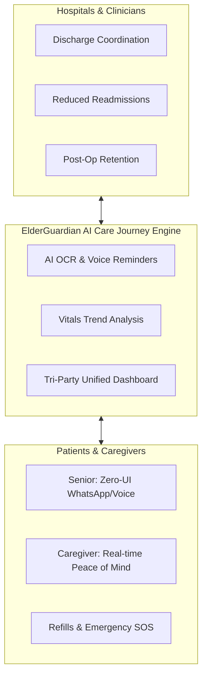
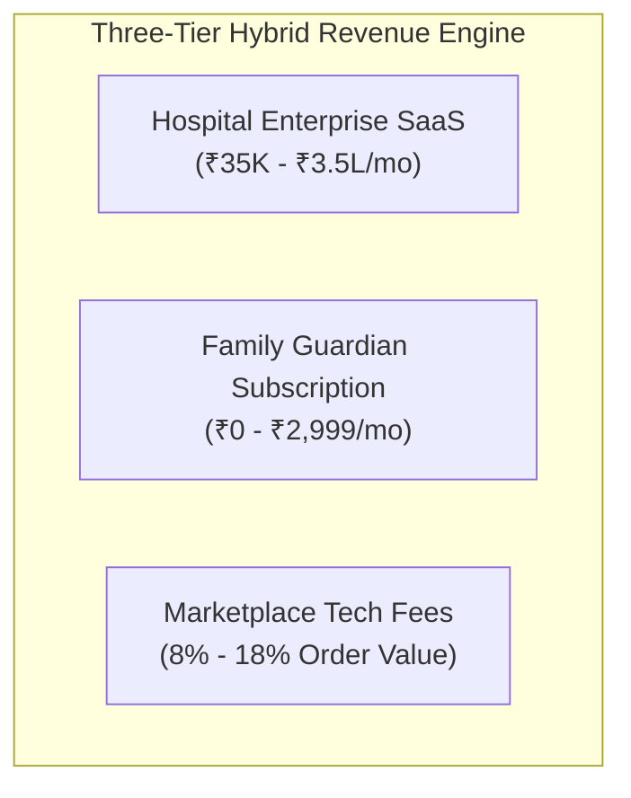
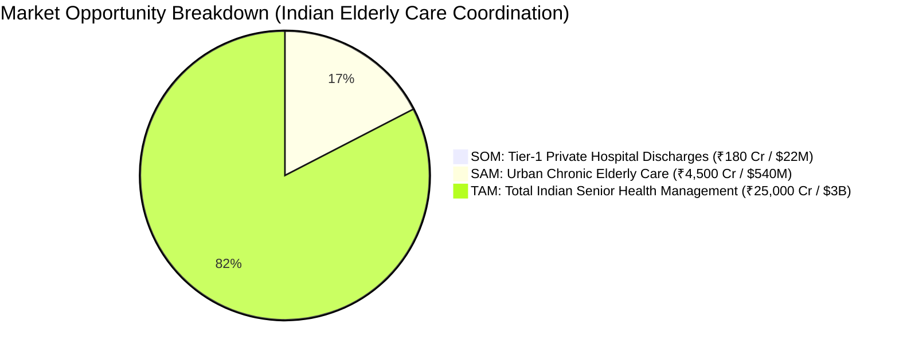
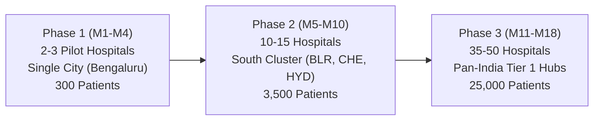
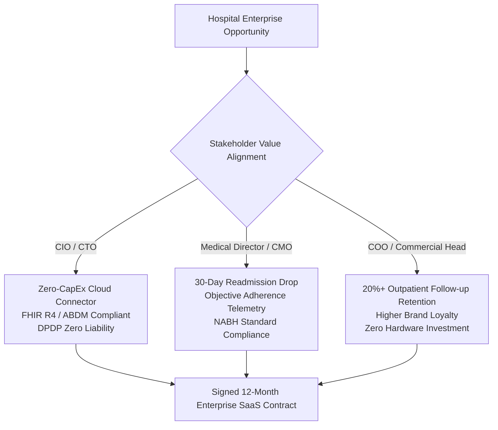
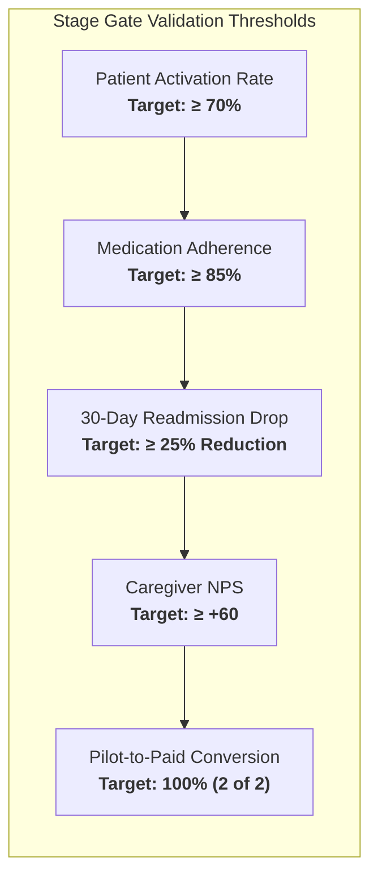
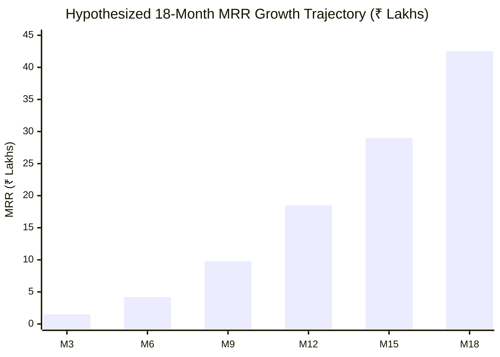
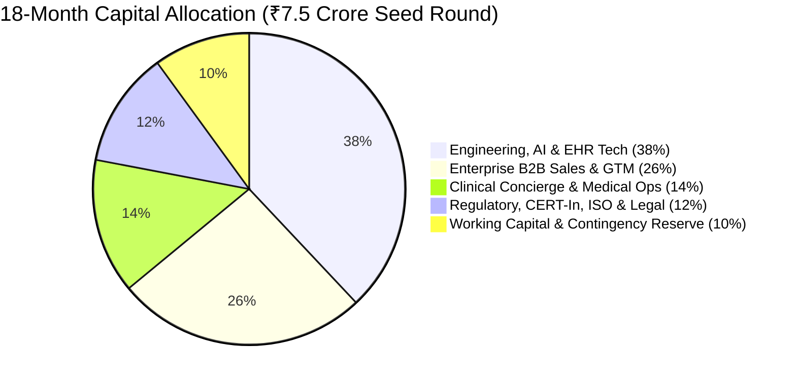

# ELDERGUARDIAN AI
## DOCUMENT 2: BUSINESS MODEL AND MARKET VALIDATION STRATEGY
**Market Focus:** India Senior Healthcare & Post-Discharge Chronic Care Coordination  
**Business Model:** Hybrid B2B2C Healthcare SaaS & Managed Care Coordination  
**Strategic Horizon:** 18-Month Launch, Clinical Pilot Validation & Regional Expansion  
**Disclaimer:** *ALL FINANCIAL PROJECTIONS, PRICING TIERS, CONVERSION RATES, AND MONETIZATION FIGURES CONTAINED HEREIN ARE STRATEGIC WORKING HYPOTHESES REQUIRING SYSTEMATIC EMPIRICAL VALIDATION THROUGH PILOTS AND USER INTERVIEWS.*

---

## EXECUTIVE SUMMARY

India is undergoing an unprecedented demographic transition. The country currently hosts over 140 million senior citizens (aged 60+), a cohort projected to double to 300+ million by 2050. Over 75% of Indian seniors suffer from one or more chronic conditions (hypertension, cardiovascular disease, diabetes, chronic respiratory diseases, or arthritis). 

Simultaneously, the traditional Indian joint family structure is rapidly dissolving due to urban migration and global career dispersal. Millions of adult children live in different metropolitan cities or abroad (Non-Resident Indians - NRIs), generating profound anxiety regarding their aging parents' daily health, medication adherence, and emergency response.

Current Indian healthcare solutions are highly fragmented into transactional point solutions (teleconsultation apps, e-pharmacy delivery, standalone diagnostic labs, or high-cost physical home care). **ElderGuardian AI** solves this through an AI-powered **Care Journey Engine** that establishes continuous, closed-loop coordination between the hospital clinical team, the elderly patient (via intuitive, zero-friction WhatsApp/Voice AI), and the distant adult caregiver.

---

## SECTION A: BUSINESS MODEL CANVAS



### 1. Value Propositions by Customer Segment

| Customer Segment | Core Pain Points | ElderGuardian AI Value Proposition |
| :--- | :--- | :--- |
| **Tertiary & Secondary Hospitals** | • High 30-day post-op readmission rates<br>• Zero visibility into patient adherence post-discharge<br>• Patient leakage to rival outpatient clinics<br>• NABH compliance burden for post-discharge follow-up | • **Reduced 30-Day Readmissions:** Proactive vital anomaly detection and medication tracking.<br>• **Outpatient Follow-Up Retention:** Automated booking of scheduled post-discharge follow-ups, increasing hospital outpatient LTV.<br>• **NABH Accreditation Ready:** Audit-ready digital records of patient post-discharge engagement.<br>• **Competitive Clinical Differentiation:** Modern branded digital care coordination. |
| **Elderly Patients (60+ Years)** | • Complex multi-drug regimens with confusing schedules<br>• Difficulty navigating modern touchscreen smartphone apps<br>• Fear of medical emergencies while living alone<br>• Fragmented paper prescriptions and lost diagnostic reports | • **Zero-UI WhatsApp & Voice AI:** No complex app to download; medication reminders delivered via voice calls or WhatsApp in regional languages (Hindi, Tamil, Telugu, etc.).<br>• **Simplified Medication Adherence:** Clear visual pill cards with vernacular audio instructions.<br>• **Emergency SOS Response:** One-touch emergency trigger alerting family caregivers, hospital desk, and ambulance services simultaneously.<br>• **Unified Digital Health Dossier:** All prescriptions and lab results auto-indexed and ABDM-linked. |
| **Distant Adult Caregivers (Metro/NRI)** | • Constant anxiety regarding parents' daily health<br>• Inability to verify if parents took medications correctly<br>• Friction in coordinating medicine refills and lab tests remotely<br>• Sudden surprise emergencies without prior clinical context | • **Real-Time Peace of Mind:** Instant daily WhatsApp notification confirming parents took morning/night doses.<br>• **Continuous Telemetry Visibility:** Live mobile dashboard tracking parents' blood pressure, blood glucose, and SpO2 trends.<br>• **Remote Care Management:** One-click automated medicine refill ordering and lab booking delivered directly to parents' doorstep.<br>• **Clinical Escalation Bridge:** Immediate alert when parent's vitals breach customized clinical thresholds. |
| **Physicians & Specialists** | • Time-consuming routine follow-up queries<br>• Lack of reliable longitudinal data during consultation<br>• Patient non-compliance sabotaging clinical outcomes | • **High-Fidelity Adherence Reports:** Objective, patient-verified adherence graphs presented during follow-up reviews.<br>• **Filtered Clinical Alerts:** Only clinically actionable anomalies escalated, avoiding alarm fatigue.<br>• **Enhanced Treatment Efficacy:** Drastic improvement in chronic condition stabilization. |
| **Pharmacy & Diagnostic Partners** | • High customer churn on chronic medication refills<br>• Escalating customer acquisition costs (CAC)<br>• Fragmented, illegible prescription uploads | • **High-Retention Chronic Refill Engine:** Predictable, automated 30-day prescription refills triggered 5 days before stock depletion.<br>• **Pre-Validated Digital Prescriptions:** Clean, digitized medication lists eliminating dispensing errors.<br>• **Zero-CAC Demand Generation:** High-intent chronic disease customer base. |

### 2. Revenue Streams (Hybrid B2B2C Model)
1. **B2B Hospital Enterprise SaaS (Annual Licenses):** Fixed monthly recurring subscription paid by hospitals for the clinical dashboard, EHR/HIS integration, and care coordination infrastructure.
2. **B2B2C / B2C Family Premium Subscription ("Family Guardian Pass"):** Tiered recurring monthly or annual subscription paid by adult caregivers (especially urban professionals and NRIs) for multi-caregiver access, AI vitals tracking, and concierge coordination.
3. **Marketplace Technology Facilitation Fees:** Legally compliant technology licensing and software service fees charged to partner retail pharmacies and diagnostic chains for processing prescription refills and home sample bookings (strictly decoupled from medical referrals to comply with NMC ethics).

### 3. Cost Structure
- **Cloud & Cybersecurity Infrastructure:** AWS India hosting (EKS, RDS, KMS), Cloudflare WAF, SIEM logging, object storage for medical documents.
- **AI & Communication API Consumption:** WhatsApp Business API messaging fees (Meta/Gupshup), Twilio/Exotel automated voice IVR telephony, LLM inference API costs for prescription OCR and extraction.
- **R&D and Engineering:** Full-stack developers, mobile engineers, data scientists, DevSecOps, and product management.
- **Clinical Operations & Care Concierge:** Salaried certified nurses and emergency care coordinators managing the 24/7 escalation desk.
- **Enterprise Sales & Account Management:** Senior enterprise healthcare sales executives interfacing with hospital C-suites (CIOs, Medical Directors, COOs).
- **Regulatory, Legal & Audit:** CERT-In empaneled VAPT audits, DPDP legal compliance counsel, ISO 27001 certification maintenance.

### 4. Key Partnerships Needed
- **Tertiary Healthcare Chains:** Fortis, Manipal Hospitals, Aster DM, Apollo regional units, Max Healthcare, and single-specialty cardiology/orthopedic hospitals.
- **Licensed Pharmacy Networks:** Large organized pharmacy retail networks (Apollo Pharmacy, MedPlus, Tata 1mg) and hospital in-house captive pharmacies.
- **Diagnostic Laboratory Networks:** Agilus Diagnostics (formerly SRL), Dr Lal PathLabs, Metropolis Healthcare, Thyrocare.
- **Senior Living & Geriatric Foundations:** Columbia Pacific Communities, Antara Senior Living, Ashiana Senior Living, Dignity Foundation, Nightingales Medical Trust.
- **National Health Infrastructure:** National Health Authority (NHA) ABDM bridging partners and authorized Health Repository Providers.

### 5. Distribution Channels
- **Hospital Discharge Onboarding (Primary Engine):** Discharge desk nurse activates patient/caregiver on ElderGuardian AI as part of the official discharge protocol.
- **Direct Enterprise B2B Sales:** High-touch enterprise sales targeting hospital CIOs, Medical Directors, and Chief Operating Officers.
- **Doctor Advocacy:** Specialist physicians (Cardiologists, Diabetologists, Geriatricians) recommending the platform on their outpatient prescription pads.
- **Digital B2C Acquisition:** Targeted digital marketing on LinkedIn, Google Search, and Meta aimed at metropolitan IT professionals and NRIs (US, UK, UAE, Canada, Singapore) searching for *"care for elderly parents in India"*.

---

## SECTION B: PRICING STRATEGY (HYPOTHESES — ALL NEED VALIDATION)

> [!IMPORTANT]
> **FINANCIAL HYPOTHESIS NOTICE**  
> All monetary values in Indian Rupees (₹) and US Dollars ($), user limits, and conversion rates outlined below represent strategic planning hypotheses. They must be validated during Phase 1 pilot interviews using the Van Westendorp Price Sensitivity Meter and Gabor-Granger pricing methodologies.



### 1. Hospital Enterprise SaaS Tiers (B2B)

| Plan Tier | Target Segment | Hypothesized Monthly Fee (₹ INR) | Included Active Monitored Patients | Core Features & Service Level Agreement (SLA) |
| :--- | :--- | :--- | :--- | :--- |
| **Starter Pilot** | Single-specialty clinics & nursing homes (30–75 beds) | **₹35,000 / month**<br>*(or ₹3.5 Lakhs / yr)* | Up to 150 active patients | • Automated WhatsApp discharge care plan reminders<br>• Basic web dashboard for care nurses<br>• Standard email support (48-hour SLA)<br>• Manual CSV export of patient adherence |
| **Professional** | Mid-sized private hospitals (100–300 beds) | **₹1,00,000 / month**<br>*(or ₹10 Lakhs / yr)* | Up to 750 active patients | • Bi-directional HIS/EHR HL7 integration<br>• AI prescription OCR parsing & digitizer<br>• Doctor-facing mobile clinical summary portal<br>• Automated 30-day readmission risk alerts<br>• Dedicated account manager (12-hour SLA) |
| **Enterprise Network** | Multi-chain corporate hospital networks (500+ beds) | **₹2,50,000 – ₹3,50,000 / month / hospital** | Up to 2,500 active patients per unit | • Full ABDM M1, M2, M3 integration gateway<br>• Custom white-labeled patient communication<br>• 24/7 human Care Concierge escalation desk<br>• Custom clinical protocol builder & analytics<br>• 99.9% uptime SLA with dedicated TAM |

### 2. Patient & Caregiver Subscription Model (B2C / B2B2C)

| Plan Tier | Monthly Price (₹) | Annual Price (₹) | Target User | Features Included |
| :--- | :--- | :--- | :--- | :--- |
| **Freemium (Basic)** | **₹0** (Free Forever) | **₹0** | Price-sensitive seniors; public hospital discharges | • Basic medication reminders via WhatsApp (up to 3 drugs)<br>• Emergency SOS button triggering SMS to 1 primary contact<br>• Digital locker for up to 10 prescription images |
| **Family Guardian (Core)** | **₹799 / month** | **₹7,999 / year** *(~₹666/mo)* | Metro-based working adult children (Dual-income households) | • Unlimited medication reminders via WhatsApp & Voice calls<br>• Multi-caregiver sync (up to 5 family members + NRI access)<br>• Smart vitals tracking with automated trend analysis<br>• Automated pharmacy refill coordination (1-click approval)<br>• Monthly comprehensive health stability report |
| **Guardian Concierge (Premium)** | **₹2,499 / month** | **₹24,999 / year** *(~₹2,083/mo)* | High-net-worth NRIs & busy executive children | • Everything in Family Guardian, plus:<br>• **Dedicated Human Care Coordinator:** Weekly check-in call with parents<br>• Priority doctor teleconsultation bookings<br>• At-home emergency ambulance dispatch coordination<br>• Direct priority coordination with treating hospital |

### 3. Pharmacy & Diagnostic Technology Enablement Fees

| Partner Category | Commercial Model | Hypothesized Fee Structure | Compliance Guardrail |
| :--- | :--- | :--- | :--- |
| **Retail Pharmacy Partners** | Technology Software Integration Fee | **8% – 10%** of gross prescription order value | Structured as software platform technology facilitation fee. Completely decoupled from clinical drug selection or physician advice to comply with NMC Ethics Regulations. |
| **Diagnostic Laboratory Chains** | Digital Marketplace Facilitation Fee | **15% – 18%** of home collection test booking value | Standard digital platform enabler fee for sample collection logistics and digital report delivery software. |

---

## SECTION C: MARKET ANALYSIS (INDIAN HEALTHCARE LANDSCAPE)

### 1. Market Sizing: TAM, SAM, SOM



1. **Total Addressable Market (TAM): ₹25,000+ Crore ($3.0+ Billion USD)**
   - *Basis:* 140 million senior citizens in India. 75% suffer from chronic disease = 105 million seniors. Assuming an annual digital health, monitoring, and adherence coordination spend of ₹2,400/year ($29) across public and private segments.
2. **Serviceable Addressable Market (SAM): ₹4,500 Crore ($540 Million USD)**
   - *Basis:* Top 30 urban cities in India. Approximately 15 million seniors residing in middle-to-high income households (annual household income > ₹8 Lakhs). These families have smartphone-enabled adult children with high willingness to pay for senior wellness.
3. **Serviceable Obtainable Market (SOM): ₹180 Crore ($22 Million USD)**
   - *Basis:* 3-year target. Partnering with 50 leading private hospital facilities across 6 key metropolitan hubs (Bengaluru, Delhi-NCR, Mumbai, Hyderabad, Chennai, Pune), capturing 75,000 active paying family caregiver subscriptions and 150,000 pharmacy refill users.

### 2. Competitive Landscape Matrix

| Competitor Category | Key Players | Strengths | Critical Weaknesses & Blind Spots | ElderGuardian AI Advantage |
| :--- | :--- | :--- | :--- | :--- |
| **Healthcare Aggregators** | **Practo, MediBuddy, mfine** | • Mass brand awareness<br>• Huge doctor listing directory<br>• High teleconsult volume | • **Transactional focus:** Purely episodic booking engines; zero post-consult care journey.<br>• No hospital discharge integration.<br>• Unfriendly UI for elderly seniors. | • **Continuous Care Journey:** Stays active 365 days between doctor visits.<br>• Deep EHR integration with treating hospital.<br>• Built for seniors (Voice/WhatsApp). |
| **E-Pharmacies & Diagnostics** | **Tata 1mg, PharmEasy, Healthians** | • Massive supply chain<br>• Discount pricing power<br>• Deep consumer reach | • E-commerce delivery mentality.<br>• Lack clinical context and doctor alignment.<br>• Cannot track if patient actually swallowed the pill. | • **Closed-Loop Adherence:** Links prescription ingest $\rightarrow$ daily pill reminder $\rightarrow$ adherence verification $\rightarrow$ refill trigger. |
| **Pure-Play Senior Care Agencies** | **Portea Medical, Emoha, Samarth Care** | • High-touch physical presence<br>• Attendant & nursing supply<br>• Community events | • **Extremely high cost** (₹15,000–₹40,000/mo), limiting addressable market to elite top 1%.<br>• Highly labor-intensive, human-heavy, almost impossible to scale rapidly across cities. | • **Scalable Tech-First Model:** 10x lower price point (₹799/mo), enabling mass middle-class and NRI adoption without heavy physical nursing overhead. |
| **Hospital Proprietary Apps** | **Apollo 24\|7, Max MyHealth** | • Captive patient base<br>• Direct brand trust | • Siloed to a single hospital brand.<br>• High abandonment rate after discharge.<br>• Overly complex apps with poor senior usability. | • **Zero-UI Accessibility:** Eliminates app store download hurdles via automated WhatsApp/Voice channels. |

### 3. Core Differentiation: Care Journey Engine vs. Point Solutions

```
Point Solutions (Practo, 1mg, Portea):
[Doctor Booking] ---- (Disconnected Void) ----> [Pharmacy App] ---- (Forgotten Voids) ----> [Emergency]

ElderGuardian AI (Care Journey Engine):
[Hospital Discharge] 
       │
       ▼ (Seamless Automated Loop)
[Daily Zero-UI Medication & Vitals Check via WhatsApp/Voice] 
       │
       ├─► [Caregiver Real-time Synced Dashboard]
       ├─► [Predictive Refill to Partner Pharmacy (Day 25)]
       └─► [Anomaly Detection Alert to Treating Hospital Doctor]
       │
       ▼ (Closed Loop)
[Scheduled Follow-Up Outpatient Retention at Treating Hospital]
```

---

## SECTION C (Cont.): MARKET ENTRY STRATEGY

ElderGuardian AI enters the market via a targeted **B2B2C Beachhead Strategy**:
1. **The Beachhead: Hospital Discharge Desk in High-Readmission Specialties:** Focus exclusively on **Interventional Cardiology** (post-angioplasty / bypass recovery) and **Orthopedics** (post-knee/hip replacement). These specialties have:
   - High post-discharge anxiety among families.
   - Strict medical compliance requirements (blood thinners, cardiac statins, physical therapy).
   - High financial incentive for hospitals to avoid 30-day surgical site infections or acute readmissions.
2. **Frictionless Patient Onboarding:** At discharge, the hospital care coordinator enters the patient’s mobile number and snaps a picture of the discharge summary. ElderGuardian AI’s OCR automatically extracts the regimen and initiates the first WhatsApp welcome message before the patient arrives home.
3. **Caregiver Viral Expansion:** The onboarded patient adds their primary family caregiver (e.g., NRI son or working daughter), who receives real-time updates and subsequently upgrades to the paid *Family Guardian* plan to access historical analytics and priority features.

---

## SECTION D: GO-TO-MARKET (GTM) EXECUTION PLAN



### Phase 1: Hyper-Local Hospital Pilots (Months 1 to 4)
- **Geography:** Bengaluru (India's tech and healthcare capital, high density of forward-thinking private hospitals and tech-savvy NRI families).
- **Target Partners:** 2 to 3 progressive private hospitals (e.g., mid-sized cardiac and orthopedic centers with 100–250 beds).
- **Cohort Size:** 300 total post-discharge elderly patients enrolled across Cardiology and Orthopedics.
- **Core Milestone:** Prove clinical engagement ($\ge 70\%$ 30-day active WhatsApp response rate) and demonstrate zero hospital IT integration friction.

### Phase 2: Regional Cluster Expansion (Months 5 to 10)
- **Geography:** Southern Metropolitan Cluster (Bengaluru, Chennai, Hyderabad).
- **Target Partners:** Expand to 10–15 hospitals, including regional units of corporate hospital chains.
- **Commercialization:** Transition pilot hospitals to paid B2B enterprise SaaS subscriptions. Activate integrated chronic pharmacy refill partnerships with regional pharmacy chains.
- **Digital Marketing:** Launch targeted digital campaigns aimed at NRI adult children in the US, UK, and Middle East.

### Phase 3: Pan-India Multi-City Expansion (Months 11 to 18)
- **Geography:** Expansion into Delhi-NCR, Mumbai, Pune, and Kolkata.
- **Target Partners:** 35 to 50 hospital enterprise contracts; deep ABDM M3 nationwide integration.
- **Channel Flywheel:** Enterprise hospital discharge desk referrals feeding high-margin B2C Family Guardian subscriptions at near-zero organic customer acquisition cost (CAC).

### Enterprise B2B Sales Approach: Selling to Hospital C-Suite



- **Chief Information Officer (CIO) Pitch:** "ElderGuardian AI requires zero on-premise hardware. Our lightweight HL7/FHIR cloud connector deploys in 48 hours without disrupting your existing HIS/EHR. We are CERT-In audited and assume full technical liability for DPDP 2023 data compliance."
- **Chief Medical Officer (CMO) Pitch:** "Eliminate post-discharge blind spots. Your clinical team gets an automated dashboard highlighting which post-stent patients stopped their antiplatelet drugs, directly preventing preventable readmissions and mortality."
- **Chief Operating Officer (COO) Pitch:** "Turn one-off inpatient discharges into lifelong hospital relationships. By automating post-discharge check-ins, we drive a verified 20% to 25% increase in timely outpatient follow-up consultation bookings back to your hospital's specialist OPDs."

---

## SECTION E: MARKET VALIDATION PLAN

### 1. Customer Discovery Interview Blueprint

| Stakeholder Group | Sample Target Size | Core Hypotheses to Test | Critical Discovery Questions |
| :--- | :--- | :--- | :--- |
| **Hospital Administrators (CIOs/COOs)** | 30 executives | • Hospitals consider post-discharge leakage a major financial loss.<br>• Willingness to pay ₹1,00,000/mo for readmission reduction software. | 1. "What percentage of surgical patients return to your hospital for their scheduled 30-day follow-up?"<br>2. "What are your primary operational hurdles during NABH patient follow-up audits?"<br>3. "How do you currently track if a discharged cardiac patient is taking their prescribed medication?" |
| **Treating Physicians (Cardiologists/Geriatricians)** | 40 specialists | • Doctors lack time for routine phone follow-ups but value structured compliance summaries.<br>• Willingness to recommend the platform at discharge. | 1. "How do you know if a patient who misses an appointment stopped their medication?"<br>2. "Would an objective adherence report change your clinical decision-making during follow-up reviews?"<br>3. "What concerns do you have regarding AI-assisted medication reminders?" |
| **Elderly Patients (65+ Years)** | 50 seniors | • Seniors struggle with mobile app navigation but actively use WhatsApp and answer phone calls.<br>• Visual pill cards reduce medication errors. | 1. "Can you show me how you remember which pill to take at night?"<br>2. "Do you find typing or navigating new phone apps frustrating?"<br>3. "Would you prefer a friendly voice call or a WhatsApp message reminding you to take your medicine?" |
| **Adult Caregivers (Local & NRI Children)** | 50 adult children | • High anxiety regarding parents' health when living apart.<br>• Strong willingness to pay ₹799–₹1,499/mo for automated peace of mind. | 1. "How often do you call your parents specifically to ask if they took their medicine or checked their BP?"<br>2. "What was the most stressful medical emergency you faced with your parents while living away?"<br>3. "What would it be worth to you to receive an instant alert only if your mother’s blood pressure exceeds dangerous levels?" |

### 2. Pilot Program Design (3-Month Hospital Clinical Trial)
- **Partner Sites:** 2 private tertiary hospitals in Bengaluru (Hospital A: 200 beds, multi-specialty; Hospital B: 150 beds, cardiac-specialty).
- **Target Cohort:** 150 consecutive post-discharge patients aged 60+ per hospital (Total Cohort: 300 patients) discharged with $\ge 3$ daily chronic medications.
- **Trial Structure (A/B Intervention Design):**
  - **Intervention Group (n = 150):** Onboarded to ElderGuardian AI at discharge desk (WhatsApp medication reminders, caregiver sync, AI vitals monitoring).
  - **Control Group (n = 150):** Standard hospital discharge protocol (paper discharge summary, standard manual phone call at Day 7).

### 3. Key Validation Metrics & Success Thresholds



1. **Patient & Caregiver Activation Rate:** Target $\ge 70\%$ of discharged seniors or their linked caregivers active on the platform on Day 7 post-discharge.
2. **Medication Adherence Rate:** Target $\ge 85\%$ verified daily medication logging in the intervention cohort (compared to estimated historical baseline of 45%–55%).
3. **30-Day Hospital Readmission Rate:** Target a statistically significant **25% to 35% relative reduction** in unplanned 30-day emergency readmissions in the intervention cohort compared to the control group.
4. **Outpatient Follow-Up Visit Retention:** Target $\ge 65\%$ attendance for scheduled 30-day OPD follow-up visits (vs. $\sim 40\%$ baseline in control group).
5. **Caregiver Net Promoter Score (NPS):** Target NPS score of **$\ge +60$** among adult family caregivers.
6. **Commercial Pilot-to-Paid Conversion:** Conversion of both pilot hospitals into multi-year commercial B2B SaaS contracts at minimum ₹75,000/month.

### 4. Pricing Validation Methodology
- **Van Westendorp Price Sensitivity Meter (PSM):** Administer 4 standard survey questions to 100 surveyed adult caregivers to map the four price curves:
  1. *At what price does this service feel so cheap that you would question its clinical quality? (Too Cheap)*
  2. *At what price does it feel like a bargain / good value? (Cheap / Great Value)*
  3. *At what price does it start feeling expensive, but you would still consider buying it? (Expensive)*
  4. *At what price is it simply too expensive to consider? (Too Expensive)*
  - *Hypothesized Optimal Price Point (OPP):* **₹799 / month**. Point of Marginal Cheapness: ₹399/mo; Point of Marginal Expensiveness: ₹1,499/mo.
- **Gabor-Granger Enterprise Pricing Testing:** Present hospital CIOs and COOs with descending enterprise price tiers (₹2.5 Lakhs/mo $\rightarrow$ ₹1.5 Lakhs/mo $\rightarrow$ ₹1 Lakh/mo $\rightarrow$ ₹50,000/mo) tied to bed capacity and patient volume to isolate the enterprise willingness-to-pay plateau.

---

## SECTION F: FINANCIAL PROJECTIONS FRAMEWORK (HYPOTHETICAL MODEL)

> [!NOTE]
> **ALL PROJECTIONS ARE WORKING HYPOTHESES REQUIRING POST-PILOT CALIBRATION.**

### 1. Unit Economics Model

#### A. B2B Hospital SaaS Unit Economics
- **Hypothesized Annual Contract Value (ACV):** ₹12,00,000 / hospital / year ($14,500 USD).
- **Enterprise Customer Acquisition Cost (CAC):** ₹3,00,000 ($3,600 USD) (including enterprise sales commissions, travel, technical integration support).
- **Direct Variable Hosting & Customer Success Cost:** ₹1,20,000 / hospital / year.
- **Gross Margin (B2B SaaS):** **$\sim 90\%$**.
- **Customer Lifetime (Assumed):** 4 Years (48 Months) due to high switching costs post-HIS integration.
- **Customer Lifetime Value (LTV):** ₹12,00,000 $\times$ 90% $\times$ 4 = **₹43,20,000** ($52,000 USD).
- **LTV-to-CAC Ratio:** **$14.4 : 1$** (Healthy SaaS target is $>3:1$).
- **CAC Payback Period:** **3.0 Months**.

#### B. B2B2C / B2C Caregiver Subscription Unit Economics
- **Blended Monthly ARPU (Average Revenue Per User):** **₹899 / month** ($10.80 USD).
- **Blended CAC:**
  - *Via Hospital Discharge Onboarding (80% of volume):* **₹150** (Nurse incentive + printed collateral).
  - *Via Direct Digital Performance Marketing (20% of volume):* **₹1,600**.
  - *Blended Weighted Average CAC:* **₹440**.
- **Direct Variable Cost per Active Patient per Month:**
  - WhatsApp Business API conversations: ₹35
  - Automated Voice Calls (IVR Telephony): ₹25
  - AWS Cloud Hosting, KMS & Database: ₹15
  - AI OCR & LLM Extraction API: ₹10
  - *Total Monthly COGS per Active User:* **₹85 / month**.
- **Monthly Gross Profit per Subscriber:** ₹899 $-$ ₹85 = **₹814 / month** (**$90.5\%$ Gross Margin**).
- **Average Subscription Duration (Assumed):** 16 Months (Chronic disease nature ensures high stickiness).
- **B2C Customer Lifetime Value (LTV):** ₹814 $\times$ 16 = **₹13,024** ($157 USD).
- **LTV-to-CAC Ratio:** **$29.6 : 1$** (driven by the low-cost hospital discharge desk acquisition channel).
- **CAC Payback Period:** **$< 1.0 Month$**.

### 2. 18-Month Financial Forecast & Milestone Targets



| Metric / Milestone | Month 3 (MVP Exit) | Month 6 (Pilots Done) | Month 9 (Regional) | Month 12 (Scale) | Month 18 (Series A Target) |
| :--- | :--- | :--- | :--- | :--- | :--- |
| **Partner Hospitals (Active B2B)** | 2 (Pilots) | 4 (Paid) | 10 | 18 | **35** |
| **Active Monitored Patients** | 300 | 1,200 | 4,000 | 9,500 | **25,000** |
| **Paying Caregiver Subscribers** | 45 | 240 | 1,000 | 2,850 | **8,750** |
| **Monthly B2B SaaS Revenue** | ₹70,000 | ₹3,50,000 | ₹9,00,000 | ₹16,00,000 | **₹31,50,000** |
| **Monthly B2C Subscription Rev** | ₹36,000 | ₹1,90,000 | ₹8,00,000 | ₹22,80,000 | **₹70,00,000** |
| **Monthly Pharmacy Tech Fees** | ₹15,000 | ₹60,000 | ₹2,50,000 | ₹6,00,000 | **₹18,50,000** |
| **Total Monthly Run-Rate (MRR)** | **₹1,21,000** | **₹6,00,000** | **₹19,50,000** | **₹44,80,000** | **₹1,20,00,000** *(₹1.2 Cr)* |
| **Annualized Run-Rate (ARR)** | ₹14.5 Lakhs | ₹72 Lakhs | ₹2.34 Cr | ₹5.37 Cr | **₹14.40 Cr** *($1.75M USD)* |

### 3. Break-Even Analysis Framework
- **Fixed Monthly Operating Burn Rate (At Month 12):**
  - Engineering & Product Team (8 Engineers, 1 PM, 1 Designer): ₹14,00,000
  - Clinical Care Concierge Team (6 Nurses, 1 Supervisor): ₹3,50,000
  - Enterprise Sales & Field Ops (3 Enterprise Reps): ₹5,50,000
  - Office, Cloud Security, Legal, Compliance & Admin: ₹4,00,000
  - *Total Monthly Fixed Burn:* **₹27,00,000 / month**.
- **Contribution Margin:** $\sim 85\%$ across blended revenue streams.
- **Monthly Revenue Needed to Break Even:** $\frac{₹27,00,000}{0.85} =$ **₹31,76,000 / month**.
- **Break-Even Operational Milestone:** Achievable when the platform maintains:
  - **14 Enterprise Hospitals** (generating ₹12.5 Lakhs MRR) +
  - **2,500 Paying Family Guardian Subscribers** (generating ₹20.0 Lakhs MRR).
- **Target Break-Even Timeline:** **Month 13 to Month 14 post-launch**.

### 4. 18-Month Funding Requirements (Seed / Pre-Series A Round)
- **Target Capital Raise:** **₹7.5 Crore INR ($900,000 USD)**.
- **Runway Provided:** **18 Months** (taking the company past operational break-even and cash-flow positive status).



- **Use of Proceeds Breakdown:**
  1. **Engineering, AI Engine & EHR Integrations (38% — ₹2.85 Cr):** Hiring core backend, mobile, and machine learning engineers; building proprietary vernacular OCR models and FHIR/ABDM connectors.
  2. **Enterprise B2B Sales & Hospital Onboarding (26% — ₹1.95 Cr):** Enterprise healthcare sales leaders, field relationship managers stationed at pilot hospital discharge desks.
  3. **Clinical Operations & 24/7 Care Concierge (14% — ₹1.05 Cr):** Certified nursing staff for triage, emergency escalation desk operations.
  4. **Regulatory, Security Audits, Certifications & Legal (12% — ₹0.90 Cr):** CERT-In external VAPT, ISO 27001/27701 audits, SOC 2 Type II attestation, and DPDP legal compliance retained counsel.
  5. **Contingency Reserve & Working Capital (10% — ₹0.75 Cr):** Cash buffer for enterprise payment delays (standard 60–90 day hospital payment cycles in India).

---

## SECTION G: RISK MATRIX AND MITIGATION STRATEGIES

| Risk Domain | Specific Threat / Vulnerability | Severity | Likelihood | Strategic & Operational Mitigation Plan |
| :--- | :--- | :--- | :--- | :--- |
| **1. Regulatory & Privacy Risk** | Penalties under DPDP Act 2023 (up to ₹250 Cr for catastrophic data breaches); changes in draft e-pharmacy regulations. | **Critical** | Low | • Proactive appointment of an independent Data Protection Officer (DPO).<br>• 100% Indian sovereign cloud data residency (AWS Mumbai/Hyderabad).<br>• Annual independent CERT-In empanelled audits.<br>• Intermediary legal structure under IT Act Section 79 decoupled from drug dispensing. |
| **2. Hospital Adoption & Sales Friction** | Long procurement cycles (6–9 months), legacy HIS IT inertia, clinical resistance from busy doctors. | **High** | High | • Standardized "Zero-CapEx" 3-month pilot structure requiring zero hospital budget approval.<br>• Cloud-based HL7/FHIR lightweight wrapper that does not require modifying legacy HIS codebases.<br>• High-yield doctor summaries that reduce routine telephone interruptions. |
| **3. Patient & Caregiver Adoption Risk** | Low digital literacy among seniors over 70; mobile app fatigue; unread notifications; abandonment of complicated interfaces. | **High** | Medium | • **Absolute "Zero-UI" Paradigm:** All interactions delivered through conversational WhatsApp messages and automated vernacular voice IVR calls.<br>• Dual onboarding: Adult caregiver activated simultaneously to supervise and assist senior onboarding.<br>• Visual pill icons with high-contrast color coding. |
| **4. Competitive Aggression** | Major platforms (Tata 1mg, Practo, Apollo 24\|7) copying features or launching similar post-discharge modules. | **Medium** | High | • Focus on deep, locked-in enterprise hospital workflow integrations that are painful to rip and replace.<br>• Superior proprietary clinical care journey engine specialized exclusively in eldercare rather than generic booking aggregators.<br>• High switching costs through long-term longitudinal family health record retention. |
| **5. Technical & AI Accuracy Risk** | Prescription OCR parsing errors (misreading drug dosages, e.g., 5mg vs 50mg); LLM hallucination of clinical suggestions. | **Critical** | Medium | • **Strict Human-in-the-Loop (HITL) Architecture:** No extracted prescription schedule is activated automatically without explicit visual confirmation by the treating doctor, discharge nurse, or primary caregiver.<br>• Multi-engine OCR validation (AWS Textract + Google Cloud Vision + proprietary medical spelling fuzzy matcher).<br>• Persistent medical disclaimers and hardcoded algorithmic dosage bounds checking. |

---
*End of Document 2.*
