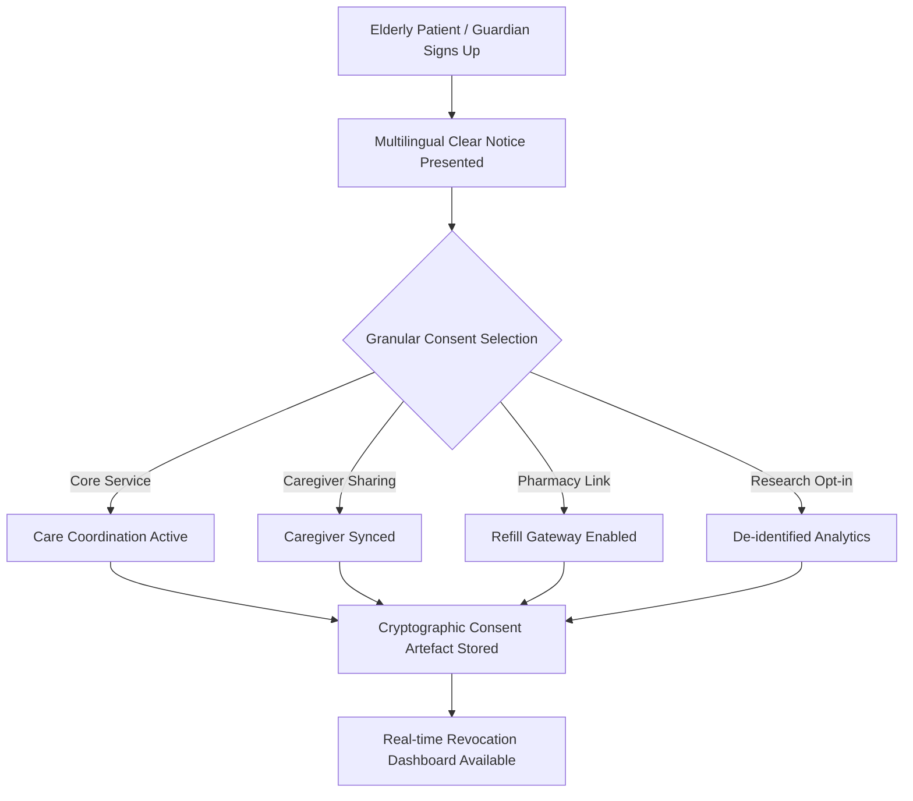
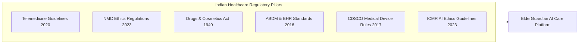
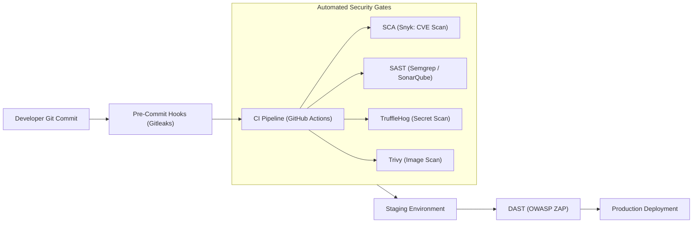
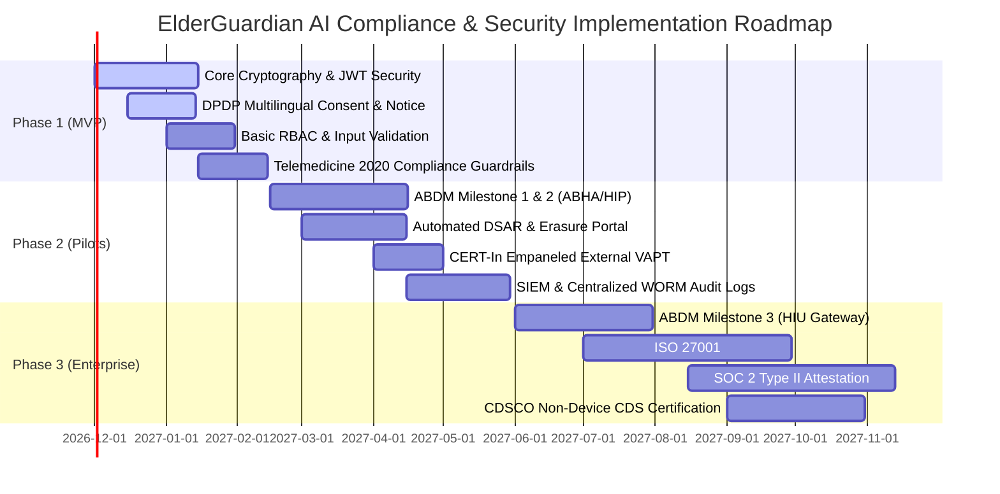

# ELDERGUARDIAN AI
## DOCUMENT 1: SECURITY, PRIVACY AND COMPLIANCE MASTER BLUEPRINT
**Target Market:** India Healthcare Ecosystem (Hospitals, Clinics, Senior Citizens, Caregivers, Pharmacies)  
**Classification:** Confidential — Internal Architecture & Regulatory Governance  
**Applicable Jurisdictions:** Digital Personal Data Protection Act (DPDP) 2023, National Medical Commission (NMC) Act 2019, Telemedicine Practice Guidelines 2020, Drugs and Cosmetics Act 1940 & Rules 1945, Information Technology Act 2000 & CERT-In Directions 2022, Ayushman Bharat Digital Mission (ABDM) Standards.

---

## EXECUTIVE SUMMARY

ElderGuardian AI is a digital health coordination platform engineered to manage chronic care journeys for elderly citizens across India. By bridging hospital clinical teams, elderly patients, and distant family caregivers, the system ingests, processes, and transmits highly sensitive Personal Health Information (PHI) and Personally Identifiable Information (PII). 

This document defines the comprehensive security architecture, statutory Indian privacy controls, medical regulatory compliance guardrails, DevSecOps framework, and phased execution roadmap to ensure full legal defensibility, high clinical reliability, and enterprise-grade cyber resilience.

---

## SECTION A: COMPREHENSIVE DATA SECURITY CHECKLIST (36 CONTROLS)

```
[✓] = Mandated Standard   [ ] = Implementation Verification Check
```

### 1. Cryptographic Security & Encryption
- [ ] **SEC-01: Encryption at Rest (Database):** All relational databases (PostgreSQL/AWS RDS) configured with AES-256 transparent data encryption (TDE). All storage volumes, automated snapshots, read replicas, and transaction write-ahead logs (WAL) encrypted at rest.
- [ ] **SEC-02: Column-Level Field Encryption for PHI:** Critical sensitive fields (Aadhaar number token, ABHA ID, clinical diagnoses, psychological assessments, biometric vitals) encrypted at the application layer using AES-256-GCM before database insertion.
- [ ] **SEC-03: Object Storage Encryption (Prescriptions & Reports):** S3 / Cloud Object Storage buckets storing prescription images, diagnostic PDFs, and lab reports enforced with Server-Side Encryption using AWS KMS Customer Managed Keys (SSE-KMS) with annual automatic key rotation.
- [ ] **SEC-04: Encryption in Transit (External Network):** Enforce TLS 1.3 (TLS 1.2 minimum fallback) across all ingress load balancers, APIs, and microservice endpoints. Deprecate legacy TLS 1.0/1.1 and insecure ciphers (CBC mode, RC4, 3DES).
- [ ] **SEC-05: Strict HSTS Configuration:** HTTP Strict Transport Security (HSTS) headers enforced across all domains: `Strict-Transport-Security: max-age=63072000; includeSubDomains; preload`.
- [ ] **SEC-06: Envelope Encryption & KMS Architecture:** Implementation of an envelope encryption scheme where a unique Data Encryption Key (DEK) encrypts individual medical records, and DEKs are wrapped using an asymmetric Key Encryption Key (KEK) governed by a dedicated Hardware Security Module (AWS CloudHSM or GCP Cloud KMS).
- [ ] **SEC-07: Key Management Separation of Duties:** Distinct cryptographic separation between operational database administrators (DBAs) and security personnel holding KMS key decryption IAM policies. Zero plaintext key exposure in source code or memory dumps.

### 2. Authentication & Credential Management
- [ ] **SEC-08: JWT Token Lifecycle & Rotation:** Short-lived JSON Web Tokens (Access Token TTL: 15 minutes) coupled with sliding-window Refresh Tokens (TTL: 7 days). Immediate token family invalidation upon detection of reused refresh tokens.
- [ ] **SEC-09: Secure Token Storage:** Client-side JWTs stored exclusively in `HttpOnly`, `Secure`, `SameSite=Strict` browser cookies to eliminate XSS-based token exfiltration. Mobile tokens stored in Android Keystore / iOS Keychain.
- [ ] **SEC-10: State-of-the-Art Password Hashing:** User passwords hashed using Argon2id (parameters: `m=65536` [64 MiB], `t=3`, `p=4`) or bcrypt with a minimum work factor of 12, salted per user using a cryptographically secure pseudo-random number generator (CSPRNG).
- [ ] **SEC-11: Multi-Factor Authentication (MFA):** Mandatory MFA for all clinical users (doctors, hospital nurses, care coordinators) and optional biometric/WhatsApp OTP MFA for family caregivers. Enforce hardware TOTP (RFC 6238) or secure WhatsApp/SMS OTP with anti-replay salts.
- [ ] **SEC-12: Brute-Force & Credential Stuffing Defense:** Progressive rate limiting and account lockout after 5 consecutive failed login attempts (15-minute progressive lockout, CAPTCHA challenge, and automated alert to registered mobile/email).
- [ ] **SEC-13: Session Revocation & Timeout:** Automatic idle session termination after 15 minutes of inactivity on hospital clinician portals. Global session revocation endpoint enabling users to invalidate all active sessions across devices upon suspected account compromise.

### 3. Authorization & Access Control
- [ ] **SEC-14: Role-Based & Attribute-Based Access Control (RBAC/ABAC):** Strict enforcement of least-privilege matrix defining distinct scopes: `SUPER_ADMIN`, `HOSPITAL_ADMIN`, `DOCTOR`, `CARE_COORDINATOR`, `PRIMARY_CAREGIVER`, `SECONDARY_CAREGIVER`, `ELDERLY_PATIENT`.
- [ ] **SEC-15: Contextual Relationship Verification:** Application-layer middleware verifying dynamic patient-caregiver-hospital linkage before returning any PHI payload. A caregiver can only query records of linked elderly family members who granted active consent.
- [ ] **SEC-16: Emergency "Break-Glass" Access Protocol:** Explicit override procedure allowing accredited emergency room doctors to access an incapacitated elder's acute allergy and medication history, immediately triggering an emergency SMS/Push audit notification to the primary caregiver and generating a tamper-proof incident log.
- [ ] **SEC-17: API Perimeter Authorization:** Microservices communicate using mutual TLS (mTLS) and cryptographically signed service-to-service service accounts with fine-grained OAuth2 scopes (zero implicit trust across internal microservice boundaries).

### 4. API, Network & Perimeter Defense
- [ ] **SEC-18: Multi-Tier API Rate Limiting:** Enforce token-bucket rate limiting via API Gateway / Redis:
  - Public authentication / OTP endpoints: 5 requests / minute / IP.
  - Authenticated API endpoints: 60 requests / minute / user.
  - Prescription OCR upload endpoints: 10 requests / minute / user.
- [ ] **SEC-19: Strict Cross-Origin Resource Sharing (CORS):** Explicitly whitelisted trusted origins on all API responses. Absolute rejection of wildcard `*` headers when `Access-Control-Allow-Credentials: true` is set.
- [ ] **SEC-20: Hardened HTTP Security Headers:** Helmet.js enforcement across all web servers:
  ```http
  Content-Security-Policy: default-src 'self'; script-src 'self'; object-src 'none'; frame-ancestors 'none';
  X-Content-Type-Options: nosniff
  X-Frame-Options: DENY
  Referrer-Policy: strict-origin-when-cross-origin
  Permissions-Policy: camera=(), microphone=(), geolocation=()
  ```
- [ ] **SEC-21: Web Application Firewall (WAF) & DDoS Mitigation:** Ingress traffic routed through Cloudflare / AWS WAF with rulesets inspecting OWASP Top 10 vulnerabilities, blocking bad bots, rate-limiting HTTP floods, and inspecting URI payloads for path traversal and SQLi patterns.
- [ ] **SEC-22: Isolated VPC & Network Segmentation:** Multi-tier AWS VPC architecture with public subnets containing only Load Balancers, private subnets containing Container Workloads (EKS/ECS), and isolated non-routable subnets hosting PostgreSQL and Redis instances with zero outbound public internet egress.

### 5. Input Validation, Sanitization & Application Security
- [ ] **SEC-23: Strict Schema Validation:** Enforce runtime schema validation (Zod / Joi / Pydantic) on 100% of incoming JSON request bodies, query parameters, and headers before business logic execution. Reject unrecognized fields automatically (`stripUnknown: false, abortEarly: true`).
- [ ] **SEC-24: SQL & NoSQL Injection Prevention:** 100% database access executed via parameterized queries and mature ORMs (Prisma / TypeORM / SQLAlchemy). Complete prohibition of raw dynamic string interpolation in SQL queries.
- [ ] **SEC-25: Stored & Reflected XSS Defenses:** Automated contextual output encoding on client rendering layers. Strict HTML sanitization via DOMPurify on any physician clinical note or user-entered medication comment before rendering.
- [ ] **SEC-26: Safe Deserialization & Prototype Pollution Guards:** Disable insecure object serialization formats; sanitize object prototypes via recursive object traversal freeze and JSON schema parsing defenses.

### 6. Medical File Upload & Document Security
- [ ] **SEC-27: Magic Byte MIME-Type Verification:** Inspect binary magic bytes (first 512 bytes) of uploaded prescription images to guarantee genuine file types (JPEG, PNG, PDF, HEIC). Immediate rejection of disguised `.exe`, `.sh`, `.php`, or `.svg` payloads.
- [ ] **SEC-28: File Size & Dimensionality Quotas:** Strict file upload limit capped at 10 MB per document; image decompression bombs prevented via canvas resolution bounding checks.
- [ ] **SEC-29: Antivirus & Anti-Malware Ingestion Pipeline:** Uploaded documents written to an isolated quarantine bucket, processed asynchronously by ClamAV / AWS GuardDuty Malware Protection, and moved to the production bucket only upon a clean scan verdict.
- [ ] **SEC-30: EXIF & Geolocation Metadata Stripping:** Automated stripping of EXIF tags (camera serial numbers, GPS latitude/longitude, device hardware identifiers) from prescription photographs before storage to eliminate accidental privacy leakage.
- [ ] **SEC-31: Pre-Signed Time-Limited Document URLs:** Direct public access to S3 buckets disabled. Prescriptions and lab reports served strictly through short-lived cryptographic pre-signed URLs (maximum expiration: 5 minutes) issued only after session authorization validation.

### 7. Audit Logging, Telemetry & Non-Repudiation
- [ ] **SEC-32: Immutable PHI Access Logging:** Tamper-evident logging of every Create, Read, Update, Delete, Export, and View action on patient health records. Every log entry captures: `Timestamp (UTC & IST)`, `ActorID`, `PatientID`, `RecordType`, `IP Address`, `UserAgent`, `ActionStatus`.
- [ ] **SEC-33: Centralized Write-Once Log Repository (WORM):** Application logs ingested into AWS CloudWatch / OpenSearch with Object Lock (WORM storage) enabled, preventing deletion or modification even by root administrators.
- [ ] **SEC-34: PII/PHI Log Sanitization:** Automated log filtering pipelines masking sensitive data (passwords, JWTs, credit card numbers, 12-digit Aadhaar numbers, 14-digit ABHA numbers) before log ingestion, preventing cleartext credential leakage in debugging tools.
- [ ] **SEC-35: CERT-In Compliant Log Retention:** Maintain secure system, network, and application access logs for a mandatory minimum duration of 180 consecutive days within the territorial boundaries of India, per CERT-In Directions 2022.

### 8. Infrastructure, Secrets & Resilience
- [ ] **SEC-36: Zero-Trust Secrets Management:** Absolute elimination of hardcoded secrets, `.env` files in git repositories, or plain environment variables. Secrets dynamically fetched at container startup from AWS Secrets Manager / HashiCorp Vault with automated 90-day secret rotation. Automated database backups encrypted with KMS, point-in-time recovery (PITR) enabled for 35 days, and quarterly disaster recovery failover simulations executed between AWS Mumbai (`ap-south-1`) and AWS Hyderabad (`ap-south-2`).

---

## SECTION B: PRIVACY COMPLIANCE (INDIA-SPECIFIC: DPDP ACT 2023)

### 1. Fiduciary Roles & Legal Classifications
- **Data Fiduciary:** ElderGuardian AI Technologies Pvt. Ltd. acts as the Data Fiduciary, determining the purpose and means of personal data processing.
- **Data Principal:** The elderly patient (Senior Citizen) is the primary Data Principal. The authorized family caregiver acts as an authorized representative or co-principal.
- **Data Processor:** Cloud hosting providers (AWS India), SMS/WhatsApp BSPs (Gupshup / Twilio), and OCR engine providers act strictly as Data Processors under legally binding Data Processing Agreements (DPAs) mandating equivalent security safeguards.
- **Significant Data Fiduciary (SDF) Readiness:** Under Section 10 of the DPDP Act 2023, due to the sensitive nature of voluminous longitudinal health data, ElderGuardian AI proactively structures its operations to fulfill SDF obligations:
  - Mandatory Data Protection Impact Assessments (DPIA).
  - Annual independent Data Audits by accredited auditors.
  - Systematic algorithmic risk assessments.

### 2. Multi-Lingual Informed Consent Architecture
- **Statutory Notice Requirement (Section 5):** Prior to or at the time of collecting personal data, ElderGuardian AI provides an unbundled, plain-language notice in English and all 22 Eighth Schedule languages (prioritizing Hindi, Tamil, Telugu, Kannada, Bengali, and Marathi for elderly demographics).
- **Consent Artefact Structure:** Consent must be free, specific, informed, unconditional, and unambiguous with a clear affirmative action (no pre-ticked boxes).
- **Granular Consent Matrix:**
  1. *Core Platform Operation:* Processing prescribed medications and vitals for care coordination (Mandatory for service).
  2. *Distant Caregiver Sharing:* Real-time transmission of adherence reports and vitals to nominated adult children (Opt-in).
  3. *Pharmacy Refill Integration:* Sharing prescription image and delivery address with partner pharmacy (Opt-in per refill).
  4. *Aggregated Research & AI Training:* Pseudonymized telemetry for predictive adherence modeling (Strictly opt-in, non-blocking).
- **Consent Architecture for Cognitive Impairment / Dementia:**
  - In cases where an elderly patient suffers from advanced dementia or cognitive impairment, the platform enforces legal guardianship onboarding under the **Rights of Persons with Disabilities Act, 2016** and the **Mental Healthcare Act, 2017**.
  - A verified legal guardian or power of attorney holder provides consent on behalf of the senior citizen, backed by uploaded and human-verified legal documentation.



### 3. Data Minimization & Retention Schedule
- **Purpose Limitation (Section 6):** Data collection restricted strictly to what is clinically necessary to facilitate care coordination, medication tracking, and vitals monitoring.
- **Automated Data Lifecycle & Deletion Engine:**
  - *Active Telemetry (SpO2, Blood Pressure):* Kept hot for 12 months for clinical trend visualization, then moved to cold encrypted archive.
  - *Ephemeral Data (Chat Transcripts with Care Concierge):* Retained for 90 days post-resolution, then permanently purged.
  - *Account Inactivity:* Accounts inactive for 24 months trigger automated consent verification notifications; non-response triggers automated data archival and subsequent cryptographic shredding.

### 4. Rights of Data Principals & Grievance Redressal
- **Right to Access & Portability (Section 11):** Self-service "Download Health Dossier" feature generating a standardized FHIR R4 / password-protected PDF export within 48 hours of request.
- **Right to Correction & Erasure (Section 12):** Principals can edit outdated vitals and request full account erasure via in-app UI or by emailing the Grievance Officer.
- **Statutory Conflict Resolution (DPDP Erasure vs. NMC Clinical Record Retention):**
  - *The Conflict:* DPDP Act gives citizens the right to erasure; however, National Medical Commission (NMC) regulations mandate medical records must be retained by treating physicians for a minimum of 3 years.
  - *ElderGuardian Protocol:* Upon receiving an Erasure Request, ElderGuardian AI cryptographically shreds all account credentials, behavioral logs, contact details, and marketing records. However, consultation notes and digital prescriptions tied to a treating hospital are retained in an immutable, pseudonymized clinical archive accessible only for legal defense or statutory audit until the 3-year medical statutory limit expires, at which point automated cryptographic deletion executes.
- **Grievance Redressal Mechanism (Section 13):**
  - Appointment of a dedicated Grievance Officer stationed in India.
  - Publicly published name, physical address, and contact email (`grievance@elderguardian.ai`).
  - Strict SLA: Acknowledgment within 24 hours; binding resolution within 7 working days (well within the statutory 30-day requirement).
  - Unresolved grievances escalate to the **Data Protection Board of India (DPBI)**.

### 5. Data Breach Notification Framework
- **Dual Reporting Mandate:**
  1. **Data Protection Board of India (DPBI) & Data Principals:** Under DPDP Section 8(6), any breach of personal data must be intimated without delay to the Board and each affected individual in plain language detailing:
     - Nature, scope, and affected categories of data.
     - Probable consequences of the breach.
     - Immediate mitigating measures undertaken by ElderGuardian AI.
     - Recommended protective steps for the user (e.g., password reset, biometric review).
  2. **CERT-In (Cyber Emergency Response Team - India):** Under the Ministry of Electronics and Information Technology (MeitY) Directions of April 28, 2022, cybersecurity incidents (system intrusions, data breaches, unauthorized server access) must be formally reported within **6 hours** of noticing or being brought to notice.

### 6. Cross-Border Data Transfer & Sovereign Data Residency
- **Data Localization Policy:** While Section 16 of the DPDP Act permits cross-border transfers to non-restricted nations, ElderGuardian AI maintains a strict **100% Indian Sovereign Data Residency Policy**.
- All production infrastructure, primary databases, KMS keys, backups, and machine learning inference pipelines are hosted strictly in AWS Asia Pacific (Mumbai: `ap-south-1` and Hyderabad: `ap-south-2`). No PHI or PII ever traverses foreign boundaries.

### 7. Data Protection Officer (DPO) Structure
- Appointment of an Indian Citizen residing in India as the permanent Data Protection Officer.
- Direct reporting line to the Board of Directors, operating independently without conflict of interest from marketing or commercial product teams.

### 8. Privacy by Design (PbD) Engineering
- Zero-trust default settings (highest privacy state without requiring user configuration).
- De-identification and Pseudonymization: All training datasets for internal AI models stripped of 18 HIPAA/DPDP identifiers, replaced with cryptographic synthetic hashes.

---

## SECTION C: HEALTHCARE REGULATIONS (INDIA-SPECIFIC GOVERNANCE)



### 1. Telemedicine Practice Guidelines (2020)
- **RMP Accreditation & Verification:** Only Registered Medical Practitioners (RMPs) enrolled in the State Medical Council or National Medical Register can conduct teleconsultations. ElderGuardian AI enforces automated API verification of doctor registration credentials prior to clinical portal onboarding.
- **Patient Identification & Consent:** Explicit patient identification (Name, Age, Address, Phone) and affirmative teleconsultation consent logged at the start of every session.
- **Drug Categorization & Prescribing Boundaries:**
  - **List O:** Over-The-Counter (OTC) drugs (paracetamol, antacids, cough lozenges, ORS) — permissible across any consultation mode.
  - **List A:** First consult safe medications (hypertension/diabetes renewals, topical ointments, anti-allergics) — permissible via video consultation.
  - **List B:** Follow-up add-on drugs for known chronic conditions previously diagnosed in-person within 6 months.
  - **List X (STRICTLY PROHIBITED):** Schedule X drugs under Drugs & Cosmetics Rules (psychotropic substances, narcotics, habit-forming sedatives, ketamine, morphine). ElderGuardian AI’s prescription generation module programmatically disables and blocks the entry or dispensing of List X compounds.

### 2. National Medical Commission (NMC) Regulations & Anti-Kickback Provisions
- **NMC Registered Medical Practitioner (Professional Conduct) Regulations:**
  - Prescriptions must specify **Generic Names** in legible capital letters, alongside dosage forms, frequency, and duration.
  - **Absolute Prohibition of Referral Fees / Kickbacks:** Regulations strictly prohibit RMPs and clinical platforms from receiving commissions, rebates, or financial cuts for referring patients to pharmacies, diagnostic labs, or nursing services.
  - **ElderGuardian Compliance Mechanism:** ElderGuardian AI charges pharmacies and diagnostic labs a flat **Technology Infrastructure Facilitation Fee** (software licensing & cloud communication fee) entirely decoupled from prescription value or medical referrals, ensuring absolute adherence to medical ethics.

### 3. Drugs and Cosmetics Act (1940) & Draft E-Pharmacy Guidelines
- **Intermediary Status:** ElderGuardian AI operates strictly as a digital marketplace intermediary under Section 79 of the Information Technology Act 2000. It does not stock, warehouse, sell, or dispense medications.
- **Prescription Validation Workflow:**
  - Digital prescription generated directly by an empanelled RMP with digital cryptographic signature; OR
  - Uploaded physical prescription validated for: Doctor's name, NMC registration number, clinic address, patient details, date of issue (prescriptions older than 6 months for chronic conditions or 7 days for acute antibiotics rejected).
  - Physical fulfillment handled exclusively by licensed brick-and-mortar retail pharmacies possessing valid **Form 20 / Form 21** drug retail licenses. Dispensing must be supervised by a Registered Pharmacist.

### 4. Electronic Health Record (EHR) Standards & ABDM Architecture
- **MoHFW EHR Standards (2016):** Full adoption of standardized clinical terminologies:
  - **SNOMED CT** for clinical findings, symptoms, and diagnoses.
  - **LOINC** for laboratory observations and diagnostic pathology results.
  - **ICD-10 / ICD-11** for disease classification.
  - **HL7 FHIR R4 (Fast Healthcare Interoperability Resources)** as the core data exchange model.
- **Ayushman Bharat Digital Mission (ABDM) Integration Milestones:**
  - **Milestone 1 (M1):** ABHA (Ayushman Bharat Health Account) Creation & Verification via Aadhaar OTP and ABHA Address (`name@abdm`) linkage.
  - **Milestone 2 (M2):** Health Information Provider (HIP) — Ability to bundle consultation summaries, prescriptions, and discharge notes into signed FHIR bundles and publish them to the ABDM gateway.
  - **Milestone 3 (M3):** Health Information User (HIU) — Requesting and ingesting longitudinal patient health records via the ABDM Electronic Consent Manager.

### 5. Clinical Establishments (Registration and Regulation) Act, 2010
- **Platform Demarcation:** ElderGuardian AI functions strictly as a Health Information Technology (HIT) platform and care-journey management workflow software. 
- It does not operate physical clinic beds or provide independent medical diagnosis, ensuring it does not require registration as a Clinical Establishment while ensuring its partner hospitals and home nursing agencies maintain active state-level establishment licenses (e.g., KPME Act in Karnataka, Delhi Nursing Homes Act).

### 6. Medical Device Regulations (CDSCO MDR 2017) & SaMD Classification
- **Software as a Medical Device (SaMD):** Under Central Drugs Standard Control Organisation (CDSCO) guidelines, software intended for diagnosis, prevention, monitoring, treatment, or alleviation of disease can be regulated as a Medical Device (Class A, B, C, or D).
- **ElderGuardian Demarcation:**
  - ElderGuardian AI is classified as **Non-Device Clinical Decision Support (CDS) & Care Coordination Software**.
  - The software aggregates and displays data from CDSCO/FDA-approved external medical devices (e.g., Bluetooth Omron BP monitors, Accu-Chek glucometers) but does not alter diagnostic parameters or autonomously trigger automated drug delivery.
  - It provides trend tracking, medication adherence reminders, and logistical care coordination.

### 7. AI Legal Disclaimers & ICMR Ethical AI Guidelines (2023)
- **Adherence to ICMR Ethical Guidelines for AI in Healthcare:**
  - Transparency, Explainability, and Algorithmic Non-Bias.
  - **Human-in-the-Loop (HITL) Imperative:** No AI model (e.g., prescription OCR parsing, vitals anomaly detection) executes autonomous clinical interventions. Any extracted medication schedule must be explicitly verified and confirmed by the treating RMP, nurse, or verified caregiver before activation.
- **Mandatory User-Facing Disclaimer (Displayed persistently in application):**
  > *"ElderGuardian AI is an assistive care coordination and medication management tool. It DOES NOT provide medical diagnosis, clinical treatment advice, or emergency triage. ElderGuardian AI is not a substitute for professional medical consultation by a Registered Medical Practitioner. In the event of a medical emergency, acute chest pain, shortness of breath, or sudden neurological deficits, immediately contact 112 / 108 or proceed to the nearest hospital emergency department."*

---

## SECTION D: DEVELOPMENT SECURITY PRACTICES (DevSecOps)



### 1. Dependency Scanning & Software Composition Analysis (SCA)
- Automated scanning integrated into GitHub Actions / GitLab CI via **Snyk** and **Dependabot**.
- Immediate build failure triggered if any production dependency contains a CVSS $\ge 7.0$ (High/Critical) vulnerability.
- Weekly automated dependency patching PRs. Elimination of abandoned or unmaintained open-source libraries.

### 2. Static (SAST) & Dynamic (DAST) Application Security Testing
- **SAST:** Continuous code scanning using **Semgrep** and **SonarQube Developer Edition** on every pull request. Custom rules enforce:
  - Detection of unvalidated regex patterns (ReDoS prevention).
  - Prohibition of SQL raw string formatting.
  - Detection of cleartext logging of PHI/PII fields.
- **DAST:** Automated weekly **OWASP ZAP** dynamic scans against staging API endpoints, fuzzing for IDOR (Insecure Direct Object References), broken authentication, and CORS misconfigurations.

### 3. Code Review & Branch Protection Rules
- GitHub repository branch protection enforced on `main` and `release/*` branches.
- Minimum of **two independent peer reviews** required for PR approval.
- One reviewer must hold designated Security Champion status for any PR touching authentication, authorization, crypto, billing, or PHI ingress/egress.
- Enforce linear git history and cryptographically signed git commits (GPG signing).

### 4. Penetration Testing (VAPT) Schedule
- **Internal VAPT:** Quarterly automated and manual penetration testing executed by internal DevSecOps engineers.
- **External Independent VAPT:** Bi-annual gray-box and black-box penetration testing conducted by an external **CERT-In Empaneled Security Auditing Organization**.
- Mandatory pre-launch VAPT audit required before signing commercial enterprise contracts with partner hospital networks.

### 5. Vulnerability Disclosure Policy (VDP) & Bug Bounty
- Implementation of `/.well-known/security.txt` per RFC 9116, publishing clear vulnerability submission guidelines, encryption PGP key, and disclosure scope.
- Dedicated monitoring inbox: `security@elderguardian.ai`.
- Strict SLA for external vulnerability reports: Initial triage and acknowledgment within **24 hours**; severity-based remediation within 7 days (Critical), 14 days (High), 30 days (Medium).
- Safe harbor clause protecting ethical security researchers acting in good faith.

### 6. Incident Response Plan (IRP) & CERT-In Playbook
- **Severity Classification:**
  - **SEV-1 (Critical Breach):** Confirmed exfiltration of PHI, ransomware outbreak, or active unauthorized admin access. Response Team mobilizes within **15 minutes**.
  - **SEV-2 (High Impact):** Service disruption of patient medication alerts or partial API downtime. Response within **1 hour**.
  - **SEV-3 (Moderate):** Non-exploitable vulnerability or minor bug. Response within **24 hours**.
- **CERT-In 6-Hour Reporting Runbook:**
  - Standardized incident notification template maintained by Legal and Security teams.
  - Mandatory submission to `incident@cert-in.org.in` within 6 hours of incident validation, specifying: Type of incident, affected systems, geographic location, IP addresses involved, mitigation actions initiated.
- **Forensic Readiness:** Automated snapshotting of compromised EC2/EKS instances, memory dumping, and preservation of unaltered S3 audit logs for law enforcement evidence submission under the Indian Evidence Act.

### 7. Security Training & Human Hygiene
- Mandatory security onboarding and annual refresher training for all software engineers, QA, and product managers based on **OWASP Top 10** and **OWASP ASVS (Application Security Verification Standard)**.
- Bi-monthly internal simulated phishing campaigns targeting all corporate employees.
- Quarterly threat modeling sessions (STRIDE methodology) conducted for all new architecture epics.

---

## SECTION E: COMPLIANCE IMPLEMENTATION ROADMAP



### Phase 1: Minimum Viable Compliance (MVP Launch — Months 1 to 3)
*Objective: Establish defensible legal foundation and impenetrable baseline security for pilot hospital deployments.*
1. Implement AES-256 database encryption, TLS 1.3 in-transit encryption, and AWS KMS key management.
2. Deploy short-lived JWT token authentication with rotating refresh tokens stored in HttpOnly cookies.
3. Build multilingual informed consent screens (English, Hindi, regional language) with granular opt-in checkboxes complying with DPDP Section 5.
4. Enforce strict input validation (Zod) and parameterized database queries across 100% of API endpoints.
5. Implement Telemedicine Practice Guidelines disclaimers, RMP verification gates, and programmatic blocking of Schedule X drugs.
6. Configure automated SCA (Snyk) and secret detection (TruffleHog) in CI/CD pipelines.
7. Publish Privacy Policy, Terms of Service, and appoint an Indian citizen as Interim Grievance Officer.

### Phase 2: Enhanced Privacy & Pilot Hospital Readiness (Months 4 to 8)
*Objective: Enable deep clinical integration with hospital EMRs and achieve national digital health interoperability.*
1. Integrate Ayushman Bharat Digital Mission (ABDM) **Milestone 1 (ABHA onboarding)** and **Milestone 2 (HIP - Health Information Provider)** to push hospital discharge bundles.
2. Build an automated self-service Data Subject Access Request (DSAR) portal allowing patients to export health dossiers or request account erasure.
3. Deploy centralized SIEM logging with AWS Object Lock (WORM storage) ensuring 180-day audit log immutability per CERT-In directives.
4. Execute full external gray-box VAPT audit through a CERT-In empaneled security firm; remediate all High and Critical findings.
5. Formalize Data Processing Agreements (DPAs) with partner pharmacies, diagnostic networks, and cloud providers.
6. Conduct formal Data Protection Impact Assessment (DPIA) on prescription OCR and medication parsing algorithms.

### Phase 3: Full Regulatory Alignment & Enterprise Scale (Months 9 to 18)
*Objective: Attain gold-standard enterprise healthcare certifications and international compliance maturity.*
1. Complete ABDM **Milestone 3 (HIU - Health Information User)** integration, allowing bidirectional data retrieval across the unified national health grid.
2. Obtain formal third-party certification for **ISO/IEC 27001:2022** (Information Security Management) and **ISO/IEC 27701** (Privacy Information Management System).
3. Undergo independent audit and achieve **SOC 2 Type II** attestation across Security, Confidentiality, and Privacy trust principles to accelerate enterprise hospital contracts.
4. Submit non-device clinical decision support documentation for formal CDSCO regulatory sign-off.
5. Establish a 24/7 Virtual Security Operations Center (vSOC) for continuous automated threat detection and immediate CERT-In incident escalation.

---
*End of Document 1.*
