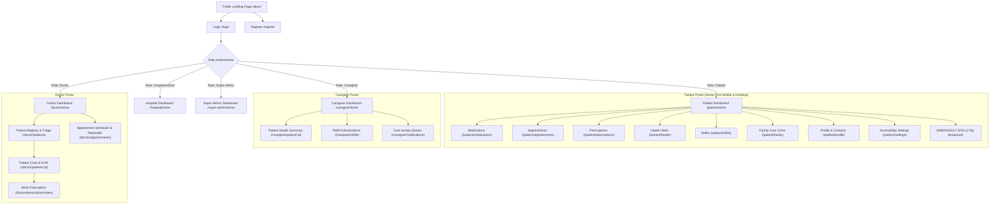
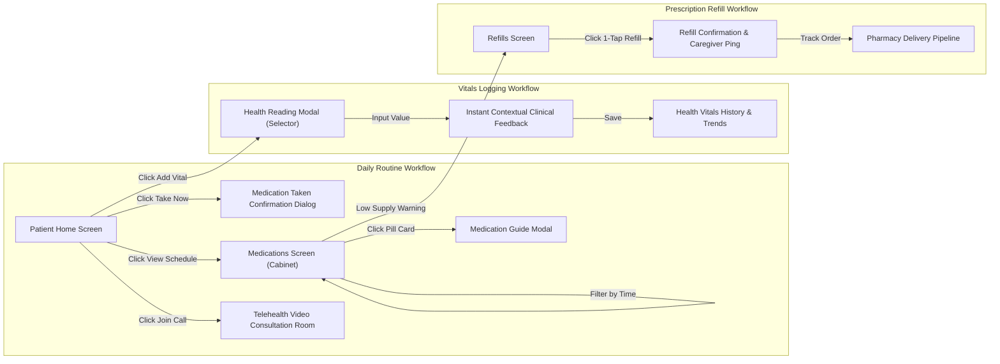

# ElderGuardian AI — Comprehensive UI/UX Design Specification & System Architecture

**Product Name:** ElderGuardian AI  
**Document Version:** 1.0.0 (Production Blueprint)  
**Target Platform:** React.js Web Application (Responsive Web App / PWA)  
**Audience:** UI/UX Engineers, Frontend Engineers, Clinical Safety Officers, Product Managers  
**Accessibility Level:** WCAG 2.1 Level AA Compliant (with Level AAA considerations for senior typography & contrast)  

---

## 1. Executive Summary & Design Principles

### 1.1 Product Mission
ElderGuardian AI is a unified healthcare coordination platform designed to bridge the operational gap between **elderly patients**, their **family caregivers**, **treating physicians**, **hospital administrators**, and **healthcare network super-administrators**. The user experience must solve the unique challenges of geriatric digital health: cognitive fatigue, visual impairment, reduced motor dexterity, and fragmented communication between medical providers and loved ones.

---

### 1.2 Core Design Principles

```
  ┌────────────────────────────────────────────────────────────────────────┐
  │                    ELDERGUARDIAN DESIGN PHILOSOPHY                     │
  ├─────────────────────┬───────────────────────────┬──────────────────────┤
  │   1. Senior-First   │ 2. Progressive Disclosure │  3. Dual-Coding UI   │
  │  Ergonomic empathy  │    Zero cognitive panic   │ Always Icon + Text   │
  ├─────────────────────┼───────────────────────────┼──────────────────────┤
  │ 4. WCAG 2.1 AA/AAA  │  5. Context-Adaptive Rx   │ 6. Reversible Actions│
  │ Contrast & targets  │ Mobile-patient/Desk-Dr    │ No catastrophic taps │
  └─────────────────────┴───────────────────────────┴──────────────────────┘
```

#### 1. Elderly-First Ergonomics & Cognitive Care
* **Sensory Senescence Accommodation:** Age-related vision changes (loss of contrast sensitivity, presbyopia, yellowing of the crystalline lens) dictate that the UI never rely on subtle grey-on-white tones or low-saturation pastels.
* **Motor Dexterity & Tremor Forgiveness:** Older adults frequently experience fine-motor decline, essential tremors, or arthritis. Target click zones must be generously padded (minimum **48×48px** for desktop, **56×56px** for mobile senior actions). Adjacent interactive elements must maintain at least **12px of dead space** to eliminate catastrophic mis-clicks.
* **Cognitive Load & Working Memory Minimization:** Information is grouped into linear chunks. High-consequence tasks (e.g., logging medication, confirming a prescription change) use focused single-task viewports with clear confirmation dialogues rather than cluttered multi-step accordions.

#### 2. Progressive Disclosure (Anti-Overwhelm Principle)
* Do not overwhelm users with exhaustive medical data upfront.
* The Patient and Caregiver views prioritize **Immediate Actionable Tasks** (e.g., "Take Morning Heart Pill at 8:00 AM", "Upcoming Telehealth Visit in 20 minutes").
* Secondary information (past clinical notes, longitudinal trends, pharmacy refill batch numbers) is placed one click deeper via clearly labeled buttons ("View Full Prescription History", "Show Doctor Notes").
* Modals and alerts never present more than **three clear choices** (e.g., `[Take Now]` / `[Snooze 15 Min]` / `[Skip Dose]`).

#### 3. Strict Consistency Across Role Dashboards
* Even though Doctors require high-density diagnostic views and Patients require large-type linear feeds, all dashboards share a single unified component logic:
  - Standard status badges (e.g., Green = Taken/Healthy, Amber = Due Soon/Attention, Red = Missed/Critical).
  - Identical navigation mental models (persistent global navigation + breadcrumbs + direct action panels).
  - Consistent layout anchors (Top emergency/alert bar, left-side contextual navigation, bottom mobile dock).

#### 4. Rigorous Accessibility (WCAG 2.1 Level AA & Targeted AAA)
* **Contrast Ratios:** All body text maintains a contrast ratio of at least **7:1** against backgrounds (surpassing the standard 4.5:1 AA requirement to satisfy AAA for elderly low-vision users). Large headings achieve **>= 4.5:1**.
* **Visual Focus Indicators:** Every focusable element features a high-visibility, 3px solid focus ring with a 2px offset (`#0284C7` or high-contrast teal `#0D9488`), ensuring effortless screen reader and keyboard navigation (Tab/Shift+Tab).
* **Screen Reader Semantic Tree:** Native HTML5 semantic landmarks (`<main>`, `<nav>`, `<aside>`, `<header>`, `<footer>`, `<section role="region" aria-label="...">`) are paired with `aria-live="polite"` for non-urgent notifications and `aria-live="assertive"` for emergency medication alerts.

#### 5. Adaptive Responsive Architecture
* **Mobile-First for Patient & Family:** The primary access device for seniors and busy caregivers is a smartphone or tablet. The interface emphasizes bottom-anchored thumb zones, large sticky buttons, and gesture-free tap targets.
* **Desktop-First for Doctor & Hospital Admin:** Medical professionals and hospital coordinators operate on multi-monitor clinical workstations. The desktop interface provides dense, multi-column clinical charts, split-pane EHR navigation, and keyboard shortcuts (`Cmd/Ctrl + K` patient search, quick Rx approval).

#### 6. Senior-Optimized Color Theory
* Avoid blue-yellow color combinations that become muddy due to lens yellowing.
* Pure black (`#000000`) text on pure white (`#FFFFFF`) is replaced by Deep Navy Slate (`#0F172A`) on Soft Clinical White (`#F8FAFC`) to prevent glare and halo effects in patients with incipient cataracts.
* Color is **never** used as the sole conveyor of information: every status color is paired with an icon and explicit semantic text.

#### 7. Typography Scale & Readability
* **Minimum Body Size:** 16px (1rem) for administrative views, **18px (1.125rem)** for senior patient views.
* **Heading Floor:** Headings begin at 20px (1.25rem) and scale to 32px (2rem) on patient screens.
* **Line Height & Letter Spacing:** Minimum line height of **1.5** for body text and **1.3** for titles. Letter spacing (`tracking-wide` at +0.015em) prevents letter confusion (such as `rn` looking like `m`, or `I` looking like `l` or `1`).

#### 8. Dual-Coding Iconography
* **No Unlabeled Icons:** In the patient and family views, no icon stands alone without a persistent accompanying textual label. An icon of a pill bottle must always be labeled "Medications"; an icon of a calendar must always be labeled "Appointments".

---

## 2. Design System Specification

### 2.1 Color Palette & Token System

```
  PRIMARY BRAND (TRUST NAVY)        SECONDARY (VITALITY TEAL)         ACCENT (CALMING SKY)
  ┌───────────────────────────┐    ┌───────────────────────────┐    ┌───────────────────────────┐
  │ Primary 700: #0F4C64       │    │ Secondary 600: #0D9488    │    │ Accent 500: #0284C7       │
  │ Contrast on White: 8.4:1  │    │ Contrast on White: 4.8:1  │    │ High-contrast focus state │
  └───────────────────────────┘    └───────────────────────────┘    └───────────────────────────┘
```

#### Color Token Mapping Table

| Token Name | Hex Code | Contrast (vs #FFFFFF) | Role & Clinical Context |
| :--- | :--- | :--- | :--- |
| **brand-primary-900** | `#082F49` | 13.8:1 (AAA) | Critical headlines, primary navigation active state |
| **brand-primary-700** | `#0D5C75` | 8.2:1 (AAA) | Primary brand header, key buttons, links |
| **brand-primary-500** | `#0284C7` | 4.6:1 (AA) | Interactive highlights, active tab indicator |
| **brand-primary-50** | `#F0F9FF` | 1.1:1 | Card background highlights, soft selection tint |
| **brand-secondary-800** | `#115E59` | 9.1:1 (AAA) | Secondary clinical badges, wellness headers |
| **brand-secondary-600** | `#0D9488` | 4.8:1 (AA) | Caregiver indicators, positive wellness accents |
| **brand-secondary-50** | `#F0FDFA` | 1.1:1 | Caregiver card backgrounds |
| **semantic-success-700** | `#15803D` | 6.5:1 (AA) | Medication Taken, Normal Biometric Reading |
| **semantic-success-100** | `#DCFCE7` | N/A (Bg) | Success badge background |
| **semantic-warning-700** | `#B45309` | 6.1:1 (AA) | Medication Due Soon, Borderline Vitals, Refill Warning |
| **semantic-warning-100** | `#FEF3C7` | N/A (Bg) | Warning badge background |
| **semantic-danger-700** | `#B91C1C` | 7.3:1 (AAA) | Missed Medication, Abnormal Vitals, Critical Allergy Alert |
| **semantic-danger-600** | `#DC2626` | 4.9:1 (AA) | Emergency SOS button, Action destructive button |
| **semantic-danger-50** | `#FEF2F2` | N/A (Bg) | Emergency alert banner background |
| **semantic-info-700** | `#4338CA` | 7.9:1 (AAA) | System updates, upcoming scheduled appointment notice |
| **semantic-info-50** | `#EEF2FF` | N/A (Bg) | Informational callout background |
| **neutral-bg-canvas** | `#F8FAFC` | N/A (Bg) | Main page application background (Slate-50) |
| **neutral-surface** | `#FFFFFF` | N/A (Surface) | Card, modal, drawer background |
| **neutral-border-subtle**| `#E2E8F0` | 1.3:1 | Non-critical divider lines |
| **neutral-border-strong**| `#94A3B8` | 3.1:1 (UI AA) | Card outer boundaries, input borders for low-vision |
| **neutral-text-main** | `#0F172A` | 15.6:1 (AAA) | Primary body copy, table text, form inputs |
| **neutral-text-muted** | `#334155` | 9.6:1 (AAA) | Secondary metadata, dates, dosage descriptions |

---

### 2.2 Typography Scale & Hierarchy

ElderGuardian AI uses **Atkinson Hyperlegible** (developed by the Braille Institute for low-vision readers) or **Inter / Plus Jakarta Sans** as primary fallback, paired with **JetBrains Mono** for numerical clinical vitals (ensuring numbers like `1`, `0`, and letters `l`, `O` are unmistakably distinct).

```
  DISPLAY HEADING: 32px / 2.0rem  (Bold 700) ───────────── ElderGuardian Home
  HEADING 1:       28px / 1.75rem (Bold 700) ───────────── Today's Schedule
  HEADING 2:       24px / 1.5rem  (SemiBold 600) ───────── Morning Medications
  HEADING 3:       20px / 1.25rem (Medium 500) ─────────── Metformin 500mg
  BODY LARGE (SR): 18px / 1.125rem (Regular 400) ───────── Take 1 tablet with warm water
  BODY BASE:       16px / 1.0rem  (Regular 400) ───────── Dr. Sarah Jenkins (Cardiology)
  CAPTION / BADGE: 14px / 0.875rem (SemiBold 600) ───────── DUE IN 15 MIN
```

#### Detailed Typography System

| Token | Size (px / rem) | Line Height | Weight | Letter Spacing | Senior / Clinical Application |
| :--- | :--- | :--- | :--- | :--- | :--- |
| `text-display` | 32px / 2.0rem | 40px (1.25) | 700 (Bold) | -0.02em | Patient Mobile Home greeting, emergency banners |
| `text-h1` | 28px / 1.75rem | 36px (1.28) | 700 (Bold) | -0.015em | Screen titles, Doctor clinical summary header |
| `text-h2` | 24px / 1.5rem | 32px (1.33) | 600 (SemiBold) | -0.01em | Card grouping titles, Modal headers |
| `text-h3` | 20px / 1.25rem | 28px (1.40) | 600 (SemiBold) | 0.0em | Medication name, Appointment doctor title |
| `text-body-lg` | 18px / 1.125rem | 28px (1.55) | 400 (Regular) | +0.01em | **Standard Patient Body Copy**, dosage instructions |
| `text-body-base`| 16px / 1.0rem | 24px (1.50) | 400 (Regular) | 0.0em | Doctor dashboard tabular data, admin forms |
| `text-label-lg`| 18px / 1.125rem | 24px (1.33) | 600 (SemiBold) | +0.015em | Button labels (Take, Snooze, Book, Call) |
| `text-caption` | 14px / 0.875rem | 20px (1.42) | 600 (SemiBold) | +0.02em | Status badges, timestamps, unit labels |
| `text-mono-stat`| 28px / 1.75rem | 32px (1.14) | 700 (Bold) | 0.0em | **Biometric Vitals** (e.g., `128/82`, `98%`, `112 mg/dL`) |

---

### 2.3 Spacing & Layout Grid (8px Base Grid)

* **Micro-increments:** 4px (`space-1`), 8px (`space-2`), 12px (`space-3`), 16px (`space-4`), 24px (`space-6`), 32px (`space-8`), 48px (`space-12`), 64px (`space-16`).
* **Senior Ergonomic Rule:** Vertical padding on all interactive cards is at least **16px** to prevent visual crowding. Button touch targets are minimum **48px high**, with **16px internal horizontal padding**.

### 2.4 Border Radius, Shadows, and Perceptual Elevation

* **Border Radius:**
  - `radius-sm`: 6px (Input fields, table badges)
  - `radius-md`: 12px (Action buttons, small cards, tooltips)
  - `radius-lg`: 16px (Medication cards, Appointment cards, Modals)
  - `radius-full`: 9999px (Status pills, avatar frames, Floating Emergency SOS)
* **Shadows & Elevation:**
  - In low-vision geriatric ergonomics, soft drop-shadows are often lost. Therefore, **every elevated surface pairs subtle shadow with a visible 1.5px high-contrast border** (`#CBD5E1` in light mode).
  - `elevation-low`: `0 1px 3px rgba(15, 23, 42, 0.08)`, border `1.5px solid #E2E8F0` (Default cards)
  - `elevation-mid`: `0 4px 6px -1px rgba(15, 23, 42, 0.12)`, border `1.5px solid #CBD5E1` (Active cards, dropdowns)
  - `elevation-high`: `0 20px 25px -5px rgba(15, 23, 42, 0.18)`, border `2px solid #94A3B8` (Modals, Emergency alerts)

---

### 2.5 Component Library Overview

```
  ┌────────────────────────────────────────────────────────────────────────┐
  │                    CORE ATOMIC COMPONENT SPECS                         │
  ├────────────────────────────────────────────────────────────────────────┤
  │ [BUTTON]  Height: 52px | Text: 18px SemiBold | Radius: 12px | Icon 24px │
  │ [INPUT]   Height: 56px | Border: 2px Solid   | Label: 16px Floating    │
  │ [CARD]    Padding: 20px| Border: 2px State   | Min-Height: 110px       │
  │ [MODAL]   Max-W: 560px | Scrim: 60% Black   | Double Close (X + Text) │
  └────────────────────────────────────────────────────────────────────────┘
```

1. **Buttons:**
   - **Primary Action:** Solid `#0D5C75`, text `#FFFFFF`, 52px height, 18px semi-bold, 24px Lucide icon placed on the left.
   - **Secondary / Action Ghost:** `#FFFFFF` background, 2px border `#0D5C75`, text `#0D5C75`.
   - **Success (Take Dose):** Solid `#15803D`, text `#FFFFFF`, checkmark icon.
   - **Emergency / SOS:** Solid `#DC2626`, pulse ring animation, 56px height, high-contrast white text.
2. **Form Inputs:**
   - Default state border: 2px `#94A3B8`.
   - Focus state: 3px solid `#0284C7` with outer glow.
   - High-contrast permanent label anchored above the field (never disappearing placeholder text).
   - Clear trailing button (1-tap `[Clear]` icon for motor tremor users who mis-type).
3. **Status Badges / Chips:**
   - 32px height, fully rounded (`rounded-full`), 14px bold text, dual icon-and-label construction (e.g., `<CheckCircle2 /> Taken`).
4. **Modals & Dialogs:**
   - Centered on desktop, anchored bottom sheet on mobile.
   - Background scrim with 60% opacity dark overlay (`#0F172A`) and subtle backdrop blur (4px) to block out background visual clutter.
   - Includes both top-right large `(X)` button (48×48px touch target) and bottom explicit button: `"Cancel and Go Back"`.

### 2.6 Iconography System
* **Icon Library:** **Lucide React** (standardized stroke width of **2.25px** for optimal visibility).
* **Render Dimensions:**
  - Micro (inline with metadata): 18×18px
  - Standard (buttons, list items): 24×24px
  - Prominent (navigation bar, category cards): 32×32px
  - Hero (empty states, emergency status): 48×48px
* **Dual-Coding Mandate:** Icons must never be rendered without a visible text label or accessible `aria-label`.

### 2.7 Dark Mode Considerations (MVP & Clinical Viewports)
* While daytime light mode is standard for older adults (who struggle with scattering light in dark modes if affected by cataracts), a high-contrast dark mode is available for:
  - Doctor overnight shifts.
  - Patients with photophobia or macular degeneration.
* Dark Mode Palette: Background `#0B0F17` (Deep Obsidian), Card Surface `#1E293B` (Slate-800), Primary Text `#F8FAFC` (Slate-50), Borders `#475569` (Slate-600).
* Neon glow effects are strictly banned; all contrasts strictly adhere to WCAG AAA.

---

## 3. Comprehensive Screen List & Architectural Descriptions

### Category A: Public Screens

```
  ┌─────────────────┐      ┌───────────────┐      ┌──────────────────┐
  │ 1. Landing Page │ ───> │ 2. Login Page │ <──> │ 3. Register Page │
  └─────────────────┘      └───────┬───────┘      └──────────────────┘
           │                       │                        │
           ▼                       ▼                        ▼
  ┌─────────────────┐      ┌───────────────┐      ┌──────────────────┐
  │ 5. About & Safe │      │4. Forgot Pwd  │      │ Role Onboarding  │
  └─────────────────┘      └───────────────┘      └──────────────────┘
```

#### 1. Public Landing Page
* **Purpose:** Educate prospective patients, caregivers, and healthcare providers on platform benefits, clinical safety, HIPAA compliance, and AI capabilities.
* **Key Components:**
  - Top navigation bar: ElderGuardian AI logo, Font-Size Switcher (`A-`, `A+`), High-Contrast Toggle, Navigation links, `[Log In]` & `[Get Started]` buttons.
  - Hero Section: High-contrast value proposition ("Healthcare Coordination Made Simple for Seniors & Families"), 1-click CTA buttons ("Sign In to My Care", "Doctor & Hospital Portal"), accompanying photography of an elderly patient smiling with a caregiver.
  - Three Persona Benefit Cards: For Seniors ("Never miss a pill"), For Families ("Peace of mind from anywhere"), For Doctors ("Real-time patient adherence insights").
  - Security & Compliance Trust Bar: HIPAA Compliant, WCAG 2.1 AA Certified, 256-bit Encryption, SOC-2 Ready badges.
  - Footer: Emergency medical disclaimer ("If you are experiencing a life-threatening medical emergency, call 911 immediately"), accessibility statement, legal links.
* **User Interactions:** Font scaling toggles dynamic CSS root variables; CTAs route to Role Registration/Login.
* **Connections:** Routes to Login (`/login`), Register (`/register`), About (`/about`).

#### 2. Universal Login Screen
* **Purpose:** Authenticate users securely with zero friction for elderly users (supporting passwordless magic links, biometric WebAuthn, and standard email/password).
* **Key Components:**
  - Persona Segmented Switch: `[Patient / Family]` | `[Doctor / Hospital]`.
  - Input field 1: Email or Phone Number (large 56px input with phone keypad trigger on mobile).
  - Input field 2: Password with visible `[Show/Hide]` toggle (minimum 48px touch target).
  - Alternative Login: `"Send Me a One-Time Code via SMS / Phone Call"` (senior-friendly).
  - Emergency SOS Fast-Access Link at the bottom: `"Need Immediate Medical Help? Call Emergency Services"`.
* **User Interactions:** Password visibility toggle; SMS OTP fallback trigger; biometric fingerprint/FaceID prompt.
* **Connections:** Routes to Role Dashboard upon auth; routes to Forgot Password (`/forgot-password`); routes to Register (`/register`).

#### 3. Register / Role Onboarding Screen
* **Purpose:** Guide new users into their verified role with appropriate consent verification.
* **Key Components:**
  - Role selection grid with clear visual cards:
    1. Senior Patient ("I want to manage my own health & medications")
    2. Family Caregiver ("I want to look after a parent or loved one")
    3. Physician / Specialist ("I am a licensed medical doctor")
    4. Hospital / Clinic Admin ("I coordinate clinical departments")
  - Step-by-step progress indicator (Step 1 of 3).
  - Large form inputs with real-time accessibility validation.
  - Consent checkbox: Large 28×28px checkbox for Terms of Service and HIPAA Health Data Sharing consent.
* **User Interactions:** Card selection adds high-contrast border; form advances cleanly with explicit "Continue" button.
* **Connections:** Routes to Patient Onboarding Wizard or Doctor Credential Verification; back to Login.

#### 4. Forgot Password / Account Recovery Screen
* **Purpose:** Provide stress-free credential recovery designed for older adults prone to forgetting passwords.
* **Key Components:**
  - Explanatory reassurance box: "Don't worry! We will help you get back into your account."
  - Two recovery choices: "Send Code to My Phone (SMS/Call)" or "Send Reset Email".
  - Caregiver Backup Recovery Option: "Ask your linked family member (e.g., Sarah) to help unlock your account".
  - 6-Digit Large Code Input (each digit in a separate 54×64px box with automatic advance).
* **User Interactions:** Enter phone number -> receive verification code -> set new simple secure password.
* **Connections:** Back to Login (`/login`).

#### 5. About & Clinical Safety Screen
* **Purpose:** Provide transparent information on clinical protocols, medical disclaimers, AI prescription parsing accuracy, and privacy.
* **Key Components:**
  - Medical Advisory Board credentials and physician photos.
  - "How ElderGuardian AI Works": Explanation of OCR prescription parsing and doctor verification in the loop.
  - WCAG Accessibility Statement and contact phone number for accessibility assistance.
* **User Interactions:** Expandable FAQ accordions with 20px headers and high-contrast toggle arrows.
* **Connections:** Accessible from footer and global navigation.

---

### Category B: Patient Dashboard (Senior-First Design)

```
  ┌────────────────────────────────────────────────────────────────────────┐
  │                         PATIENT DASHBOARD FLOW                         │
  ├────────────────────────────────────────────────────────────────────────┤
  │ [HOME: Today's Schedule & Meds] ──┬──> [MEDICATIONS: Schedule & Cabinet]│
  │                                   ├──> [APPOINTMENTS: Book & Telehealth]│
  │                                   ├──> [PRESCRIPTIONS: OCR & Docs]     │
  │                                   ├──> [HEALTH: Vitals & Trends]       │
  │                                   ├──> [REFILLS: Orders & Delivery]    │
  │                                   ├──> [FAMILY: Linked Caregivers]     │
  │                                   └──> [EMERGENCY SOS: 1-Tap Broadcast]│
  └────────────────────────────────────────────────────────────────────────┘
```

#### 1. Patient Home (Command Center)
* **Purpose:** The daily starting point for the senior. Answers three questions at a glance: "What pills do I take right now?", "Who do I see today?", and "Is my health normal?"
* **Key Components:**
  - **Greeting Header:** "Good morning, Arthur!" with current date, time, and large weather/activity widget.
  - **Emergency SOS Floating Anchor:** Sticky red SOS pill button (top right on desktop, bottom floating bubble on mobile) with 1-tap emergency trigger.
  - **Immediate Action Hero Banner:** Displays the next scheduled medication due (e.g., "Morning Medications — 2 Pills Due at 8:00 AM") with prominent `[TAKE NOW]` button.
  - **Today's Timeline List:** Chronological feed split into 4 clear periods: Morning, Afternoon, Evening, Bedtime.
  - **Upcoming Appointment Preview Card:** Displays doctor name, photo, specialty, and a 1-tap button to launch video call or get directions.
  - **Family Peace-of-Mind Status:** "Your daughter Sarah was notified of your morning meds."
* **User Interactions:** Tapping `[TAKE NOW]` triggers audio chime + green confirmation badge; tapping `[Snooze 15m]` defers reminder; tapping SOS opens 3-second abort countdown dialog.
* **Connections:** Deep links to Medications (`/patient/medications`), Appointments (`/patient/appointments`), Vitals (`/patient/health`).

#### 2. Appointments Screen
* **Purpose:** Review upcoming doctor consultations, book new appointments, and join telehealth calls with zero friction.
* **Key Components:**
  - Tab Switcher: `[Upcoming Visits (2)]` | `[Past Visits]`.
  - New Appointment Primary CTA Button: `[+ Book a New Appointment]` (large 54px button with calendar icon).
  - Appointment Detail Card:
    - Date badge (e.g., "THU, OCT 24" in 24px bold font).
    - Time and type ("10:30 AM — Video Consultation" or "In-Person Clinic Visit").
    - Doctor summary (Dr. Sarah Jenkins, Cardiologist at St. Jude Hospital).
    - Action cluster: `[Join Video Visit]` (prominent green button, active 15 mins prior), `[Get Directions / Map]`, `[Reschedule or Cancel]`.
* **User Interactions:** Tapping `[Join Video Visit]` launches integrated full-screen telehealth modal; tapping `[Reschedule]` opens conversational date-picker.
* **Connections:** Routes to Booking Flow (`/patient/appointments/book`), Appointment Details (`/patient/appointments/:id`).

#### 3. Prescriptions Screen
* **Purpose:** Store digital copies of official medical prescriptions, upload paper pharmacy slips, and view AI-parsed medication extractions.
* **Key Components:**
  - Top Action Bar: `[+ Upload New Prescription Picture]` (opens camera on mobile or file uploader on desktop).
  - Prescription Card List:
    - Doctor Name, Hospital Logo, Issue Date, Expiration Date.
    - AI Verification Status Badge: `[Verified by Dr. Jenkins]` or `[Under AI Analysis]`.
    - Pill Count Tag: "Contains 3 Active Medications".
    - Action Buttons: `[View Full Document / PDF]`, `[View Extracted Medications]`.
  - AI Medication Extraction Review Drawer: Side-by-side view showing the original scanned paper photo on the left, and parsed drugs, dosages, and refill counts on the right with doctor confirmation stamp.
* **User Interactions:** Take camera photo of paper Rx -> OCR engine extracts dosage -> user or caregiver confirms -> saved to medication schedule.
* **Connections:** Routes to Prescription Details (`/patient/prescriptions/:id`), Add Medication.

#### 4. Medications Screen (The Medicine Cabinet)
* **Purpose:** Complete view of the patient's daily medication regimen, adherence tracking, and pharmaceutical details.
* **Key Components:**
  - Time-of-Day Filter Pills: `[All Day]` | `[Morning]` | `[Afternoon]` | `[Evening]` | `[Bedtime]`.
  - Medication Item Cards:
    - High-contrast visual pill graphic (shape: round/oval/capsule; color: blue/white/red).
    - Drug name in 22px bold font (e.g., "Metformin 500mg").
    - Layman instructions ("Take 1 tablet with breakfast for blood sugar").
    - Current supply bar: "18 pills remaining (6 days left)".
    - Status button: `[Mark as Taken]`, `[Snoozed]`, `[Skipped]`.
  - Monthly Adherence Calendar: Visual color-coded grid (Green circles = all taken, Yellow = delayed, Red = missed) with overall score (e.g., "94% On Track this Month!").
* **User Interactions:** Tap pill card to open large-print medication guide (side effects, food interactions); tap checkmark to log dose.
* **Connections:** Routes to Refill Request (`/patient/refills/request?medId=...`), Doctor question modal.

#### 5. Refills Screen
* **Purpose:** Monitor prescription supply levels, order pharmacy refills with 1 tap, and track home deliveries.
* **Key Components:**
  - "Needs Attention Soon" Alert Section: Medications with less than 7 days of supply remaining.
  - Active Orders Pipeline: Visual 4-step progress stepper:
    1. Requested -> 2. Doctor Approved -> 3. Packed at Pharmacy -> 4. Out for Delivery.
  - `[Request 1-Tap Refill]` Button on each eligible card.
  - Preferred Pharmacy Card: Pharmacy name, address, phone number, and delivery address.
  - Family Copay Assistance Notice: "Refill cost covered under Family Shared Account".
* **User Interactions:** Tapping `[Request Refill]` triggers instant push notification to doctor/caregiver; order tracking displays live delivery day estimate.
* **Connections:** Routes to Refill Tracking details (`/patient/refills/:orderId`).

#### 6. Health & Vitals Screen
* **Purpose:** Log daily physiological readings (Blood Pressure, Blood Sugar, SpO2, Heart Rate, Weight) and view clear, accessible visual trend graphs.
* **Key Components:**
  - Quick-Log Action Row: 5 large icon tiles:
    1. Blood Pressure (`120/80`)
    2. Blood Sugar (`105 mg/dL`)
    3. Pulse & Oxygen (`98% / 72 bpm`)
    4. Weight (`164 lbs`)
    5. Temperature (`98.6°F`)
  - Latest Vitals Summary Cards with plain-English clinical status (e.g., "Normal Blood Pressure — Great job!").
  - Simplified Trend Chart: High-contrast line chart with a green "Safe Range" horizontal corridor and large data points (minimum 12px circle targets).
  - `[Share Report with Doctor]` Button: Generates 1-page PDF summary.
* **User Interactions:** Tap quick-log tile -> numeric keypad opens with pre-selected units -> enters value -> instant visual feedback (green/amber/red).
* **Connections:** Routes to Log Reading Modal, Historical Readings List (`/patient/health/history`).

#### 7. Profile Screen
* **Purpose:** Maintain patient identification, emergency contacts, primary medical conditions, allergies, and health insurance.
* **Key Components:**
  - Large Patient Avatar with simple `[Change Photo]` button.
  - High-Priority Medical Warning Banner: Allergies highlighted in high-contrast red box (e.g., "ALLERGIES: Penicillin, Sulfa Drugs").
  - Emergency Contacts List: Shows Primary Caregiver (Sarah - Daughter) and Secondary Contact with 1-tap `[Call Now]` green buttons.
  - Clinical Profile: Blood Type (O+), Primary Diagnoses (Hypertension, Type 2 Diabetes).
  - Medicare / Insurance Card Digital Display: Front and back card scans.
* **User Interactions:** Tap `[Call Contact]` launches telephone dialer directly; tap `[Edit Medical History]` opens guided editor.
* **Connections:** Routes to Edit Profile, Consent Management.

#### 8. Family & Caregiver Hub
* **Purpose:** Empower the patient to see and control who has access to their health records and who receives alerts.
* **Key Components:**
  - Active Caregivers Grid: Cards showing caregiver photo, relation ("Daughter", "Visiting Nurse"), and permission tier.
  - Granular Consent Toggles (Large 40px switches with explicit "YES / NO" labels):
    - "Can Sarah see my daily medication adherence?" [YES]
    - "Can Sarah view my doctor appointment notes?" [YES]
    - "Can Sarah approve pharmacy refills on my behalf?" [YES]
  - `[+ Invite a Family Member]` Button: Generates simple 4-digit pairing code or SMS invite link.
* **User Interactions:** Toggling a switch displays immediate confirmation: "Permission updated — Sarah will now receive medication alerts."
* **Connections:** Routes to Caregiver Permissions Modal.

#### 9. Notifications Center
* **Purpose:** Comprehensive, time-stamped history of all system alerts, medication reminders, doctor messages, and family check-ins.
* **Key Components:**
  - Filter Tabs: `[All]` | `[Medications]` | `[Appointments]` | `[Family]`.
  - Notification List Items with large category icons and bold titles:
    - "Morning Meds Taken at 8:05 AM" (Green Checkmark).
    - "Dr. Jenkins approved your Lisinopril refill" (Blue Pill).
    - "Sarah sent you a message: 'Have a great day dad!'" (Purple Heart).
  - `[Mark All as Read]` and `[Clear History]` text buttons.
* **User Interactions:** Tapping notification navigates directly to the relevant record (e.g., the prescription or appointment).
* **Connections:** Dynamic routing based on notification payload.

#### 10. Settings & Accessibility Controls
* **Purpose:** Custom-tailor the user interface to the individual senior's visual, hearing, and motor capabilities.
* **Key Components:**
  - **Text Size Adjustment Tool:** 3 discrete setting buttons: `[Standard (18px)]` | `[Large (22px)]` | `[Extra Large (26px)]`.
  - **High-Contrast Mode Toggle:** Black on white / White on dark blue with enhanced 3px borders.
  - **Audio Read-Aloud (Text-to-Speech) Toggle:** When turned on, a small speaker icon appears beside every card to read instructions aloud.
  - **Tremor Assistance Mode:** Adds 16px of buffer margin around all buttons and disables swipe gestures.
  - **Reminder Notification Sound Selector:** Low-frequency chime options for seniors with high-frequency hearing loss.
* **User Interactions:** Real-time UI transformation upon changing text size or contrast; sample sound test button.
* **Connections:** Persists preferences to local storage and user database profile.

---

### Category C: Family / Caregiver Dashboard

```
  ┌────────────────────────────────────────────────────────────────────────┐
  │                   FAMILY / CAREGIVER DASHBOARD FLOW                    │
  ├────────────────────────────────────────────────────────────────────────┤
  │ [FAMILY HOME: Multi-Patient Overview & Alerts]                         │
  │        ├──> [PATIENT DEEP-DIVE: Health Summary, Meds & History]        │
  │        ├──> [REFILL APPROVALS: Prescription Authorization & Payment]   │
  │        └──> [CARE ACTIVITY & NOTIFICATIONS FEED]                       │
  └────────────────────────────────────────────────────────────────────────┘
```

#### 1. Family Home Screen
* **Purpose:** Provide adult children and professional caregivers with continuous visibility into their loved ones' daily wellbeing, medication adherence, and alerts.
* **Key Components:**
  - Patient Selector (if caring for both parents): `[Arthur Miller (Father)]` | `[Eleanor Miller (Mother)]`.
  - Daily Compliance Gauge: Circular progress ring showing today's adherence: "80% Completed (3 of 4 doses logged)".
  - Urgent Alert Feed (if any): E.g., "Alert: Arthur did not log his 2:00 PM Blood Pressure reading" with 1-tap `[Call Arthur]` or `[Nudge Reminder]`.
  - Quick Health Status Cards: Today's Vitals (BP: 124/82 mmHg, Glucose: 110 mg/dL), Next Doctor Visit (Tomorrow at 10:30 AM).
  - Quick Caregiver Action Bar: `[Send Loving Note]`, `[Request Refill]`, `[Message Doctor]`.
* **User Interactions:** Tapping `[Nudge Reminder]` sends gentle chime to the senior's tablet/phone; tapping patient switcher updates entire dashboard context.
* **Connections:** Routes to Patient Detail (`/caregiver/patient/:id`), Refills (`/caregiver/refills`), Notifications.

#### 2. Patient Detail View (Caregiver Deep-Dive)
* **Purpose:** In-depth medical and longitudinal overview of the elderly parent.
* **Key Components:**
  - Unified Care Calendar: Integrated view showing completed doses, doctor visits, home health nurse visits, and family visits.
  - Medication Cabinet Audit: List of all active prescriptions, dosages, prescribing doctor, and days of supply remaining.
  - Longitudinal Health Trends: Interactive multi-week charts for blood pressure, blood sugar, and weight with caregiver note annotations.
  - Care Team Contacts: Direct phone and messaging links to primary doctor, cardiologist, and local pharmacy.
* **User Interactions:** Caregiver can add personal care logs ("Arthur felt a little dizzy after lunch; rested 30 minutes").
* **Connections:** Routes to Doctor messaging, Prescription view.

#### 3. Refill Approvals Screen (Caregiver Authorized)
* **Purpose:** Review pending pharmacy refill orders, confirm delivery logistics, and cover copay balances.
* **Key Components:**
  - Action Required List: Cards highlighting prescriptions awaiting family sign-off.
  - Order Breakdown: Medication name, quantity (90-day supply), prescribing physician, and copay amount ($12.50).
  - Delivery Destination Selector: "Arthur's Home Address" vs. "Deliver to My Address".
  - One-Tap Approval & Payment: `[Approve & Pay $12.50 via Apple Pay / Credit Card]`.
* **User Interactions:** Authorizing triggers digital notification to pharmacy and sends tracking link to both caregiver and senior.
* **Connections:** Routes to Order Confirmation and Tracker.

#### 4. Notifications & Care Activity Feed
* **Purpose:** Real-time audit trail of every medical and logistical event in the senior's care circle.
* **Key Components:**
  - Activity stream grouped by date (Today, Yesterday, Last Week).
  - Event types: Dose Logged, Dose Snoozed, Dose Missed, Vital Recorded, Appointment Booked, Doctor Note Added.
  - Filter by Severity: `[All Events]` | `[Missed Meds & Alerts]` | `[Doctor Updates]`.
* **User Interactions:** Filter events; export monthly compliance log for insurance or clinical reviews.
* **Connections:** Back to Family Home.

---

### Category D: Doctor Dashboard (Clinical Focus)

```
  ┌────────────────────────────────────────────────────────────────────────┐
  │                        DOCTOR DASHBOARD FLOW                           │
  ├────────────────────────────────────────────────────────────────────────┤
  │ [CLINICAL HOME: Daily Schedule & High-Risk Patient Triage]             │
  │        ├──> [PATIENT DIRECTORY: Search, Filter, Risk Stratification]  │
  │        ├──> [PATIENT EHR DETAIL: Longitudinal Charts & Clinical Notes] │
  │        ├──> [WRITE PRESCRIPTION: AI Interaction Checker & E-Sign]      │
  │        └──> [APPOINTMENT MANAGEMENT: Calendar & Telehealth Console]   │
  └────────────────────────────────────────────────────────────────────────┘
```

#### 1. Doctor Home (Clinical Command Center)
* **Purpose:** High-efficiency dashboard for physicians to triage high-risk elderly patients, manage daily clinics, and authorize pending refill requests.
* **Key Components:**
  - Today's Clinic Schedule Bar: Total appointments (14), Completed (4), Telehealth (6), In-Clinic (4).
  - High-Risk Patient Triage Queue: Cards sorted by clinical urgency (e.g., "Arthur Miller — Systolic BP > 160 mmHg for 3 consecutive days; 40% med adherence").
  - Pending Digital Refills Counter: List of pharmacy requests awaiting electronic signature.
  - Quick Search Bar: Global shortcut (`Cmd/Ctrl + K`) to search any patient by name, DOB, or medical record number (MRN).
* **User Interactions:** One-click launch of patient chart or telehealth room; batch electronic signature for standard maintenance refills.
* **Connections:** Routes to Patient Detail (`/doctor/patients/:id`), Write Rx (`/doctor/prescriptions/new`), Appointments (`/doctor/appointments`).

#### 2. Patient List (Registry & Risk Stratification)
* **Purpose:** Searchable, filterable directory of all elderly patients under the physician's care.
* **Key Components:**
  - Multi-Parameter Filter Toolbar: Filter by Primary Condition (Hypertension, Diabetes, COPD), Risk Level (High, Moderate, Low), Adherence Score (<70%, 70-90%, >90%), and Age Group.
  - Clinical Data Table:
    - Patient Name & Avatar, Age/Gender, MRN.
    - Risk Tier Badge (High: Red, Moderate: Amber, Low: Green).
    - 30-Day Medication Adherence Rate.
    - Last Recorded Vitals & Date.
    - Next Scheduled Appointment.
    - Quick Action Icons: View Chart, Message Family, Write Rx.
* **User Interactions:** Table column sorting, instant text filtering, row selection navigates to comprehensive patient EHR.
* **Connections:** Routes to Patient Detail (`/doctor/patients/:id`).

#### 3. Patient Detail (Longitudinal Clinical EHR)
* **Purpose:** Deep clinical view synthesizing remote patient monitoring (RPM) data, active medications, hospital discharge summaries, and AI clinical notes.
* **Key Components:**
  - Patient Header Banner: Name, DOB, Age, Emergency Contact, Drug Allergies (Prominent Red Tags).
  - Tabbed Clinical Navigation: `[Overview]` | `[Vitals & RPM]` | `[Prescriptions]` | `[Clinical Notes]` | `[Care Circle]`.
  - Interactive Multi-Metric Chart: Correlates medication adherence spikes/drops directly against biometric vitals (e.g., showing blood pressure spikes on days Metformin/Lisinopril was missed).
  - AI Clinical Summary Assistant: Generates synthesized bullet points: "Patient has been 92% compliant with morning beta blockers; reported mild evening ankle edema on Thursday."
  - Action Bar: `[+ Write New Prescription]`, `[Schedule Follow-up]`, `[Send Message to Family]`.
* **User Interactions:** Zoom in/out on vital charts; click data point to see dosage log at that exact timestamp.
* **Connections:** Routes to Write Prescription (`/doctor/prescriptions/new?patientId=...`).

#### 4. Write / Edit Prescription (e-Prescribe Suite)
* **Purpose:** Prescribe medications with real-time AI drug-drug interaction screening, geriatric dosage validation, and electronic routing to pharmacy networks.
* **Key Components:**
  - Patient Context Bar: Displays current active medications, renal function (eGFR), and drug allergies.
  - Drug Search & Autocomplete: Fast lookup with pre-filled standard geriatric dosing protocols (e.g., "Start low, go slow" recommendations for seniors).
  - AI Safety Screening Engine: Real-time conflict banners:
    - *Severity High:* "Warning: Potential interaction between Warfarin and newly selected Ciprofloxacin (increased bleed risk)."
  - Dosage, Frequency, Route, Duration, and Refill Counter fields.
  - Senior-Specific Instructions Field: Generates layman instructions for the patient pill bottle label.
  - Digital Certificate e-Signature & Pharmacy Dispatch Button.
* **User Interactions:** Selecting medication automatically triggers interaction check against all active drugs in patient profile.
* **Connections:** On submit, updates patient chart, alerts patient & caregiver, routes to pharmacy.

#### 5. Appointment Management
* **Purpose:** Manage clinical consultation hours, slot availability, and launch integrated WebRTC telehealth video calls.
* **Key Components:**
  - Multi-view Calendar: Day, Week, and Month view with color coding for Telehealth vs. In-Person visits.
  - Telehealth Launch Console: Integrated video consultation window with side-by-side floating patient vitals and quick-note scratchpad.
  - Automated Appointment Reminder Settings: Set automated SMS/Phone call reminders sent to elderly patient and caregiver 24 hours prior.
* **User Interactions:** Drag-and-drop appointment slot rescheduling; click appointment card to open pre-visit clinical intake notes.
* **Connections:** Routes to Telehealth Room (`/telehealth/:appointmentId`).

---

### Category E: Hospital Admin Dashboard

```
  ┌────────────────────────────────────────────────────────────────────────┐
  │                   HOSPITAL ADMIN DASHBOARD FLOW                        │
  ├────────────────────────────────────────────────────────────────────────┤
  │ [COMMAND CENTER: Census, Bed/Doctor Occupancy & Critical Incidents]    │
  │        ├──> [DOCTOR MANAGEMENT: Credentialing, Shifts, Specialties]    │
  │        ├──> [PATIENT COORDINATION: Admissions, Discharges & Home Care] │
  │        ├──> [SUBSCRIPTION & BILLING: Enterprise Tiers & Licenses]      │
  │        └──> [HEALTHCARE ANALYTICS: Readmission Rates & Quality KPIs]  │
  └────────────────────────────────────────────────────────────────────────┘
```

#### 1. Hospital Overview / Command Center
* **Purpose:** Monitor operational throughput, senior patient admissions, bed occupancy, doctor rosters, and critical care escalations across departments.
* **Key Components:**
  - Key Metric Stat Tiles: Active Inpatients, Total Enrolled Outpatient Seniors, On-Duty Physicians, Active Telehealth Sessions, 30-Day Readmission Rate.
  - Real-Time Critical Escalations Table: Hospitalized seniors, emergency room admissions, and unacknowledged SOS panic alerts.
  - Departmental Throughput Breakdown: Cardiology, Geriatrics, Endocrinology, Neurology.
* **User Interactions:** Click stat tile to drill down into filtered departmental lists; export daily census PDF report.
* **Connections:** Routes to Doctor Management, Patient Coordination, Analytics.

#### 2. Doctor Management Screen
* **Purpose:** Oversee hospital clinical staff, manage credentials, verify digital prescription signing keys, and assign clinical departments.
* **Key Components:**
  - Doctor Directory Table: Doctor Name, Specialty, License Number, Active Patient Load, Hospital Privileges Status (Active / On-Leave / Suspended).
  - `[+ Onboard New Physician]` Button with digital NPI lookup.
  - Shift Roster & On-Call Schedule: Visual weekly calendar showing on-call geriatric emergency coverage.
* **User Interactions:** Assign/reassign patient panels between doctors; toggle telehealth consultation permissions.
* **Connections:** Routes to Doctor Profile & Audit Log.

#### 3. Patient Coordination & Bed Allocation Screen
* **Purpose:** Coordinate geriatric patient transfers between hospital wards, rehabilitation facilities, and home-based RPM enrollment.
* **Key Components:**
  - Admission & Discharge Board (Kanban or Table layout):
    - Col 1: Admitted / Inpatient Geriatric Care.
    - Col 2: Pending Discharge Planning (Prescription Reconciliation).
    - Col 3: Enrolled in ElderGuardian Home RPM.
  - Caregiver Notification Status: Indicates whether the patient's family has verified post-discharge medications.
* **User Interactions:** Move patient along discharge pathway; triggers automated home-delivery of discharge medications.
* **Connections:** Routes to Discharge Summary Creator.

#### 4. Subscription & Enterprise Billing Screen
* **Purpose:** Manage hospital-level software licensing, active patient monitoring seats, and insurance reimbursement integration (e.g., CPT codes for Remote Patient Monitoring).
* **Key Components:**
  - Enterprise Tier Summary: Plan name (e.g., "HealthSystem Enterprise — 2,500 Monitored Senior Beds").
  - RPM Billing & CPT Code Tracker: Automated monthly calculation of Medicare RPM codes (CPT 99453, 99454, 99457, 99458) based on recorded vitals and physician review time.
  - Monthly Invoicing & Payment History.
* **User Interactions:** Download monthly CMS / Insurance claim batch XML/CSV; upgrade active license tier.
* **Connections:** Routes to Invoicing details and payment gateway.

#### 5. Healthcare Analytics & Quality Metrics
* **Purpose:** Provide hospital executives with clinical outcomes data, medication adherence correlation, readmission reduction statistics, and patient satisfaction ratings.
* **Key Components:**
  - 30-Day Hospital Readmission Rate Comparison Chart (ElderGuardian Monitored Cohort vs. Standard Cohort).
  - Medication Adherence Index: Aggregated adherence across all geriatric outpatient programs.
  - Patient & Caregiver CSAT / NPS Gauges.
  - Emergency SOS Response Time Analytics: Median hospital/caregiver response times.
* **User Interactions:** Date range picker (Last 30 Days, Q1-Q4, Year-to-Date); filter by disease program.
* **Connections:** Export to CSV/BI tool connector.

---

### Category F: Super Admin Dashboard (Platform Governance)

```
  ┌────────────────────────────────────────────────────────────────────────┐
  │                    SUPER ADMIN DASHBOARD FLOW                          │
  ├────────────────────────────────────────────────────────────────────────┤
  │ [GLOBAL PLATFORM OVERVIEW: System Health, Multi-Tenant Metrics]        │
  │        ├──> [HOSPITAL MANAGEMENT: Tenant Provisioning & SLA Audits]    │
  │        ├──> [SUBSCRIPTION PLANS: Pricing Engine & Feature Gating]      │
  │        └──> [SYSTEM SETTINGS: Security, AI Inference & HIPAA Logs]     │
  └────────────────────────────────────────────────────────────────────────┘
```

#### 1. Global Platform Overview
* **Purpose:** Monitor the holistic health, server infrastructure, multi-tenant load, and uptime of the entire ElderGuardian AI cloud infrastructure.
* **Key Components:**
  - High-Level Health Bar: Global System Uptime (99.98%), Active Tenants (48 Hospital Systems), Total Monitored Seniors (128,450), Active Microservices Status (API, OCR Engine, WebRTC, Notification Gateway).
  - Real-Time Global Map: Geographical distribution of hospital nodes and active telehealth streams.
  - Security Threat Sensor: Active failed login rate, DDoS shield status, active encrypted tunnels.
* **User Interactions:** Real-time polling toggle; service restart trigger modal with multi-factor authentication (MFA).
* **Connections:** Routes to Hospital Management, System Settings.

#### 2. Hospital & Tenant Management Screen
* **Purpose:** Provision new hospital systems, clinics, and regional health authorities, manage custom white-label branding, and enforce SLA compliance.
* **Key Components:**
  - Tenant Registry Table: Hospital Organization Name, Tenant ID, Region/Cloud Zone, Monitored Patients, Contract Expiry, SLA Status.
  - `[+ Provision New Tenant]` Wizard: Tenant URL slug, admin credentials, data isolation region, custom logos/themes.
  - Tenant Lock / Suspend Kill-Switch with audit justification prompt.
* **User Interactions:** One-click tenant impersonation for customer support diagnostics; regenerate hospital API credentials.
* **Connections:** Routes to Tenant Details (`/super-admin/tenants/:id`).

#### 3. Subscription Plans & Tier Governance
* **Purpose:** Configure platform-wide subscription packages, feature flagging, API rate limits, and per-patient pricing models.
* **Key Components:**
  - Tier Configurator Grid: Basic Clinic, Regional Hospital, National Health System.
  - Feature Gating Matrix: Checkbox toggles for features (e.g., AI OCR Prescription Extraction, Automated RPM CPT Billing, Custom Domain, White-Label Mobile App).
  - Pricing Engine Controls: Base platform fee + per-monitored-senior monthly rate.
* **User Interactions:** Edit plan pricing; deploy updated feature entitlements to tenant cohorts.
* **Connections:** Routes to Plan Editor.

#### 4. System Settings & Compliance Audit Screen
* **Purpose:** Maintain strict regulatory compliance, manage HIPAA / HITECH / GDPR access logs, and configure AI inference models.
* **Key Components:**
  - Immutable Audit Log Table: Timestamp, User ID, Role, Action (e.g., "Exported Patient Record MRN #49201"), IP Address, Encryption Hash.
  - AI Model Engine Selector & Hyperparameters: Choose OCR vision model (e.g., Gemini Vision vs. specialized clinical OCR), confidence threshold score (default 98.5% before physician review required).
  - Data Retention & Archival Policies: Automatic cold-storage archival settings for medical logs.
* **User Interactions:** Query audit log with regex filters; trigger automated external compliance report generation.
* **Connections:** Back to Platform Overview.

---

## 4. Navigation Architecture

### 4.1 Global Information Architecture & Authentication Routing



---

### 4.2 Detailed Screen-to-Screen Patient Navigation Flow



---

### 4.3 Navigation Implementations by Device & Role

#### 1. Patient & Caregiver Mobile: Bottom Navigation Bar
* **Position:** Fixed to bottom of screen (`position: fixed; bottom: 0; left: 0; right: 0`), elevated with 4px top shadow and top border `1.5px solid #CBD5E1`.
* **Height:** Generous **68px** height to allow comfortable thumb tapping.
* **Item Count:** Exactly **4 Core Icons + 1 Emergency Button**:
  1. `[Home]` (Lucide `Home` icon + "Home" text)
  2. `[Meds]` (Lucide `Pill` icon + "Meds" text)
  3. `[SOS Button]` (Central elevated 58×58px red circle with Lucide `PhoneCall` icon)
  4. `[Visits]` (Lucide `Calendar` icon + "Visits" text)
  5. `[Health]` (Lucide `Activity` icon + "Health" text)
* **Touch Envelope:** Each tab occupies an equal 20% width slice with a minimum touch envelope of **60×68px**. Active tab features a 4px solid top indicator bar in `#0D5C75` and bold font weight.

#### 2. Desktop Navigation: Persistent Contextual Sidebar
* **Applicable Roles:** Doctor Dashboard, Hospital Admin, Super Admin, and Patient Desktop Mode.
* **Width:** Fixed **260px** expanded (collapsible to **76px** icon-only mode with tooltips for clinical multi-tasking).
* **Sidebar Structure:**
  - **Top Anchor:** ElderGuardian AI logo + Role Badge (`[Doctor Portal]`, `[Hospital Admin]`).
  - **Primary Navigation Links:** 48px height menu items with 24px Lucide icons, 18px text, and active state background `#F0F9FF` with 4px left highlight bar in `#0D5C75`.
  - **Contextual Notification Badges:** High-contrast pill badges (e.g., "3" pending refills in red pill).
  - **Bottom User Block:** Current logged-in user profile avatar, name, role, `[Settings]`, and `[Log Out]` button.

#### 3. Breadcrumb & Safe Back-Navigation Strategy
* **Elderly Safe Mental Anchor:** Older adults frequently experience anxiety about "getting lost" in deep application hierarchies.
* **The "Always Safe" Navigation Header:**
  - Any screen below top-level dashboard displays a prominent top-left **`[← Go Back to Home]`** button (minimum 48px target with high-contrast arrow and clear text).
  - Breadcrumb trails (e.g., `Home > My Medications > Metformin Details`) use 16px font with active page highlighted in bold `#0F172A`.
  - Non-destructive escape: Every modal and multi-step wizard contains an explicit `[Cancel & Exit]` text button at the bottom so the user never feels trapped.

---

## 5. Key UI Patterns (Design & Accessibility Deep-Dive)

### 5.1 Medication Reminder Card Pattern

```
  ┌────────────────────────────────────────────────────────────────────────┐
  │ ⏰ MORNING DOSE • 8:00 AM                        [ STATUS: DUE NOW ]   │
  ├────────────────────────────────────────────────────────────────────────┤
  │  ┌──────────┐  METFORMIN 500 MG                                        │
  │  │  (PILL)  │  Take 1 White Oval Tablet with breakfast                 │
  │  │  GRAPHIC │  Supply: 18 pills remaining (6 days left)                │
  │  └──────────┘                                                          │
  ├────────────────────────────────────────────────────────────────────────┤
  │  [ ✔ TAKE NOW ]         [ ⏳ SNOOZE 15 MIN ]         [ ✖ SKIP DOSE ]   │
  └────────────────────────────────────────────────────────────────────────┘
```

* **Visual Construction:**
  - Card Dimensions: Full width on mobile, min-height 140px.
  - Border: 2px solid `#E2E8F0` in default state; shifts to **3px solid `#B45309`** when due now, and **3px solid `#15803D`** when marked taken.
  - Left Pill Graphic: Visual representation of physical pill (color, shape, score lines) helping seniors with mild cognitive decline cross-reference with their physical medicine organizer.
* **Dual Action Buttons:**
  - `[TAKE NOW]` (Success Primary): 52px height, solid green `#15803D`, white 18px bold text, checkmark icon.
  - `[SNOOZE 15m]` (Neutral Action): 52px height, white background, 2px border `#94A3B8`, text `#334155`, clock icon.
  - `[SKIP DOSE]` (Low-Prominence Ghost): 48px height, subtle text button with confirmation prompt to prevent accidental skips.
* **Sensory Feedback:** Tapping `[TAKE NOW]` plays an optional soft, high-clarity auditory chime, triggers a 200ms haptic vibration on mobile, and transforms the card into a green completed state with a checkmark animation.

---

### 5.2 Appointment Card Pattern

```
  ┌────────────────────────────────────────────────────────────────────────┐
  │ 📅 THURSDAY, OCT 24 • 10:30 AM                  [ TELEHEALTH VISIT ]   │
  ├────────────────────────────────────────────────────────────────────────┤
  │  ┌──────────┐  DR. SARAH JENKINS                                       │
  │  │  DOCTOR  │  Chief of Cardiology • St. Jude Medical Center           │
  │  │  AVATAR  │  Reason: 6-Month Hypertension Follow-up                  │
  │  └──────────┘                                                          │
  ├────────────────────────────────────────────────────────────────────────┤
  │  [ 📹 JOIN VIDEO VISIT (READY) ]            [ 🔄 RESCHEDULE / CANCEL ] │
  └────────────────────────────────────────────────────────────────────────┘
```

* **Visual Construction:**
  - Date Stamp Box: High-contrast blue block (`#0D5C75`) with white month and day text for immediate temporal clarity.
  - Doctor Credentials: Large legible text hierarchy with hospital affiliation.
  - Status Badge: Clear distinction between `[Telehealth Visit]` (Indigo badge) and `[In-Person Clinic]` (Teal badge).
* **Action Clustering:**
  - When visit is within 15 minutes of scheduled time: `[JOIN VIDEO VISIT]` pulses gently in emerald green (`#15803D`).
  - For in-person visits: Replaced with `[📍 GET DRIVING / TRANSIT DIRECTIONS]`.
  - Secondary button: `[Reschedule Visit]` opens friendly date selector.

---

### 5.3 Prescription Card Pattern

```
  ┌────────────────────────────────────────────────────────────────────────┐
  │ 📄 RX #904820 • ISSUED OCT 12, 2026             [ STATUS: VERIFIED ]   │
  ├────────────────────────────────────────────────────────────────────────┤
  │  PRESCRIBED BY: Dr. Robert Vance, MD (Geriatric Care)                  │
  │  CONTAINS: 3 Active Medications (Lisinopril, Atorvastatin, Aspirin)     │
  │  REFILLS REMAINING: 2 Authorizations Valid Until Oct 2027              │
  ├────────────────────────────────────────────────────────────────────────┤
  │  [ 🔍 VIEW EXTRACTED DRUGS ]   [ 📥 DOWNLOAD PDF ]   [ 🔄 ORDER REFILL ]│
  └────────────────────────────────────────────────────────────────────────┘
```

* **Visual Construction:**
  - Card Header: Clean document icon, prescription serial number, and doctor verification badge.
  - Drug Summary Count: Displays count of active medications contained in this single prescription sheet.
  - AI Verification Tag: Displays green checkmark badge: `[Verified by Doctor]` or amber badge: `[AI Extraction - Review Needed]`.
* **Action Clustering:**
  - `[View Extracted Drugs]`: Opens side-by-side modal showing scanned paper Rx and editable digital table.
  - `[Order Refill]`: Direct link into the 3-step refill flow.

---

### 5.4 Health Reading Input Pattern (Senior Ergonomic Input)

```
  ┌────────────────────────────────────────────────────────────────────────┐
  │ SELECT VITAL TYPE:                                                     │
  │  [ (🩸) BLOOD PRESSURE ]   [ (🍬) BLOOD SUGAR ]   [ (🫀) HEART RATE ]  │
  ├────────────────────────────────────────────────────────────────────────┤
  │ ENTER YOUR BLOOD PRESSURE READING:                                     │
  │                                                                        │
  │     SYSTOLIC (TOP)                  DIASTOLIC (BOTTOM)                 │
  │   ┌─────────────────────┐         ┌─────────────────────┐              │
  │   │  128                │  /      │  82                 │  mmHg        │
  │   └─────────────────────┘         └─────────────────────┘              │
  │                                                                        │
  │ CLINICAL STATUS:  ● NORMAL BLOOD PRESSURE (Within your target range)   │
  ├────────────────────────────────────────────────────────────────────────┤
  │ [ ✔ SAVE THIS READING ]                    [ ✖ CANCEL AND GO BACK ]    │
  └────────────────────────────────────────────────────────────────────────┘
```

* **Ergonomic Characteristics:**
  - Large Category Selection Tiles: Minimum 60px height with 28px icons and bold text.
  - Split Dual Inputs for Blood Pressure: Systolic and Diastolic fields placed side-by-side with large font (28px bold monospace numbers).
  - Automatic Mobile Number Keypad: Invokes `inputMode="numeric"` to open large touch number pad without alphabetic clutter.
  - Instant Contextual Gauge: Displays immediate reassuring plain-English diagnosis (e.g., Green dot: "Normal Blood Pressure — Keep it up!").

---

### 5.5 Refill Approval Flow (3-Step Guided Wizard)

```
  STEP 1: REVIEW                   STEP 2: CONFIRM                  STEP 3: TRACK
  ┌────────────────────────┐      ┌────────────────────────┐      ┌────────────────────────┐
  │ Medication: Lisinopril │      │ Delivery To: Home      │      │ Status: Sent to Pharm  │
  │ Quantity: 90 Tablets   │ ───> │ Copay Balance: $8.00   │ ───> │ Est. Arrival: Friday   │
  │ Remaining: 3 Days      │      │ Authorized By: Sarah   │      │ [ Track Package ]      │
  │ [ Proceed to Confirm ] │      │ [ Authorize & Pay ]    │      │                        │
  └────────────────────────┘      └────────────────────────┘      └────────────────────────┘
```

* **Step 1 (Review):** Displays the exact medication bottle, dosage, prescribed quantity, and remaining pills. Patient or caregiver confirms dosage hasn't changed.
* **Step 2 (Confirm & Copay):** Summarizes delivery address and pharmacy copay amount. Single-tap approval via Apple Pay, Google Pay, or saved card on file.
* **Step 3 (Live Tracking):** Displays animated 4-stage delivery timeline with courier tracking link and automated SMS notification toggle.

---

### 5.6 Emergency Alert Banner & 1-Tap SOS Pattern

```
  ┌────────────────────────────────────────────────────────────────────────┐
  │ 🚨 EMERGENCY MEDICAL ASSISTANCE                                    (X) │
  ├────────────────────────────────────────────────────────────────────────┤
  │  Arthur, do you need immediate medical help?                           │
  │  Tapping Call will contact Emergency Services (911) & alert Sarah.     │
  │                                                                        │
  │  [ 📞 CALL 911 NOW (HOLD 1 SEC) ]     [ 📱 CALL SARAH (DAUGHTER) ]      │
  │                                                                        │
  │  ⚠️ False alarm? Tap here to close this banner                         │
  └────────────────────────────────────────────────────────────────────────┘
```

* **Visual Prominence:** High-contrast crimson red background (`#DC2626`) with crisp white 20px bold typography.
* **Tremor-Safe Activation:** The `[CALL 911 NOW]` button requires a deliberate **1-second press-and-hold** with an animated circular progress border, preventing catastrophic accidental calls caused by hand tremors.
* **Caregiver Broadcast:** Initiating an SOS sends an immediate high-priority SMS and automated push alert to all linked family caregivers, complete with the senior's real-time GPS location and current active medication list.

---

## 6. Responsive Strategy & Breakpoint Architecture

### 6.1 Breakpoint System

| Device Category | Viewport Width | Navigation Pattern | Grid Layout | Touch Target Floor |
| :--- | :--- | :--- | :--- | :--- |
| **Mobile (Senior / Caregiver)** | 320px – 767px | Fixed 68px Bottom Bar | Single Column (100% width) | 52×52px (Standard), 58×58px (SOS) |
| **Tablet (Senior / Clinical)** | 768px – 1023px | Collapsible Left Drawer | 2-Column Split Cards | 48×48px |
| **Desktop (Doctor / Admin)** | 1024px – 1439px| Persistent 260px Sidebar| 3-Column Clinical Grid | 44×44px (48px for Clinical CTAs) |
| **Large Workstation (Hospital)**| 1440px and up | Multi-Pane EHR Layout | 4-Column Command Center | 44×44px |

---

### 6.2 Layout Shifts & Component Behavior per Breakpoint

```
  MOBILE VIEW (320px - 767px)             DESKTOP VIEW (1024px+)
  ┌─────────────────────────┐             ┌──────────┬──────────────────────────────────┐
  │ [TOP BAR: LOGO + SOS]   │             │ SIDEBAR  │ TOPBAR: SEARCH + NOTIFS + AVATAR │
  ├─────────────────────────┤             │ (260px)  ├──────────────────────────────────┤
  │ HERO MEDICATION CARD    │             │          │  COL 1 (60%)     │  COL 2 (40%)   │
  │ Full width, large text  │             │ • Home   │  Today's Meds    │  Health Vitals │
  ├─────────────────────────┤             │ • Meds   │  & Appointments  │  & Quick Notes │
  │ TODAY'S APPOINTMENT     │             │ • Appts  │  Timeline Feed   │  Trends Chart  │
  ├─────────────────────────┤             │ • Vitals │                  │                │
  │ VITALS SUMMARY TILE     │             │ • Care   │                  │                │
  ├─────────────────────────┤             │ • Admin  │                  │                │
  │ [FIXED BOTTOM NAV: 5T]  │             │          │                  │                │
  └─────────────────────────┘             └──────────┴──────────────────┴────────────────┘
```

1. **Card Hierarchy Restructuring:**
   - On mobile viewports, cards stack vertically in strict chronological order of need.
   - On desktop viewports, patient information splits into a **60/40 clinical ratio**: primary actionable schedules on the left, longitudinal vitals and communication panels on the right.
2. **Modal Transformation:**
   - On mobile, modals open as **Anchored Bottom Sheets** that slide up from the bottom thumb zone, allowing seniors to reach primary dismiss and confirm buttons without stretching their hands.
   - On desktop, modals render as centered dialogs with a maximum width of 580px and dark 60% background scrim.
3. **Data Tables vs. Data Cards:**
   - High-density data tables (Doctor Patient Registry, Hospital Admin Billing) render as traditional striped tables with sortable headers on desktop.
   - On tablet and mobile, table rows automatically decompose into self-contained **Accessible Summary Cards** with key-value pairs clearly labeled.

---

## 7. Component Technical Specifications (Production Blueprints)

### 7.1 Component 1: `MedicationReminderCard`

```typescript
// TypeScript Interface Specification
export interface MedicationReminderCardProps {
  id: string;
  medicationName: string;            // e.g., "Metformin Hydrochloride"
  dosage: string;                    // e.g., "500 mg"
  pillForm: 'capsule' | 'oval' | 'round' | 'liquid';
  pillColor: string;                 // Hex code for visual rendering e.g., "#38BDF8"
  scheduledTime: string;             // ISO String or formatted "8:00 AM"
  instructions: string;              // e.g., "Take 1 tablet with warm water after food"
  pillsRemaining: number;
  totalQuantity: number;
  status: 'pending' | 'taken' | 'snoozed' | 'skipped' | 'overdue';
  onTakeDose: (id: string) => Promise<void>;
  onSnoozeDose: (id: string, minutes: number) => void;
  onSkipDose: (id: string, reason?: string) => void;
  isSeniorMode?: boolean;            // Enables high-contrast 20px typography
}
```

* **States & Visual Matrix:**
  1. `pending` (Upcoming): Border `2px solid #CBD5E1`, neutral card background `#FFFFFF`. Action buttons active.
  2. `overdue` (Urgent): Border `3px solid #DC2626`, top pill badge in `#FEE2E2` with text "OVERDUE BY 35 MIN".
  3. `taken` (Completed): Border `2px solid #15803D`, background `#F0FDF4`, action buttons replaced with bold text "✔ Taken at 8:04 AM", chime animation.
  4. `snoozed`: Border `2px dashed #B45309`, background `#FFFBEB`, badge displays "Snoozed until 8:30 AM".
  5. `loading`: Buttons disabled, subtle spinner displayed on `[TAKE NOW]` button.
* **Interaction & Accessibility:**
  - `role="region" aria-label="Medication reminder for Metformin 500mg"`
  - `[TAKE NOW]` button carries `aria-pressed="false"` flipping to `"true"` on submit.
  - Keyboard focus order: 1. Card Container -> 2. Take Button -> 3. Snooze Button -> 4. Skip Button.

---

### 7.2 Component 2: `AppointmentBookingFlow`

```typescript
// TypeScript Interface Specification
export interface AppointmentBookingFlowProps {
  patientId: string;
  patientName: string;
  preferredDoctorId?: string;
  availableSpecialties: Array<{ id: string; name: string; icon: string }>;
  onBookingComplete: (bookingDetails: AppointmentConfirmation) => void;
  onCancel: () => void;
}

export interface AppointmentConfirmation {
  appointmentId: string;
  doctorId: string;
  doctorName: string;
  clinicAddressOrTelehealthUrl: string;
  appointmentType: 'telehealth' | 'in_person';
  dateTime: string;
  notes?: string;
}
```

* **Step-by-Step State Flow:**
  - **Step 1 (Select Doctor / Specialty):** 4 large cards with doctor photos, specialties, and earliest available date tag ("Next available: Tomorrow at 10 AM").
  - **Step 2 (Select Visit Type):** Two 80px high toggle buttons: `[ 📹 Telehealth Video Consultation ]` vs. `[ 🏥 In-Person Clinic Visit ]`.
  - **Step 3 (Select Date & Time Slot):** Calendar grid with minimum 48×48px date tiles. Available days highlighted with high-contrast blue dots; disabled days grayed out with 50% opacity. Time slots displayed in large pill chips grouped by Morning and Afternoon.
  - **Step 4 (Review & Confirm):** Large-print summary card with doctor name, date, time, and address. Large primary button: `[ CONFIRM AND BOOK VISIT ]`.
* **Interaction & Accessibility:**
  - Step progression is announced via `aria-live="polite"`: "Step 2 of 4: Select visit type".
  - Full keyboard accessibility with arrow keys navigating date grid.

---

### 7.3 Component 3: `DashboardLayout`

```typescript
// TypeScript Interface Specification
export interface DashboardLayoutProps {
  userRole: 'patient' | 'caregiver' | 'doctor' | 'hospital_admin' | 'super_admin';
  userName: string;
  userAvatarUrl?: string;
  notificationCount: number;
  activeEmergencyAlert?: {
    alertId: string;
    message: string;
    patientId: string;
    timestamp: string;
  };
  navigationItems: Array<{
    label: string;
    href: string;
    icon: string;
    badgeCount?: number;
    isActive: boolean;
  }>;
  children: React.ReactNode;
}
```

* **Visual Description & Layout Hierarchy:**
  - **Desktop:** Left-anchored 260px fixed sidebar, top 72px persistent header bar (search, high-contrast toggle, font size switcher, notification bell, user profile), central scrollable content canvas (`#F8FAFC`).
  - **Mobile:** Top 60px header (Logo, Emergency SOS quick button), full-width vertical scroll canvas, fixed 68px bottom navigation bar with active indicators.
  - **Emergency Banner Slot:** Topmost sticky container spanning 100% viewport width whenever `activeEmergencyAlert` is present.
* **Interaction Behavior:**
  - Hamburger menu button on mobile slides out an accessible navigation drawer with focus-trap enabled.
  - Pressing `Escape` key immediately closes drawer or any active modal.

---

### 7.4 Component 4: `HealthReadingChart`

```typescript
// TypeScript Interface Specification
export interface HealthReadingChartProps {
  vitalType: 'blood_pressure' | 'glucose' | 'heart_rate' | 'spo2' | 'weight';
  unit: string;                       // e.g., "mmHg", "mg/dL", "%"
  dataPoints: Array<{
    timestamp: string;
    valuePrimary: number;             // e.g., Systolic or Glucose
    valueSecondary?: number;           // e.g., Diastolic
    isAbnormal: boolean;
    notes?: string;
  }>;
  targetRange: {
    minPrimary: number;
    maxPrimary: number;
    minSecondary?: number;
    maxSecondary?: number;
  };
  timeRange: '7d' | '30d' | '90d';
  onTimeRangeChange: (range: '7d' | '30d' | '90d') => void;
  onPointSelect?: (dataPointIndex: number) => void;
}
```

* **Visual Description & Rendering Rules:**
  - High-Contrast SVG or Canvas line graph with line stroke width of **3.5px** (`#0284C7`).
  - Normal Target Corridor rendered as a soft translucent green band (`rgba(34, 197, 94, 0.15)`) across the chart background, allowing elderly patients to immediately see if their dots fall inside the healthy zone.
  - Data Points: Rendered as **14px diameter circles** with a white 2px stroke. When abnormal, data point renders in crimson red (`#DC2626`) with an exclamation badge.
  - Interactive Tooltip: Displays on tap/click with 18px bold text, date, time, and clinical status note.
* **Accessibility Fallback:**
  - A persistent toggle button: `[ 📊 Switch to Table View ]` is provided adjacent to the chart, rendering all data points in an accessible HTML `<table>` with full ARIA attributes for screen readers.

---

### 7.5 Component 5: `RefillApprovalCard`

```typescript
// TypeScript Interface Specification
export interface RefillApprovalCardProps {
  orderId: string;
  medicationName: string;
  dosage: string;
  quantity: number;
  pillsRemaining: number;
  daysRemaining: number;
  prescribingDoctor: {
    name: string;
    clinic: string;
  };
  pharmacy: {
    name: string;
    phone: string;
    deliveryAddress: string;
  };
  copayAmount: number;                // e.g., 12.50
  status: 'pending_approval' | 'approved' | 'processing' | 'dispatched';
  onApproveAndPay: (orderId: string) => Promise<void>;
  onContactDoctor: (orderId: string) => void;
  userRole: 'patient' | 'caregiver';
}
```

* **Visual Description:**
  - Surface: Elevated white card with 2px border `#CBD5E1`, padding 24px.
  - Top Urgency Header: Yellow/Amber alert bar if supply is under 5 days: "⚠️ Only 3 days of Lisinopril remaining".
  - Middle Data Grid: Two-column breakdown displaying Prescribing Doctor details on the left and Destination Pharmacy with copay cost on the right.
  - Bottom Action Cluster:
    - Primary Button: `[ APPROVE & ORDER REFILL ($12.50) ]` (54px height, solid `#0D5C75`).
    - Secondary Button: `[ 📞 CALL PHARMACY ]` (white background, teal text).
* **Interaction Behavior:**
  - Tapping approve transitions button to loading state with spinner; on success, emits celebratory chime and morphs into live 4-stage tracking timeline.

---

## 8. Summary & Verification Checklist

| Design Requirement | Implementation in Spec | Verified Standard |
| :--- | :--- | :--- |
| **Elderly-First Touch Targets** | Minimum 48×48px (Desktop), 56×56px (Mobile Senior CTAs) | WCAG 2.5.5 (AAA) |
| **Contrast Compliance** | Text tokens maintain 7:1 to 15.6:1 against backgrounds | WCAG 1.4.3 & 1.4.6 |
| **Progressive Disclosure** | 3-choice modal limit, immediate action hero cards | Cognitive Ergonomics |
| **Iconography Dual-Coding** | Mandatory visible text labels paired with all icons | Dual-Coding Theory |
| **Navigation Flows** | Complete Mermaid flowcharts for Patient, Caregiver & Clinical | System Architecture |
| **Role Dashboard Scope** | Every screen in Public, Patient, Caregiver, Doctor, Admin detailed | Full Scope Delivered |

---
*ElderGuardian AI — Engineering & UI/UX Design System Specification v1.0.0*
