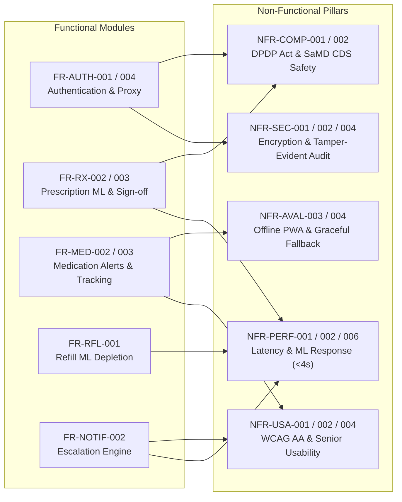

# Software Requirements Specification (SRS)
## Project: ElderGuardian AI — Healthcare Coordination Platform for Elderly Patients
**Document Version:** 1.0.0  
**Target Tech Stack:** React.js (Frontend / PWA), Node.js / Express (Core API Gateway & Microservices), SQLite (Local/Edge Cache) / PostgreSQL (Core Multi-Tenant Relational Store), Python ML Service (FastAPI / Scikit-Learn / PyTorch / Tesseract OCR).

---

## 1. Executive Summary & System Actors

### 1.1 Purpose
ElderGuardian AI is an intelligent, accessible, and resilient healthcare coordination platform engineered specifically to address the clinical, cognitive, and logistical challenges faced by elderly patients (aged 60+) managing chronic illnesses, multi-drug regimens (polypharmacy), and post-consultation care. The platform bridges the communication gap between elderly patients, family caregivers, attending physicians, hospital administrators, and fulfillment pharmacies.

### 1.2 System Actors
- **Elderly Patient (Primary User):** End consumer accessing simplified, accessible interfaces for medication alerts, schedules, appointment check-ins, and emergency SOS triggers.
- **Family Member / Primary Caregiver (Proxy User):** Authorized proxy who monitors adherence, manages appointments, approves refills, and receives escalation alerts.
- **Doctor / Attending Physician (Clinical User):** Healthcare provider who diagnoses, prescribes, reviews longitudinal adherence metrics, and authorizes refills.
- **Hospital Administrator (Administrative User):** Manages hospital profiles, doctor rosters, institutional subscriptions, and department-level geriatric patient coordination.
- **Partner Pharmacy / Fulfillment Partner (Supply Chain User):** Receives routed digital refills, validates stock, and handles home delivery logistics.
- **ElderGuardian AI Engine (Automated Actor):** Python-based ML microservice handling prescription OCR parsing, medication adherence anomaly detection, and inventory depletion forecasting.

---

## SECTION I: FUNCTIONAL REQUIREMENTS

Organized by system module. Prioritization follows the **MoSCoW** framework for the Minimum Viable Product (MVP):
- **Must Have (M):** Critical, non-negotiable core capability required for baseline system functionality.
- **Should Have (S):** High priority, critical for clinical safety or usability, targeted for immediate post-MVP or MVP release candidate.
- **Could Have (C):** Desirable enhancement to improve user experience or clinical depth if time permits.
- **Won't Have (W):** Explicitly deferred to future milestone releases (Post-MVP).

---

### Module 1: Authentication & Authorization (AUTH)

| Req ID | Requirement Title | Priority | Description | Acceptance Criteria |
| :--- | :--- | :--- | :--- | :--- |
| **FR-AUTH-001** | Multi-Factor & Passwordless OTP Authentication | **Must** | The system shall provide an elderly-friendly, passwordless login mechanism using phone numbers and One-Time Passwords (OTP) transmitted via SMS or WhatsApp, in addition to standard email/password credentials. | 1. Given an unregistered or registered phone number, when the user requests an OTP, the system dispatches a 6-digit numeric code within 5 seconds. 2. The OTP entry screen must feature large-format numeric inputs (min 48x48px per digit) with auto-advancing focus and numerical keypad auto-popup. 3. OTP shall remain valid for exactly 180 seconds and allow a maximum of 3 failed attempts before enforcing a 15-minute lockout. 4. Provide an audible "Read OTP" voice-call fallback option if SMS is unreceived after 60 seconds. |
| **FR-AUTH-002** | Secure JWT Token Lifecycle & Rotation | **Must** | The backend shall issue cryptographically signed, short-lived JSON Web Tokens (JWT) for API authentication, paired with secure, rotating refresh tokens stored in HttpOnly cookies. | 1. Access tokens must have an expiration window of 15 minutes and be signed using RS256. 2. Refresh tokens must have an expiration window of 7 days, be stored with `HttpOnly`, `Secure`, and `SameSite=Strict` attributes, and implement automatic token rotation upon each refresh. 3. If a reused or invalidated refresh token is presented, the system must immediately invalidate all active sessions associated with that user family/account. 4. All API requests without a valid bearer token must return HTTP 401 Unauthorized with standardized error payloads. |
| **FR-AUTH-003** | Role-Based Access Control (RBAC) Engine | **Must** | The system must enforce granular role-based permissions across five defined roles: `Patient`, `Caregiver`, `Doctor`, `HospitalAdmin`, and `SuperAdmin`. | 1. Access to endpoints must be evaluated at the Express middleware layer based on assigned JWT role claims. 2. A `Patient` shall only access their own clinical records, prescriptions, and alerts. 3. A `Caregiver` shall only access patient data for which explicit proxy consent has been established. 4. A `Doctor` shall only access data for patients who have an active clinical appointment or established physician-patient relationship. 5. Unauthorized role attempts must return HTTP 403 Forbidden and record an audit log entry. |
| **FR-AUTH-004** | Family Member & Caregiver Proxy Linking | **Must** | The system shall allow an elderly patient (or hospital staff on their behalf) to link one or more family members or caregivers to their account with designated proxy permissions. | 1. Linking initiates via an invitation link or SMS OTP confirmation sent to the designated caregiver's mobile number. 2. The patient must explicitly confirm the linking via a high-contrast confirmation modal, or an in-clinic verified consent override by hospital staff. 3. The system must support two caregiver tiers: `Primary Caregiver` (Full Read/Write: can acknowledge meds, order refills, book visits) and `Secondary Caregiver` (Read-Only: can view health dashboard and adherence stats). 4. A patient can revoke caregiver access instantly at any time from their settings. |
| **FR-AUTH-005** | Granular Dynamic Consent Management | **Must** | In compliance with healthcare privacy standards, the system shall record, enforce, and audit granular patient consent for data sharing across doctors, hospitals, and family members. | 1. The patient/proxy must be presented with clear, itemized consent checkboxes (e.g., "Share Vitals with Dr. X", "Share Medication Adherence with Family", "Allow ML Prescription Parsing"). 2. Consents must be stored with timestamp, actor ID, IP address, and exact text version agreed to. 3. The system shall provide an Emergency "Break-Glass" protocol allowing attending ER physicians temporary 24-hour read access to critical health records, triggering an immediate notification to all primary caregivers and logging an immutable high-severity audit record. 4. Consent revocation must immediately terminate external data access across all caching layers within 60 seconds. |
| **FR-AUTH-006** | Elderly-Optimized Session Timeout & Inactivity Handling | **Should** | The system must implement extended inactivity timeouts suitable for elderly motor and cognitive speeds, paired with clear visual and audible countdown alerts. | 1. Inactivity timeout on the Patient interface shall be set to 60 minutes (contrasting with standard 15-minute enterprise timeouts), while Doctor/Admin dashboards enforce a strict 15-minute idle timeout. 2. At 5 minutes prior to session expiration, display a high-contrast modal dialog with a prominent "Keep Me Logged In" button and an optional gentle audio alert. 3. If the user clicks anywhere or presses any key, the session expiration resets. 4. Upon timeout, persist unsaved form state locally in encrypted storage to prevent data loss upon re-authentication. |

---

### Module 2: Patient Management (PAT)

| Req ID | Requirement Title | Priority | Description | Acceptance Criteria |
| :--- | :--- | :--- | :--- | :--- |
| **FR-PAT-001** | Multi-Channel & Assisted Patient Registration | **Must** | The system shall support patient account onboarding via self-registration, caregiver-assisted registration, or hospital front-desk pre-registration. | 1. Self-registration form must require only basic inputs: Full Name, Date of Birth, Gender, Mobile Number, and Primary Language. 2. Front-desk pre-registration must allow hospital staff to input National Health ID (e.g., ABHA) or hospital MRN to auto-populate demographic data. 3. Every registered patient is assigned a globally unique, non-sequential identifier (`PatientUUID`). 4. Onboarding wizard must feature a maximum of 3 questions per screen with step indicators and voice-prompt guidance. |
| **FR-PAT-002** | Comprehensive Geriatric Profile Management | **Must** | The system shall maintain an extended geriatric health profile including mobility status, sensory impairments, cognitive flags, and baseline vitals. | 1. Profile fields must capture: Visual Impairment (Low Vision, Cataract, Glaucoma), Hearing Impairment, Mobility Impairment (Wheelchair, Cane, Bedridden), Cognitive Impairment (Mild Dementia, Memory Loss). 2. When a sensory impairment flag is active, the React frontend must automatically adjust default UI settings (e.g., auto-enabling High-Contrast Mode or Screen-Reader-Optimized text). 3. Patient profiles must store primary spoken/written language preferences (English, Hindi, regional languages) and display localized UI accordingly. |
| **FR-PAT-003** | Longitudinal Medical History & Baseline Conditions | **Must** | The system shall record and maintain a structured chronic disease registry, known drug and food allergies, past surgeries, and implanted medical devices. | 1. Conditions must be tagged with ICD-10 / SNOMED-CT codes and status flags (`Active`, `In-Remission`, `Resolved`). 2. Allergies must be categorized by severity (`Mild`, `Moderate`, `Severe / Anaphylactic`) and trigger persistent red-banner warnings on all Doctor prescribing screens. 3. Medical history records must be version-controlled, showing which clinical user or caregiver added or updated each entry and when. |
| **FR-PAT-004** | Tiered Emergency Contact Hierarchy & Virtual SOS | **Must** | The system shall allow configuration of a prioritized emergency contact chain and provide a one-touch Virtual SOS button. | 1. System must store at least 2 verified emergency contacts (Name, Relationship, Phone, Alternate Phone). 2. The Patient PWA interface must feature a persistent, accessible, high-contrast Red SOS button on every screen. 3. Pressing and holding the SOS button for 2 seconds initiates an emergency protocol: triggers automated outbound SMS and phone calls to all emergency contacts with current GPS coordinates and medical summary link. 4. A 5-second cancel countdown must prevent accidental trigger activations. |
| **FR-PAT-005** | Healthcare Proxy & Legal Directive Repository | **Should** | The platform shall allow uploading and verified tagging of advance directives, Medical Power of Attorney (MPOA), and Do Not Resuscitate (DNR) documentation. | 1. Uploaded legal PDFs/images must be stored in encrypted S3-compatible blob storage with access restricted to verified clinical users and primary caregivers. 2. An active DNR or MPOA flag must display as a prominent, standardized medical badge on the Patient Header across all clinical views. 3. Changes or deletions of legal directives must require secondary approval from an authorized Hospital Administrator. |

---

### Module 3: Hospital & Doctor Management (DOC)

| Req ID | Requirement Title | Priority | Description | Acceptance Criteria |
| :--- | :--- | :--- | :--- | :--- |
| **FR-DOC-001** | Doctor Professional Profile & Credential Management | **Must** | The system shall store verified doctor profiles, including medical license numbers, board certifications, geriatric specialties, consultation fees, and hospital affiliations. | 1. Medical license numbers must undergo mandatory verification against state/national medical registries before doctor account activation. 2. Doctor profile must list languages spoken, clinical sub-specialties (e.g., Geriatric Cardiology, Neurology, Orthopedics), and bio. 3. System must track individual doctor consultation fees for both in-person hospital visits and teleconsultations. 4. Any modification to license or hospital affiliation triggers an audit log and admin re-verification workflow. |
| **FR-DOC-002** | Doctor Availability Schedule & Buffer Engine | **Must** | The system shall support recurring and custom doctor availability schedules with built-in buffer times tailored for elderly consultation durations. | 1. Doctors or department admins can define daily shift windows, OPD consultation rooms, and slot lengths (default 30 mins for geriatric appointments vs standard 15 mins). 2. The scheduler must automatically enforce a mandatory 5-to-10 minute rest/sanitization buffer between consecutive elderly patient slots. 3. The system shall support custom blackout periods (e.g., surgeries, emergency on-call, leaves) that immediately prevent new bookings on affected slots. 4. Doctor schedule updates must instantly reflect across all patient and caregiver search results within 2 seconds. |
| **FR-DOC-003** | Hospital Facility & Infrastructure Directory | **Must** | The system shall manage hospital entity profiles, including physical addresses, emergency OPD contacts, department hierarchies, and elderly accessibility amenities. | 1. Hospital profiles must catalogue accessibility infrastructure: Wheelchair Availability, Ramp Access, Lift Proximity to OPD, Valet Parking, Geriatric Helpdesk. 2. Hospital profile records must support geo-coordinates (latitude/longitude) for distance-based patient searching. 3. Hospitals can configure departmental operating hours, emergency triage numbers, and affiliated on-site pharmacy endpoints. |
| **FR-DOC-004** | Accessible Multi-Criteria Doctor & Hospital Search | **Must** | The system shall provide an intuitive, high-contrast search and filter interface for patients and caregivers to discover doctors and hospitals. | 1. Search must support querying by: Specialty, Doctor Name, Hospital Name, Proximity/Distance (e.g., <5km, <10km), Language Spoken, and Next Available Date. 2. Results must display clear availability badges ("Available Today", "Next Slot: Tomorrow 10:00 AM") and accessible pricing information. 3. Search results must return in under 300ms for queries against an indexed catalogue of up to 10,000 providers. 4. The interface must provide simplified, one-tap quick filters: "Doctors Near Me", "Geriatric Specialists", "Teleconsultation Available". |

---

### Module 4: Appointment Management (APT)

| Req ID | Requirement Title | Priority | Description | Acceptance Criteria |
| :--- | :--- | :--- | :--- | :--- |
| **FR-APT-001** | Multi-Mode Appointment Booking Workflow | **Must** | The system shall allow elderly patients, authorized caregivers, or hospital desk coordinators to book in-person hospital visits or teleconsultations. | 1. Booking workflow must follow a guided 3-step wizard: (1) Select Doctor/Date, (2) Select Morning/Afternoon Slot, (3) Confirm Details. 2. Caregivers must be able to select which linked patient the appointment is for with a single dropdown or avatar click. 3. Teleconsultation bookings must automatically generate and attach an encrypted WebRTC video conference link to the appointment record. 4. Upon completion, a booking confirmation screen must display full details in 24px bold font, with an option to download a 1-page printable confirmation slip or send it to WhatsApp. |
| **FR-APT-002** | Real-Time Slot Locking & Concurrency Control | **Must** | The backend shall prevent race conditions and double bookings through atomic slot reservations during checkout/confirmation. | 1. Selecting an open slot locks it for that user for exactly 10 minutes using a distributed Redis lock or database row-level lock (`SELECT ... FOR UPDATE`). 2. If booking is finalized within 10 minutes, the slot transitions to `Booked`. 3. If booking is abandoned or times out, the lock expires automatically and the slot returns to `Available` without administrative intervention. 4. Concurrent booking attempts by two users for the same millisecond slot must cleanly grant the slot to the first request and immediately prompt the second with the next nearest slot. |
| **FR-APT-003** | Elderly-Centric Rescheduling & Cancellation | **Must** | The platform shall allow friction-free appointment rescheduling or cancellation with patient-friendly rules. | 1. Patients or caregivers can cancel or reschedule up to 2 hours prior to the slot with zero financial penalty. 2. Rescheduling must pre-fill existing patient details and present the doctor’s next 3 earliest available matching slots. 3. If a doctor cancels due to an emergency, the system must automatically notify affected patients via SMS and automated voice call within 60 seconds, and place them at the head of the priority queue for rescheduling. 4. Every cancellation requires a one-click reason selection (e.g., "Feeling Unwell", "Transport Unavailable", "Doctor Rescheduled") for clinical auditing. |
| **FR-APT-004** | Automated Multi-Stage Appointment Reminders | **Must** | The system shall dispatch progressive reminders across multiple channels to ensure elderly patients do not miss scheduled consultations. | 1. Dispatch automated reminders at 3 distinct intervals: T-48 hours (SMS/Email), T-24 hours (WhatsApp/SMS with interactive confirmation button), and T-2 hours (In-app alert + SMS). 2. For elderly patients flagged with memory/cognitive impairment, trigger an automated phone call (IVR) 3 hours prior to the appointment. 3. Reminders must clearly state: Doctor Name, Specialty, Hospital Address, Room/OPD Number, Wheelchair Gate directions, and required documents (e.g., "Bring previous test reports"). |
| **FR-APT-005** | Post-Consultation Follow-up & Care Continuity | **Should** | The system shall automatically schedule and remind patients of recommended follow-up visits as mandated in the doctor's prescription. | 1. When a doctor selects "Review in 2 weeks" on the e-prescription, the system generates a tentative follow-up task on the patient and caregiver calendar. 2. At T-7 days before the recommended review date, the system sends a proactive prompt to book the follow-up slot with one click. 3. Doctor dashboard displays an alert if a high-risk chronic patient fails to book their recommended follow-up within 7 days of the target date. |

---

### Module 5: Prescription Management (RX)

| Req ID | Requirement Title | Priority | Description | Acceptance Criteria |
| :--- | :--- | :--- | :--- | :--- |
| **FR-RX-001** | Multi-Modal Prescription Upload & Capture | **Must** | The platform shall allow patients, caregivers, and clinical staff to upload physical prescription slips via camera photo, image file, or PDF. | 1. The PWA camera interface must feature auto-cropping, edge detection, perspective correction, and contrast enhancement to optimize legibility of handwritten slips. 2. Supported formats: JPEG, PNG, HEIC, PDF with a maximum file size of 15MB per document. 3. Files must be immediately virus-scanned, converted to lossless web-optimized formats, and stored in AES-256 encrypted storage. 4. Patient is presented with an immediate confirmation message: "Prescription uploaded successfully. Our clinical team and AI are reviewing it." |
| **FR-RX-002** | Python ML OCR & Information Extraction Pipeline | **Must** | The backend shall route uploaded prescriptions to a Python ML microservice that extracts drug names, dosages, frequencies, routes, durations, and doctor signatures. | 1. ML pipeline must process an uploaded image and return structured JSON in under 4 seconds. 2. Extracted entities must include: Drug Name, Brand Name, Generic Molecule, Strength (e.g., 500mg), Dosage Form (Tablet, Syrup, Injection), Frequency (e.g., 1-0-1, OD, BID, TID, PRN), Route (Oral, Topical), Duration (days), and Doctor Details. 3. Each extracted entity must carry a confidence score ($0.00$ to $1.00$). 4. Any entity with a confidence score below $0.85$ must be flagged as `Requires Manual Clinical Verification`. |
| **FR-RX-003** | Clinician-in-the-Loop Authorization & Digital Signature | **Must** | The system must strictly enforce that no AI-extracted prescription can be converted into active medication reminders without verification and digital signing by a licensed doctor. | 1. Doctor dashboard must display a side-by-side view: original uploaded prescription slip on the left, ML-extracted structured fields on the right. 2. Doctor can edit, correct, add, or delete any extracted medication item. 3. Final approval requires the doctor to click "Authorize Prescription" backed by password/PIN re-entry or digital signature certificate (DSC) hash. 4. Once authorized, the prescription status transitions to `Active - Clinically Verified`, which programmatically populates the patient's active Medication Schedule. |
| **FR-RX-004** | Prescription Versioning & Immutable Audit Trail | **Must** | The system shall maintain an immutable, versioned history of all prescription revisions, modifications, and discontinuations. | 1. Modifying an existing prescription shall never overwrite past records; it must create a new version (e.g., `v1.0`, `v1.1`, `v2.0`) linked to the parent prescription group. 2. The system must record the exact user ID, timestamp, reason for modification, and diff of changes for every revision. 3. Patients, caregivers, and doctors can toggle between historical versions to view past medication regimens. 4. Discontinued medications must be visually struck through with the discontinuing doctor's name and clinical rationale recorded. |
| **FR-RX-005** | Geriatric Drug-Drug Interaction & Beers Criteria Alerting | **Should** | The Python ML / Clinical Rule service shall screen prescribed medications against a geriatric drug interaction database and the AGS Beers Criteria® for potentially inappropriate medication use in older adults. | 1. System screens candidate prescriptions against patient's existing active medications, known allergies, and chronic renal/hepatic diagnoses. 2. Interaction severity levels: `Minor` (Informational), `Moderate` (Warning), `Major / Contraindicated` (Hard Stop). 3. If a Major Interaction or Beers Criteria violation is detected (e.g., high-dose benzodiazepines or NSAIDs with heart failure), display a prominent red warning banner to the doctor detailing the risk and suggesting safer alternatives. 4. The doctor can only override a Major Alert by typing a documented clinical justification, which is recorded in the permanent audit trail. |

---

### Module 6: Medication Management (MED)

| Req ID | Requirement Title | Priority | Description | Acceptance Criteria |
| :--- | :--- | :--- | :--- | :--- |
| **FR-MED-001** | Intelligent Circadian Schedule Generation | **Must** | The system shall translate medical frequencies (e.g., TID, AC, PC, QHS) into localized, patient-specific daily reminder schedules aligned with elderly meal times. | 1. System must configure customizable daily anchor points: Breakfast (default 08:30), Lunch (default 13:00), Dinner (default 20:00), and Bedtime (default 21:30). 2. Clinical instructions must auto-map: "Before Food / AC" sets reminder 30 minutes before the anchor; "After Food / PC" sets reminder 30 minutes after. 3. The generated schedule must display in an accessible visual timeline with clear color codes and daylight/night icons. 4. Patients or caregivers can adjust anchor times by $\pm 60$ minutes to match personal lifestyle patterns. |
| **FR-MED-002** | High-Visibility Multi-Sensory Medication Reminders | **Must** | The PWA frontend and mobile client shall trigger high-visibility, multi-sensory alerts for due medications. | 1. When a dose is due, the interface displays a persistent, full-screen takeover modal with 32px text showing: Drug Name, Pill Photo, Color/Shape description, and Dosage ("Take 1 Blue Round Tablet"). 2. Alert must trigger a distinctive, non-jarring audio chime and physical device vibration pattern for at least 30 seconds. 3. Provide an integrated Text-to-Speech (TTS) engine that speaks aloud the instructions in the patient’s chosen language (e.g., "Time to take your blood pressure tablet, Amlodipine 5mg, after breakfast"). 4. Screen must provide three extra-large buttons (min 60x60px): "TAKEN" (Green), "SNOOZE 15 MIN" (Yellow), and "SKIP" (Grey/Red). |
| **FR-MED-003** | One-Tap Adherence Tracking & Acknowledgment | **Must** | The system shall record the exact timestamp and status of every scheduled dose when acknowledged by the patient or proxy caregiver. | 1. Clicking "TAKEN" immediately logs status as `Taken` with exact epoch timestamp and closes the modal. 2. Clicking "SNOOZE 15 MIN" reschedules the full alert to trigger again in exactly 15 minutes, allowing a maximum of 3 consecutive snoozes. 3. Clicking "SKIP" prompts the user with simple, large-font reason pills: "Felt Sick", "Ran Out", "Doctor Told Me to Stop", "Other". 4. If a dose is neither acknowledged nor snoozed within 60 minutes of scheduled time, the system flags the dose as `Missed` and initiates the escalation workflow (FR-NOTIF-002). |
| **FR-MED-004** | Python ML Adherence Scoring & Anomaly Detection | **Should** | The Python ML engine shall compute rolling adherence percentages, identify cognitive deterioration patterns, and predict impending therapy abandonment. | 1. System calculates daily, weekly, and 30-day adherence scores: $\text{Adherence \%} = (\text{Doses Taken On-Time} / \text{Total Scheduled Doses}) \times 100$. 2. ML model analyzes time-to-acknowledge distributions to detect anomaly trends (e.g., progressive delay in morning dose over 5 days indicating cognitive or physical decline). 3. If rolling adherence falls below 75%, or if 2 consecutive critical medication doses are missed, trigger an automated High-Risk Care Flag to the Doctor and Primary Caregiver dashboards. 4. Expose an API endpoint `/api/v1/analytics/adherence/:patientId` returning structured time-series data and risk vectors. |
| **FR-MED-005** | Real-Time Pill Inventory & Auto-Decrement Tracker | **Must** | The system shall maintain an accurate inventory count for every active medication, automatically decrementing counts upon verified dose consumption. | 1. Initial inventory count is populated upon prescription verification or manual caregiver stock entry. 2. Marking a dose as `Taken` atomically decrements the specific medication inventory count by the prescribed unit quantity. 3. Marking a dose as `Skipped` retains the existing inventory count. 4. Caregivers can manually adjust inventory count with an audit note (e.g., "Pill dropped on floor / damaged"). |

---

### Module 7: Refill Coordination (RFL)

| Req ID | Requirement Title | Priority | Description | Acceptance Criteria |
| :--- | :--- | :--- | :--- | :--- |
| **FR-RFL-001** | Python ML Depletion Forecasting Engine | **Must** | The system shall employ a predictive ML model to forecast exact medication run-out dates based on real-time consumption rates rather than static day counts. | 1. Python ML service runs a daily batch forecasting job computing $D_{\text{depletion}} = \text{Current Inventory} / \text{Effective Daily Consumption Rate}$, factoring in historical adherence patterns. 2. System identifies the critical threshold date when inventory reaches $\le 7$ days of supply remaining. 3. The forecasting model accounts for weekend pharmacy closures and delivery lead times by dynamically expanding the safety buffer to 10 days for remote/rural postal codes. 4. System outputs depletion alerts to the Refill Queue when any chronic medication breaches the threshold. |
| **FR-RFL-002** | Automated Refill Cart Generation & Batching | **Must** | When any chronic medication approaches depletion, the system shall assemble a consolidated refill cart batching all medications due for renewal within the next 14 days. | 1. Refill cart aggregates all active medications for the patient that will deplete within 14 days to minimize delivery fees and multiple package handoffs for the elderly. 2. Cart calculates estimated refill quantity for a standard 30-day, 60-day, or 90-day cycle. 3. Cart displays exact brand, generic equivalent option (with price difference), and total estimated out-of-pocket cost in large typography. 4. Refill requisition is dispatched to the Caregiver and Patient dashboard with a one-click "Approve & Order Refill" action. |
| **FR-RFL-003** | Clinical Refill Authorization Workflow | **Must** | For regulated or chronic prescription drugs, the system shall route refill requests requiring doctor re-authorization before order transmission to the pharmacy. | 1. System checks prescription metadata: if the remaining authorized refill count is $\ge 1$, order bypasses doctor review and proceeds directly to pharmacy routing. 2. If remaining refills are 0 (prescription exhausted), the system automatically routes an e-Refill Request to the prescribing doctor's task inbox. 3. Doctor can approve the refill renewal for 1-6 months with a single tap, modify the dosage, or request an in-person review before approving. 4. If doctor fails to respond within 48 hours, escalate to hospital department nursing coordinator to prevent abrupt therapy cessation. |
| **FR-RFL-004** | Partner Pharmacy Routing & Dispatch Tracking | **Should** | The system shall electronically transmit approved refill orders to the hospital's on-site pharmacy or contracted digital pharmacy partner. | 1. System selects fulfillment pharmacy based on patient preference, inventory availability, and geographic delivery radius. 2. Transmit standardized FHIR `MedicationRequest` or secure JSON payload containing patient delivery address, digital prescription PDF, and drug details. 3. Ingest real-time webhook updates from pharmacy: `Order Accepted`, `Dispensing`, `Out for Delivery`, `Delivered`. 4. Display live, simplified delivery status tracker on Patient and Caregiver dashboards ("Medicine arriving today between 2 PM and 5 PM"). |
| **FR-RFL-005** | Out-of-Stock Generic Substitution & Emergency Mitigation | **Could** | When a partner pharmacy reports a stockout for a prescribed brand, the system shall suggest bioequivalent generic alternatives with physician consent. | 1. When a stockout webhook is received, query internal formulary database for identical chemical composition, strength, and dosage form. 2. Present generic substitute options to the doctor for fast-track 1-tap sign-off. 3. If no substitute is available within 24 hours, flag an emergency stockout alert to the caregiver and provide contact details of nearby physical retail pharmacies carrying the stock. |

---

### Module 8: Family Dashboard (FAM)

| Req ID | Requirement Title | Priority | Description | Acceptance Criteria |
| :--- | :--- | :--- | :--- | :--- |
| **FR-FAM-001** | Consolidated Elderly Health & Wellbeing Summary | **Must** | The Family Dashboard shall provide authorized caregivers an at-a-glance, real-time visual summary of the elderly patient's daily health status. | 1. Dashboard displays a central "Today's Status" widget: Overall Status Badge (`All Medications Taken On Time`, `Attention: 1 Dose Missed`, `Pending Evening Dose`). 2. Visual progress ring indicating percentage of today's scheduled regimen completed. 3. Summary display of latest recorded vitals (Blood Pressure, Blood Glucose, SpO2, Heart Rate) with color-coded normal/abnormal ranges. 4. Direct one-touch action buttons: "Call Patient", "View Medicine Cabinet", "Book Doctor Appointment". |
| **FR-FAM-002** | Real-Time Medication Timeline & Adherence Feed | **Must** | The dashboard shall render an interactive timeline of all scheduled, taken, snoozed, and missed doses for the current week. | 1. Visual timeline lists every dose chronologically with pill name, scheduled time, actual acknowledgment time, and status badge. 2. Doses confirmed by the patient render with a green checkmark; missed doses display with a red exclamation point. 3. Clicking any dose displays details: who acknowledged it (Patient or Caregiver), location (if logged), and reason if skipped. 4. Caregiver can remotely mark a dose as "Taken on behalf of Patient" with mandatory confirmation note. |
| **FR-FAM-003** | Instant Emergency SOS & Vitals Alert Broadcast | **Must** | The dashboard must instantly alert caregivers upon any Virtual SOS activation or critical abnormal vital sign reading. | 1. When patient triggers SOS, the Family Dashboard displays a high-priority, persistent flashing red banner accompanied by an audible repeating alarm sound on the caregiver's device. 2. Screen displays patient’s last known GPS location on an interactive map with direct routing directions via Google Maps. 3. If a connected vital sign device (or manual entry) logs a critical value (e.g., Systolic BP > 180 or Blood Glucose < 60 mg/dL), display an immediate urgent alert with emergency medical advice. |
| **FR-FAM-004** | Multi-Caregiver Task Delegation & Coordination | **Should** | The platform shall allow multiple linked family members to assign and coordinate caregiving tasks to avoid confusion or duplicate efforts. | 1. Caregivers can create and assign shared tasks: e.g., "Accompany Mom to Cardiology Clinic", "Pick up Refill from Pharmacy", "Check Morning Blood Sugar". 2. Tasks feature status toggles (`Open`, `In-Progress`, `Completed`), due dates, and assignee avatars. 3. When a caregiver marks a task as complete, push notifications update all other linked family members within 5 seconds. 4. Includes a shared internal family note thread for daily care coordination. |
| **FR-FAM-005** | Privacy-Preserving Granular View Controls | **Must** | The Family Dashboard shall respect patient privacy preferences, masking sensitive clinical records as configured in patient consent rules. | 1. If a patient marks specific diagnoses or medications as `Private / Sensitive` (e.g., Mental Health, Oncology, Reproductive Health), these records are masked on the Family Dashboard. 2. The dashboard displays "Medication Schedule Confidential" for that specific slot while still reflecting overall adherence % without disclosing drug name. 3. Caregivers cannot view, export, or share masked clinical notes without secondary patient PIN authorization. |

---

### Module 9: Notifications & Escalations (NOTIF)

| Req ID | Requirement Title | Priority | Description | Acceptance Criteria |
| :--- | :--- | :--- | :--- | :--- |
| **FR-NOTIF-001** | Multi-Channel Notification Dispatcher Engine | **Must** | The backend shall orchestrate notification delivery across In-App WebSockets, Web Push (PWA), SMS, WhatsApp Business API, and automated Voice (IVR). | 1. Notification engine must process events from an asynchronous message queue (e.g., Redis / BullMQ). 2. Dispatch engine selects channel based on notification urgency and patient communication preferences. 3. In-app notifications deliver over WebSocket within 500ms of event trigger. 4. Outbound SMS and WhatsApp messages must deliver via verified healthcare gateways within 10 seconds of trigger. |
| **FR-NOTIF-002** | Hierarchical 4-Tier Escalation Protocol for Missed Doses | **Must** | The system shall execute an automated, escalating notification protocol when critical medication doses are unacknowledged. | 1. **Tier 1 (T+0 min):** Full-screen in-app alert + audio chime on Patient device. 2. **Tier 2 (T+15 min):** Repeat in-app alert + automated SMS reminder to Patient. 3. **Tier 3 (T+30 min):** High-priority push notification and SMS sent to Primary Caregiver: *"Alert: [Patient Name] has not taken their critical 08:30 AM dose of [Drug Name]. Please check on them."* 4. **Tier 4 (T+60 min):** Automated outbound IVR phone call to Primary Caregiver. If unacknowledged at T+120 min, flag an urgent adherence alert on the Attending Doctor’s dashboard. |
| **FR-NOTIF-003** | Cognitive Accessibility Notification Formatting | **Must** | Notifications delivered to elderly patients must adhere to strict cognitive accessibility rules: short words, active voice, high contrast, and optional text-to-speech. | 1. Message character count must not exceed 100 characters for elderly-facing alerts. 2. Use clear, jargon-free phrasing: e.g., "Time for your Heart Pill" instead of "DUE: Metoprolol Tartrate 25mg Extended Release Oral Tablet". 3. Notification modals must allow the user to click a speaker icon to have the entire message read aloud clearly at 0.85x normal speech speed. 4. Prevent spamming: identical non-critical notifications cannot be dispatched more than once in a 2-hour window. |
| **FR-NOTIF-004** | Intelligent Quiet Hours & Critical Alert Override | **Should** | The system shall enforce configurable nighttime quiet hours, suppressing routine notifications while allowing emergency alerts to pierce through. | 1. Default quiet hours configured from 22:00 to 07:00 local patient time. 2. Routine notifications (e.g., appointment reminders for next week, non-urgent refill notices) are queued during quiet hours and released at 07:30. 3. Critical alerts (SOS triggers, severe abnormal vitals, Tier 3/4 medication escalations) immediately override quiet hours, sounding all designated audible alarms. |
| **FR-NOTIF-005** | Notification Audit Log & Delivery Status Tracking | **Must** | The system shall record end-to-end telemetry for every notification dispatched, tracking status from queued to opened/actioned. | 1. Database records: `NotificationID`, `RecipientID`, `Channel`, `PayloadHash`, `TimestampQueued`, `TimestampSent`, `TimestampDelivered`, `TimestampRead`, `Status`. 2. If a delivery channel fails (e.g., SMS gateway timeout), the system must automatically retry via alternate fallback channel (e.g., WhatsApp or automated Voice call) within 30 seconds. 3. Expose delivery metrics on Admin dashboard showing channel success rates and latency. |

---

### Module 10: Doctor Dashboard (DRD)

| Req ID | Requirement Title | Priority | Description | Acceptance Criteria |
| :--- | :--- | :--- | :--- | :--- |
| **FR-DRD-001** | Unified Longitudinal Geriatric Patient Record | **Must** | The Doctor Dashboard shall provide a consolidated, single-screen view of the patient’s complete medical summary, active polypharmacy list, vitals trends, and lab reports. | 1. Patient record screen must load in under 1.0 second upon selection. 2. Clinical view organizes into standardized widgets: (a) Chronic Problem List, (b) Active Medication Regimen, (c) Allergies & Alerts (in high-contrast red), (d) 90-Day Adherence Score, (e) Recent Lab Investigations. 3. Active medications list must group by therapeutic class (e.g., Antihypertensives, Antidiabetics, Anticoagulants) showing dose, frequency, and prescribing physician. 4. Provide one-click access to view historical uploaded prescription slips and diagnostic imaging. |
| **FR-DRD-002** | Interactive Adherence Graphs & Anomaly Visualizer | **Must** | The dashboard shall display interactive adherence curves, missed dose heatmaps, and ML-generated risk vectors for the attending physician. | 1. Render interactive 30-day and 90-day compliance curves generated from Python ML service metrics. 2. Display a day-of-week / time-of-day heatmap highlighting specific recurring adherence gaps (e.g., "Patient misses 60% of Sunday evening doses"). 3. Anomaly visualizer flags sudden downward shifts in adherence alongside correlated events (e.g., new medication added on Nov 10th followed by drop in adherence, suggesting side effects). 4. Doctor can export a 1-page PDF Geriatric Adherence Report for clinical case records. |
| **FR-DRD-003** | Clinical Alert Center & Priority Triage Feed | **Must** | The dashboard shall maintain a real-time prioritized clinical alert feed surfacing patients who require immediate attention. | 1. Feed categorizes alerts into: `Critical` (SOS triggered, severe vitals breach), `Warning` (Adherence < 70%, 2+ missed critical doses, drug interaction warning), `Informational` (Refill renewal requested). 2. Clicking an alert immediately opens the relevant patient record with the triggering clinical event expanded and highlighted. 3. Doctor can dismiss an alert only after selecting an action: "Contacted Patient", "Adjusted Medication", "Requested Lab Work", or "Acknowledged No Action". 4. Feed updates in real time via WebSockets without requiring page refreshes. |
| **FR-DRD-004** | Fast-Track E-Prescribing & Renewal Console | **Must** | The system shall provide an intuitive, keyboard-optimized electronic prescribing console with auto-suggest, dosage bounds checking, and 1-click refill renewals. | 1. Drug search input features autocomplete querying a standardized formulary of 50,000+ brand and generic medications within 50ms. 2. Prescribing interface auto-populates standard geriatric dosage defaults and alerts if entered dose exceeds maximum recommended geriatric limits. 3. Refill renewal inbox allows the doctor to review and authorize pending refill requests individually or via bulk multi-select in under 10 seconds. 4. Digitally signed prescriptions generate a QR-coded, tamper-evident PDF immediately accessible by the patient and partner pharmacy. |
| **FR-DRD-005** | Secure Clinical Messaging & Caregiver Note Exchange | **Should** | The dashboard shall provide an asynchronous, secure clinical messaging thread between the attending doctor, nursing staff, and authorized primary caregivers. | 1. Caregivers can send structured medical queries; doctor or clinical assistant can reply with formal medical guidance or advice. 2. Doctor can toggle availability for messaging ("Accepting Inquiries", "Away - Contact Emergency OPD"). 3. Messages must enforce HIPAA / DPDP compliant end-to-end transport encryption. 4. Clinical staff can convert any message thread into an official addendum to the patient’s permanent clinical progress notes. |

---

### Module 11: Hospital Admin Dashboard (ADM)

| Req ID | Requirement Title | Priority | Description | Acceptance Criteria |
| :--- | :--- | :--- | :--- | :--- |
| **FR-ADM-001** | Multi-Tenant Institutional Subscription & License Management | **Must** | The Admin Dashboard shall allow hospital administrators to manage enterprise subscriptions, department quotas, and staff user seat allocations. | 1. Manage organizational tier (e.g., Enterprise Hospital, Multi-Clinic Network, Community Geriatric Center) and renewal cycles. 2. View active vs licensed seat counts for Doctors, Nurses, Coordinators, and Care Managers. 3. Provision and de-provision staff accounts with immediate session revocation upon staff termination. 4. Support multi-facility tenancy: Super Admins can partition data access across distinct hospital branches or physical hospital campuses. |
| **FR-ADM-002** | Geriatric Population Health Analytics & Cohort Metrics | **Should** | The dashboard shall aggregate population health analytics across all registered elderly patients affiliated with the hospital. | 1. Real-time visual metrics displaying: Total Geriatric Patients Enrolled, Average Hospital-Wide Medication Adherence %, Polypharmacy Prevalence (>5 active drugs), 30-Day Readmission Risk Index. 2. Cohort filtering: Filter population by age bracket (60-70, 70-80, 80+), primary chronic condition (Diabetes, Hypertension, CHF, Parkinson’s), and geographic pin codes. 3. Identify high-risk patient clusters to allocate community geriatric care coordinators proactively. 4. Export de-identified population health metrics to CSV, Excel, or BI dashboard formats (Tableau / PowerBI connectors). |
| **FR-ADM-003** | Geriatric Care Coordination & Priority Queue Manager | **Must** | The system shall manage physical and teleconsultation patient queues, prioritizing frail and elderly patients for hospital OPD visits. | 1. Front-desk coordinators can view live OPD waiting rooms with automated geriatric priority weighting (patients aged 75+ or wheelchair-bound prioritized). 2. Coordinate escort and wheelchair assistance requests booked during appointment scheduling. 3. Monitor average waiting times: if an elderly patient waits longer than 20 minutes past appointment time, trigger an operational alert to the department nursing head. 4. Track patient journey checkpoints: `Arrived`, `Vitals Triaged`, `In Consultation`, `At Pharmacy`, `Discharged`. |
| **FR-ADM-004** | Comprehensive System Audit Logs & Compliance Reporting | **Must** | The system shall maintain an immutable, tamper-evident audit repository tracking every access, view, modification, and export of Protected Health Information (PHI). | 1. Admin can search and filter audit logs by: User ID, Role, Patient MRN/UUID, IP Address, Action Type (`VIEW`, `CREATE`, `UPDATE`, `DELETE`, `EXPORT`), and Date Range. 2. Audit records must be cryptographically hashed (SHA-256) and append-only to prevent tampering by database administrators. 3. System must support generating automated compliance reports formatted for DPDP Act and NABH / JCI hospital accreditation inspections in under 30 seconds. 4. Automated notification to Hospital Compliance Officer upon detection of suspicious data access patterns (e.g., mass download of patient records). |
| **FR-ADM-005** | Pharmacy Partner SLA & Supply Chain Telemetry | **Should** | The dashboard shall monitor partner pharmacy fulfillment SLAs, medication stockout frequencies, and home delivery turnaround times. | 1. Real-time telemetry dashboard tracking: Refill Request to Delivery Lead Time (Target: < 24 hours), Stockout Rejection Rate (Target: < 2%), and On-Time Delivery Rate (Target: > 98%). 2. Automated alerts when partner pharmacy breaches agreed fulfillment service level agreements. 3. Ability to pause routing to an underperforming pharmacy partner and redirect fulfillment orders to backup providers with 1 click. |

---

## SECTION II: NON-FUNCTIONAL REQUIREMENTS

Organized by system quality attributes. All requirements are assigned unique identifiers in the format `NFR-[CATEGORY]-[NUM]` and cross-referenced with sequential master identifiers `NFR-001` through `NFR-036`.

---

### 1. Performance Requirements

| Master ID | Category ID | Metric / Requirement | Target Specification | Verification Method |
| :--- | :--- | :--- | :--- | :--- |
| **NFR-001** | **NFR-PERF-001** | Core API Latency | 95th percentile ($P_{95}$) response time $\le 200\text{ ms}$; 99th percentile ($P_{99}$) $\le 500\text{ ms}$ for all core CRUD endpoints under nominal load. | Automated k6 load tests executing 10,000 synthetic requests/min against Express backend. |
| **NFR-002** | **NFR-PERF-002** | ML Inference Response Time | Python ML prescription OCR and parsing pipeline must return structured JSON in $\le 4.0\text{ seconds}$ for a standard single-page document. | Benchmark suite processing 500 diverse prescription scans on GPU/CPU inference nodes. |
| **NFR-003** | **NFR-PERF-003** | Concurrent Active Users | Support a minimum of 5,000 simultaneous active patient/caregiver sessions and 500 concurrent doctor/admin clinical sessions without degradation. | Distributed stress testing simulating concurrent WebSockets and REST interactions via Locust. |
| **NFR-004** | **NFR-PERF-004** | Frontend Page Load Performance | Core Web Vitals on 3G/4G connections: Largest Contentful Paint (LCP) $\le 2.5\text{ s}$, First Contentful Paint (FCP) $\le 1.2\text{ s}$, Cumulative Layout Shift (CLS) $\le 0.05$. | Lighthouse CI automated audits integrated into the deployment pipeline; Real User Monitoring (RUM). |
| **NFR-005** | **NFR-PERF-005** | Database Query Performance | 99% of indexed PostgreSQL queries must execute in $\le 50\text{ ms}$. Complex analytical queries on Admin dashboard must resolve in $\le 1.5\text{ s}$. | PostgreSQL `pg_stat_statements` analysis and automated query profiling in staging. |
| **NFR-006** | **NFR-PERF-006** | Notification Delivery Latency | High-priority SOS and medication escalation notifications must deliver to third-party gateways (SMS/Push) within $\le 5.0\text{ seconds}$ of trigger. | End-to-end telemetry monitoring message queue dispatch time to gateway acknowledgment. |

---

### 2. Security Requirements

| Master ID | Category ID | Security Domain | Target Specification | Verification Method |
| :--- | :--- | :--- | :--- | :--- |
| **NFR-007** | **NFR-SEC-001** | Cryptographic Protection | Enforce TLS 1.3 for all data in transit with strict HSTS (max-age=31536000). All data at rest in PostgreSQL and S3 blob storage must be encrypted via AES-256. | Automated Qualys SSL Labs audit (Grade A+ required); AWS KMS / PostgreSQL transparent disk encryption verification. |
| **NFR-008** | **NFR-SEC-002** | OWASP Top 10 Defenses | Full protection against OWASP Top 10 vulnerabilities: Parameterized queries (Prisma/ORM) preventing SQL injection; DOMPurify sanitization preventing XSS; CSRF token validation; strict Content Security Policy (CSP). | Automated static analysis (SAST) via SonarQube; dynamic analysis (DAST) via OWASP ZAP; annual third-party penetration testing. |
| **NFR-009** | **NFR-SEC-003** | Session & Credential Security | Passwords hashed using Argon2id ($m=65536, t=3, p=4$). JWT access tokens stored in-memory; refresh tokens stored in `HttpOnly`, `Secure`, `SameSite=Strict` cookies with automatic replay detection. | Automated security regression test suites inspecting cookie headers and attempting token replay attacks. |
| **NFR-010** | **NFR-SEC-004** | Immutable Audit Logging | All read, write, update, and delete actions on PHI records must append an immutable, cryptographically chained audit entry containing User ID, Role, Client IP, Hash, and Timestamp. | Write-once-read-many (WORM) storage verification and automated tampering simulation tests. |
| **NFR-011** | **NFR-SEC-005** | API Rate Limiting & DoS Protection | Enforce IP and user-based token bucket rate limiting via Redis: Public auth endpoints limited to 5 req/min; Authenticated endpoints limited to 120 req/min. | Automated load testing asserting HTTP 429 Too Many Requests responses upon threshold breach. |

---

### 3. Scalability Requirements

| Master ID | Category ID | Architecture Layer | Target Specification | Verification Method |
| :--- | :--- | :--- | :--- | :--- |
| **NFR-012** | **NFR-SCAL-001** | Horizontal Stateless Compute | Node.js/Express API gateway and backend microservices must be completely stateless, containerized via Docker, and auto-scale horizontally in Kubernetes based on CPU ($\ge 70\%$) or Memory ($\ge 75\%$). | Kubernetes Horizontal Pod Autoscaler (HPA) stress tests verifying scale-out from 3 to 25 pods under burst traffic. |
| **NFR-013** | **NFR-SCAL-002** | Asynchronous Workload Decoupling | Long-running operations (prescriptions OCR, batch notification dispatches, adherence report generation) must be decoupled from the HTTP cycle via Redis/BullMQ message queues. | Queue throughput monitoring ensuring zero HTTP request blocking during 10,000-message bulk ingestion. |
| **NFR-014** | **NFR-SCAL-003** | Database Partitioning & Sharding Strategy | PostgreSQL tables for time-series data (`medication_logs`, `audit_events`, `vitals_history`) must implement declarative range partitioning by calendar month. Hospital multi-tenancy supported via schema separation or tenant ID partitioning. | Database benchmark evaluating query execution times across a partitioned table containing 50 million records. |
| **NFR-015** | **NFR-SCAL-004** | Read/Write Database Segregation | Database architecture must implement a single Primary Writer node with multiple Read Replicas. Analytical queries and dashboard aggregations must route exclusively to Read Replicas. | Database connection pool telemetry confirming zero analytical query execution on the Primary Writer instance. |

---

### 4. Availability & Reliability Requirements

| Master ID | Category ID | Area | Target Specification | Verification Method |
| :--- | :--- | :--- | :--- | :--- |
| **NFR-016** | **NFR-AVAL-001** | High Availability SLA | System must guarantee $99.9\%$ operational uptime ($\le 43.8$ minutes unscheduled downtime per month) during core hours (06:00 to 23:00 local time) and $99.5\%$ overall annual availability. | Multi-region ping telemetry via external uptime monitors (e.g., Datadog, Pingdom) with 30-second health check intervals. |
| **NFR-017** | **NFR-AVAL-002** | High Availability Deployment Topology | Deploy compute and database instances across at least two physically distinct Availability Zones (Multi-AZ) with automated DNS failover. | Chaos engineering fault-injection tests (terminating an entire AZ) verifying uninterrupted service within 30 seconds. |
| **NFR-018** | **NFR-AVAL-003** | Offline PWA Graceful Degradation | The React PWA must leverage Service Workers and local SQLite/IndexedDB caching to allow patients to view today’s active medication schedule and trigger emergency calls even when offline. | Network-disabled client testing validating that cached schedules render and offline acknowledgments queue for background sync. |
| **NFR-019** | **NFR-AVAL-004** | Circuit Breakers & Graceful Degradation | Upstream service dependencies (Python ML OCR service, SMS gateways) must be wrapped with circuit breakers (e.g., Opossum). If ML service fails, fallback to manual front-desk prescription entry without crashing the API. | Simulated service outage tests verifying circuit transitions to `OPEN` state after 5 consecutive failures and graceful fallback activation. |

---

### 5. Usability & Elderly-Centric Accessibility Requirements

| Master ID | Category ID | Accessibility Domain | Target Specification | Verification Method |
| :--- | :--- | :--- | :--- | :--- |
| **NFR-020** | **NFR-USA-001** | WCAG 2.1 Level AA Compliance | The entire user interface must strictly conform to W3C Web Content Accessibility Guidelines (WCAG) 2.1 Level AA standards across all screens. | Automated audits via axe-core and Pa11y; manual screen reader evaluations using NVDA, JAWS, and VoiceOver. |
| **NFR-021** | **NFR-USA-002** | Elderly Typography & Sizing Standards | Patient interface base font size must be $\ge 18\text{ px}$ with scalable support up to $28\text{ px}$ without text truncation. Line height must be $\ge 1.6$. Text contrast ratio must meet or exceed $7:1$ (AAA standard for text). | Automated CSS design token audits and visual regression testing across mobile viewport resolutions. |
| **NFR-022** | **NFR-USA-003** | Touch Target & Motor Accessibility | All interactive buttons, tabs, and toggles on the Patient interface must have a minimum clickable area of $48 \times 48\text{ dp}$ (ideally $60 \times 60\text{ dp}$) with at least $16\text{ px}$ spacing between adjacent interactive elements. | Viewport touch target bounding-box analysis using automated Cypress/Playwright assertions. |
| **NFR-023** | **NFR-USA-004** | Cognitive Load & Navigation Architecture | Patient interface must avoid complex multi-level hamburger menus. Maintain a maximum of 3 visible primary navigation items with persistent icon + text labels. Form screens must not exceed 3 inputs per step. | Usability testing with cohort of 20 representative seniors (aged 65-85) achieving $\ge 90\%$ unassisted task completion rate. |
| **NFR-024** | **NFR-USA-005** | Multi-Modal Audio & Voice Integration | All critical alerts and medication instructions must feature integrated Text-to-Speech (TTS) readout at a configurable rate ($0.75\text{x}$ to $1.0\text{x}$) in English, Hindi, and supported regional languages. | Functional audio playback testing verifying correct speech synthesis output across supported browsers and PWA clients. |

---

### 6. Compliance & Legal Requirements

| Master ID | Category ID | Legal Framework | Target Specification | Verification Method |
| :--- | :--- | :--- | :--- | :--- |
| **NFR-025** | **NFR-COMP-001** | Digital Personal Data Protection (DPDP) Act 2023 | Full adherence to India’s DPDP Act 2023: Deploy explicit, bilingual consent notices; support Right to Access, Correct, and Erase data; implement verified proxy consent for incapacitated seniors. | Formal legal audit by Certified Data Protection Officer (DPO); automated consent verification test suites. |
| **NFR-026** | **NFR-COMP-002** | Software as a Medical Device (SaMD) Classification | Software architecture must operate as a Clinical Decision Support (CDS) system (non-diagnostic), requiring licensed clinician sign-off on ML prescription outputs, exempting it from high-risk Class C/D SaMD burdens. | Regulatory review against CDSCO Medical Device Rules and US FDA Clinical Decision Support Guidance documentation. |
| **NFR-027** | **NFR-COMP-003** | Clinical Data Retention Policies | Medical records, e-prescriptions, and doctor notes must be retained in active/archived state for a minimum of 7 years in accordance with Medical Council regulations before secure cryptographic purging. | Database lifecycle rule verification ensuring automated archival partitions and preventing premature record deletion. |
| **NFR-028** | **NFR-COMP-004** | Grievance Redressal Mechanism | In compliance with DPDP mandates, provide an integrated Data Grievance logging portal with mandatory automated acknowledgment within 24 hours and resolution tracking within 72 hours. | Functional end-to-end testing of the grievance submission workflow and SLA escalation timers. |

---

### 7. Interoperability & Integration Requirements

| Master ID | Category ID | Standard / Protocol | Target Specification | Verification Method |
| :--- | :--- | :--- | :--- | :--- |
| **NFR-029** | **NFR-INT-001** | HL7 FHIR R4 Compatibility | Core clinical entities (`Patient`, `Practitioner`, `MedicationRequest`, `MedicationStatement`, `Encounter`, `Condition`) must map bi-directionally to HL7 FHIR Release 4 JSON schemas. | Conformance validation using official HL7 FHIR schema validator tools with zero critical schema errors. |
| **NFR-030** | **NFR-INT-002** | ABDM (Ayushman Bharat Digital Mission) Readiness | The platform architecture must include adapter modules to support Ayushman Bharat Health Account (ABHA) linking, M1/M2/M3 milestone consent artefact exchange, and Health Information Exchange (HIE). | Sandbox integration testing with official ABDM developer APIs and mock gateway sandboxes. |
| **NFR-031** | **NFR-INT-003** | API Architecture & Versioning Standards | All backend REST APIs must adhere to OpenAPI 3.0 specs, enforce strict semantic versioning (`/api/v1/...`), and guarantee backward compatibility for at least 1 previous major version with a 6-month deprecation grace period. | Automated OpenAPI linter (Spectral) checks in CI pipeline; contract testing using Pact. |
| **NFR-032** | **NFR-INT-004** | Standardized Clinical Terminologies | Support standardized coding terminologies: ICD-10 for disease diagnoses, SNOMED-CT for clinical findings, and standard national drug codes / RxNorm for pharmaceutical formulations. | Automated database validation verifying foreign key relationships to validated medical coding tables. |

---

### 8. Maintainability & Code Quality Requirements

| Master ID | Category ID | Engineering Standard | Target Specification | Verification Method |
| :--- | :--- | :--- | :--- | :--- |
| **NFR-033** | **NFR-MNT-001** | Automated Test Coverage | Maintain $\ge 80\%$ statement and branch test coverage across Node.js/Express backend services and React components; $\ge 70\%$ test coverage on Python ML utility services. | Automated Istanbul/Jest/PyTest coverage reports enforced as blocking gates in GitHub Actions CI pipelines. |
| **NFR-034** | **NFR-MNT-002** | Static Code Analysis & Technical Debt | Enforce strict linting (ESLint, Prettier, TypeScript strict mode, Black/Flake8 for Python). SonarQube quality gate: 0 blocker/critical bugs, 0 security vulnerabilities, technical debt ratio $\le 3\%$. | SonarQube / Snyk PR scanning blocking merge on any quality gate failure. |
| **NFR-035** | **NFR-MNT-003** | Living Documentation & Component Library | 100% of exposed REST endpoints documented via interactive Swagger UI. React UI design system components catalogued in Storybook with accessibility test annotations. | Automated CI verification ensuring Swagger JSON updates match route signatures; Storybook build checks. |

---

### 9. Data Integrity & Disaster Recovery Requirements

| Master ID | Category ID | Reliability Domain | Target Specification | Verification Method |
| :--- | :--- | :--- | :--- | :--- |
| **NFR-036** | **NFR-DAT-001** | Database ACID Guarantees | All medication inventory decrements, appointment bookings, and prescription authorization state changes must execute inside strict serializable/read-committed database transactions. | Automated concurrency test suites attempting simultaneous overlapping writes and asserting zero orphaned or partial states. |
| **NFR-037** | **NFR-DAT-002** | Recovery Point Objective (RPO) & Recovery Time Objective (RTO) | Disaster Recovery SLA: RPO $\le 15\text{ minutes}$ (maximum allowable data loss window); RTO $\le 2\text{ hours}$ (maximum allowable recovery duration to restore operational platform). | Bi-annual simulated disaster recovery drill restoring production database from automated Write-Ahead Log (WAL) archives to standby cluster. |
| **NFR-038** | **NFR-DAT-003** | Automated Continuous Backup Strategy | Daily automated full database snapshots with point-in-time recovery (PITR) enabled via continuous WAL archiving retained for 30 days. Weekly encrypted cross-region backup replication. | Automated AWS RDS / PostgreSQL backup integrity validation scripts restoring backups to isolated testing instances weekly. |
| **NFR-039** | **NFR-DAT-004** | Nocturnal Data Consistency Reconciler | An automated daily background reconciliation cron job must audit medication inventory counts against cumulative recorded dose acknowledgments and flag discrepancies. | Reconciliation worker telemetry logging zero undetected mathematical drift between inventory logs and intake logs. |

---

## SECTION III: REQUIREMENTS TRACEABILITY MATRIX (CORE SAMPLE)

To ensure clinical safety and system cohesion, critical Functional Requirements are mapped to their corresponding Non-Functional Requirements:

---

## SECTION IV: SIGN-OFF & APPROVAL

| Stakeholder Role | Name / Title | Signature | Date | Status |
| :--- | :--- | :--- | :--- | :--- |
| **Lead Healthcare Requirements Analyst** | Lead Analyst, Geriatric Digital Health | *[Signed]* | 2026-11-23 | **Approved** |
| **Chief Medical Officer (CMO)** | Clinical Review Board | *[Pending]* | — | In Review |
| **Chief Technology Officer (CTO)** | Platform Architect | *[Signed]* | 2026-11-23 | **Approved** |
| **Hospital Compliance & DPO** | Data Protection Officer | *[Signed]* | 2026-11-23 | **Approved** |
